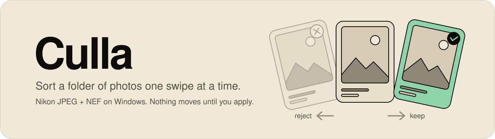
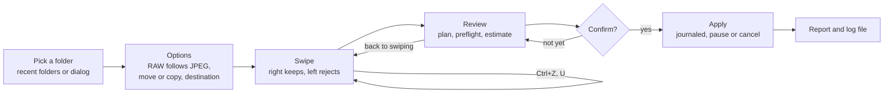
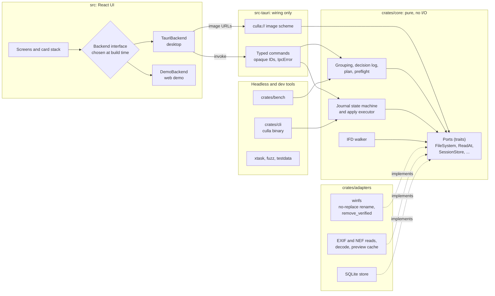
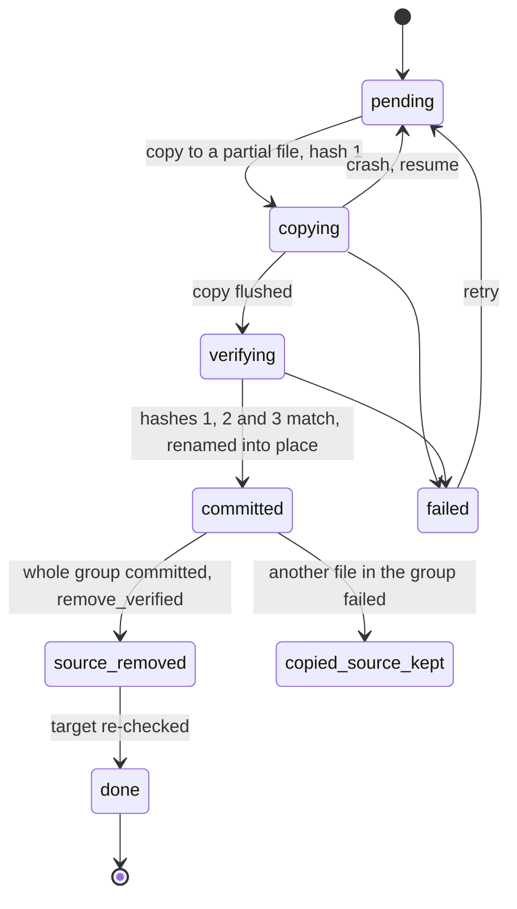

<p align="center">
  
</p>

<p align="center">
  <a href="https://github.com/margaux-faurie/culla/actions/workflows/ci.yml"></a>
  <a href="LICENSE"></a>
  <a href="https://scorecard.dev/viewer/?uri=github.com/margaux-faurie/culla"></a>
</p>

Culla is a Windows desktop app for culling a folder of Nikon photos. You look at each shot once and swipe it right to keep or left to reject. Every decision goes into a queue; nothing on disk changes until you review the full plan and confirm it. Then Culla moves or copies the keepers and sets the rejects aside in a `_rejected` folder, treating each JPEG, its RAW (NEF) and its sidecars as one unit. Every file operation is journaled, verified and resumable, so a crash or a pulled SD card never costs you a photo.

**Status:** pre-release. M0 (repo and tooling) is done; M1 (core engine, headless) is in progress. There is no download yet. See the [roadmap](docs/roadmap.md).

## How it works for you

1. **Pick a folder.** Choosing the folder is part of the experience: recent folders show their session status, and the folder dialog opens from the app itself. Then choose whether the RAW follows the JPEG, whether keepers are moved or copied, and where they go. If you have been here before, resume where you left off.
2. **Swipe.** A full-screen photo on a dark surround. Drag it, press <kbd>→</kbd> to keep or <kbd>←</kbd> to reject, or click the Keep and Reject buttons. Each decision is saved as you go.
3. **Change your mind.** <kbd>Ctrl</kbd>+<kbd>Z</kbd> and <kbd>Ctrl</kbd>+<kbd>Shift</kbd>+<kbd>Z</kbd> walk back and forth through your decisions, and <kbd>U</kbd> clears the photo in front of you. <kbd>Z</kbd> zooms to 100%, <kbd>I</kbd> shows EXIF, <kbd>N</kbd> jumps to the next undecided photo, <kbd>?</kbd> lists every shortcut.
4. **Review.** Counts, grids of kept and rejected photos, the full list of operations, preflight checks (free space, locked files, read-only card) and an estimated time.
5. **Apply.** Confirm, then watch it run per file. You can pause or cancel; it ends with a report and a log file.



## Promises

These are design rules. Lints enforce them now; tests enforce more of them as the engine lands (see [Safety and quality](#safety-and-quality)).

- **Nothing moves before you confirm.** Swiping only records decisions. Files are touched only after you press Apply and confirm the counts.
- **Nothing is ever overwritten.** If a target name is taken, the whole group gets a suffix (`_1`, `_2`). A rename that would replace a file fails instead.
- **Nothing is deleted.** Rejects are moved to `_rejected`, not removed. The only file Culla ever removes is the original of a move to another drive, and only after the copy and the original have both been read back from disk and their hashes match. (It also cleans up its own unfinished `*.culla-partial` files.)
- **Undecided photos are left alone.** Only photos you kept or rejected appear in the plan.
- **The window that shows your photos has no file access.** The user interface only knows opaque photo IDs. It cannot read, list or move files, and it never sees a path.

## How the repo works

Culla is built as a hexagon: a pure core in the middle, real-world adapters plugged into its ports, and thin shells that wire them together.



- **`crates/core`** holds every decision that matters: how files are grouped, how the decision log folds into state, which operations a plan contains and which journal transitions are legal. It does no I/O and forbids `unsafe`, so it is tested on any OS with in-memory fakes.
- **`crates/adapters`** implements the ports for real: Windows file operations (all in `winfs`, the only place allowed to remove a file), EXIF and NEF reads, JPEG decode and the SQLite session store.
- **`src-tauri`** is wiring only. The UI calls typed commands with opaque IDs and gets images through the `culla://` scheme, never through file paths. The desktop and web demo builds share one React app; `vite.config.ts` points the `#backend-impl` alias at the Tauri or the demo backend, so the demo bundle contains no Tauri code at all.
- **`crates/cli`** and **`crates/bench`** wire the same core and adapters without a UI, for crash tests and benchmarks.

Each file operation of an apply is a row in a journal, written to SQLite before or after the step it names. This is the path of a move to another drive:



Hash 1 is taken while copying, hash 2 by reading the copy back from disk and hash 3 by reading the original again, both bypassing the Windows cache, so a flaky card reader cannot fool the check. Because the journal is never ahead of the disk, Culla can roll an interrupted apply forward the next time it opens. There is no rollback: every photo always has at least one complete, verified copy, and the journal says where it is. The full state machine, including same-drive renames, is in the [file engine design](docs/design/file-engine.md).

| Folder | What lives there |
|---|---|
| [`crates/core`](crates/core) | `culla-core`: domain, ports and pure logic. No I/O, no Tauri. |
| [`crates/adapters`](crates/adapters) | `culla-adapters`: Windows file operations, EXIF and NEF parsing, decode, SQLite. |
| [`crates/cli`](crates/cli) | `culla-cli`, binary `culla`: headless scan, preview, plan, apply, resume. |
| [`crates/bench`](crates/bench) | `culla-bench`: benchmark harness. |
| [`src-tauri`](src-tauri) | `culla-app`: Tauri 2 shell, commands, `culla://` scheme, capabilities. |
| [`src`](src) | React and TypeScript UI, built for the desktop or the web demo. |
| [`xtask`](xtask) | Development tasks such as fixture generation. |
| [`fuzz`](fuzz) | cargo-fuzz targets for the file parsers. |
| [`testdata`](testdata) | Synthetic and golden test fixtures. |
| [`e2e`](e2e) | Playwright and accessibility tests on the web demo. |
| [`docs`](docs) | Specification, design docs, ADRs and research. |

## Safety and quality

In place now:

- **Lints that make unsafe file calls fail the build.** Clippy bans `std::fs::remove_*`, `std::fs::rename`, `std::fs::copy` and `std::fs::write` in the core, adapters, CLI and app crates; in product code, removal is allowed only in the audited `winfs` module (benchmarks and tests may clean up their own temp folders), and a CI script checks every lint exception.
- **CI on every pull request:** on Linux, rustfmt, clippy with warnings as errors, `cargo deny`, Rust tests, Biome, TypeScript, Vitest and Playwright with axe; on Windows, clippy, Rust tests and the app build. CodeQL runs on pull requests and weekly, OpenSSF Scorecard weekly and on main, and actions are pinned by SHA.
- **Independent review.** Every pull request is read by separate read-only reviewer agents (spec, file safety and security) before it is merged. Changes to protected paths, such as CI and lint configuration, are blocked for agents and need the author's go-ahead.
- **A bounded NEF parser.** The NEF preview reader checks every offset, caps every count, size and pixel total, detects loops and reports broken structures instead of crashing; its fuzz target exists, and nightly fuzz runs are still to come.
- **Decisions on record** as [architecture decision records](docs/adr/README.md).

Planned, as the engine is built:

- Property tests on plan building and the decision log, golden decision-log fixtures shared by Rust and TypeScript (the CI check is already in place), and Windows integration tests on a second mounted volume (M2).
- Crash tests that kill the process and detach the volume mid-apply, then check that resume ends in a correct state (M2).
- Nightly fuzzing of the NEF, EXIF and JPEG parsers; the NEF target exists, the others follow in M1.
- Signed updates through the Tauri updater (M6). Windows code signing comes later, so early builds will show a SmartScreen warning.

What could go wrong and how each risk is handled is in the [threat model](docs/threat-model.md); how it is tested is in the [test strategy](docs/testing.md).

## Docs

| Document | What it covers |
|---|---|
| [SPEC](docs/SPEC.md) | The author's decisions and the map of every other document |
| [PRD](docs/PRD.md) | Problem, users, scope, no-gos, success criteria |
| [Architecture](docs/architecture.md) | Crates, runtime views, IPC, the `culla://` scheme, glossary |
| [File engine](docs/design/file-engine.md) | Data model, grouping, plan, apply, recovery, invariants |
| [ADRs](docs/adr/README.md) | Decisions and their reasons |
| [Threat model](docs/threat-model.md) | Threats and mitigations |
| [Incident response](docs/incident-response.md) | What to do about a leaked key, a bad release or a vulnerability |
| [Testing](docs/testing.md) | Test strategy and definition of done |
| [Roadmap](docs/roadmap.md) | Milestones M0 to M6 |

## Building from source

Requirements: Windows 11 with WebView2 for the desktop app, the Rust toolchain pinned in [`rust-toolchain.toml`](rust-toolchain.toml) (rustup installs it), Node.js 22.12 or later and pnpm. The web demo and the Rust tests also run on Linux (untested on macOS); there, install `libwebkit2gtk-4.1-dev` or run the tests with `--exclude culla-app`.

```sh
pnpm install                             # install UI dependencies
pnpm dev:demo                            # run the web demo in a browser
cargo test --workspace                   # run the Rust tests
cargo run -p culla-cli -- scan <folder>  # list a folder's photos, read-only
cargo run -p culla-cli -- preview <folder>  # time each photo's preview, read-only
pnpm tauri dev                           # run the desktop app (Windows)
```

The full list of commands is in [CLAUDE.md](CLAUDE.md).

## Contributing

Issues and ideas are welcome: bug reports, Nikon files that do not behave, and suggestions. Outside pull requests are not merged for now, so that the project keeps a single author. See [CONTRIBUTING.md](CONTRIBUTING.md).

## Security

Please report vulnerabilities privately through GitHub [private vulnerability reporting](https://github.com/margaux-faurie/culla/security/advisories/new), not in a public issue. Scope and response times are in [SECURITY.md](SECURITY.md).

## Licence and name

Culla is licensed under the GNU General Public License v3.0 only (GPL-3.0-only); see [LICENSE](LICENSE). Copyright © 2026 Margaux Faurie.

The name "Culla" and its logo are not covered by the licence; see [TRADEMARKS.md](TRADEMARKS.md). Forks are welcome under the licence but must use a different name.

---

Built by [Margaux Faurie](https://github.com/margaux-faurie), with Claude Code as a pair; the design docs double as notes for a future guide on building with agents.
