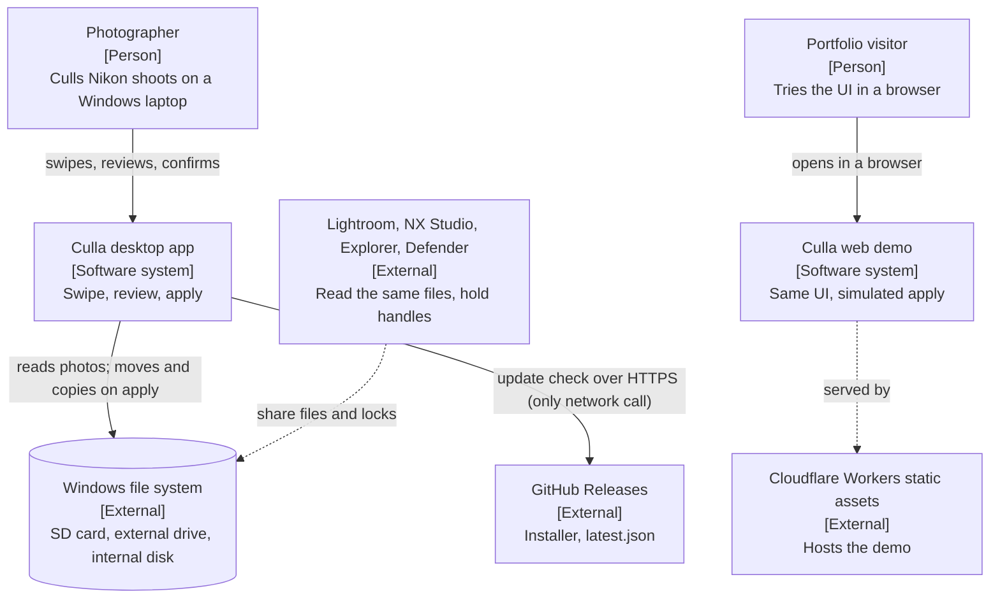
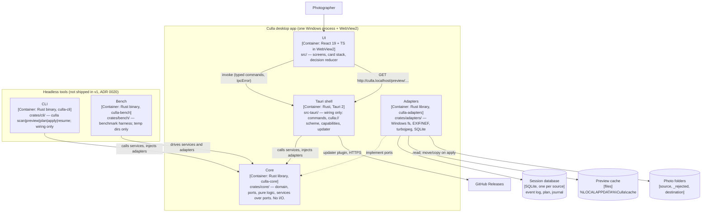
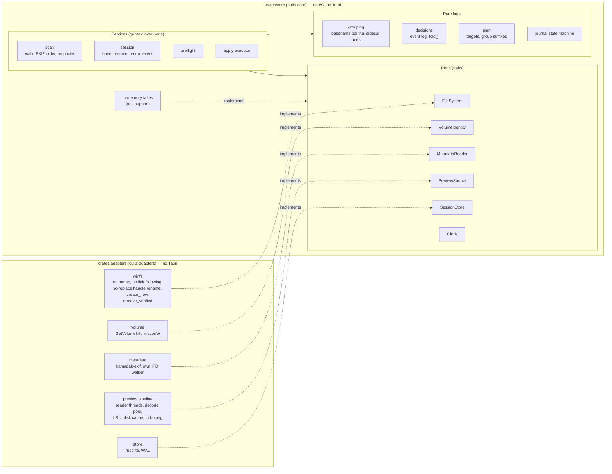
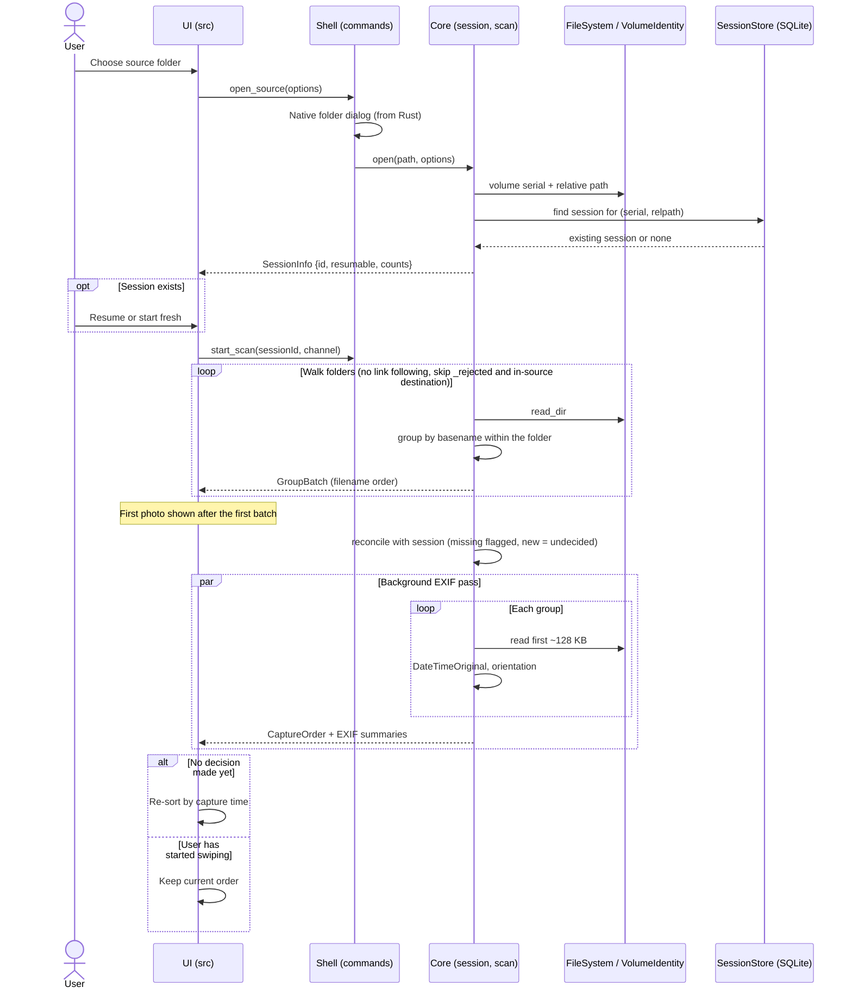
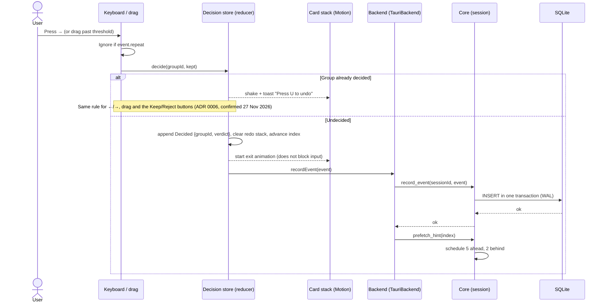
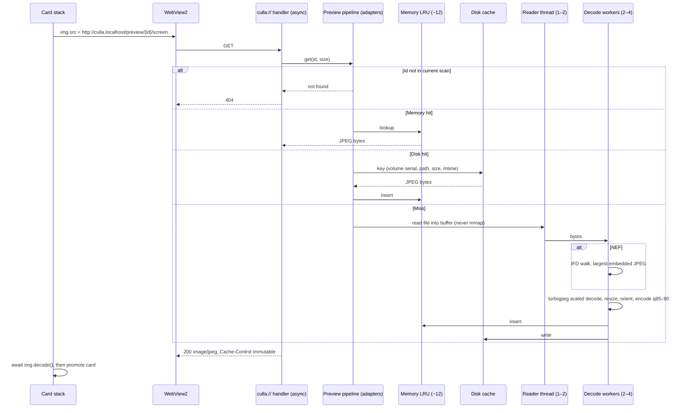
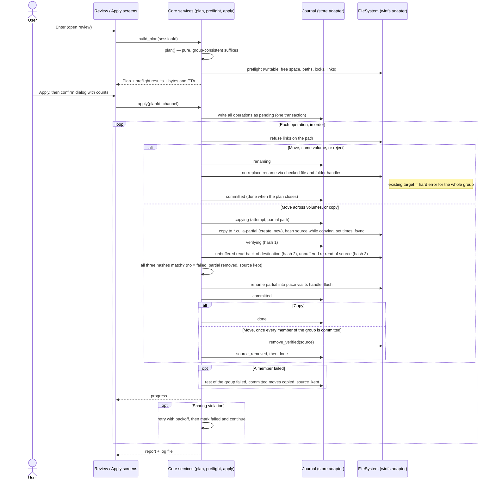
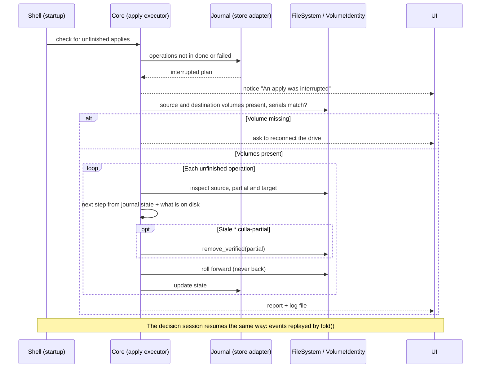
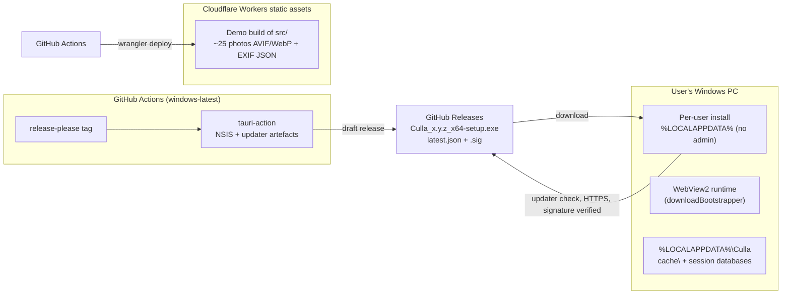

# Culla architecture

Status: draft, 24 Nov 2026. Lean [arc42](https://docs.arc42.org/home/) with C4 diagrams in Mermaid. Section 4 (solution strategy) is left out: the decisions are in the [ADR index](#9-architecture-decisions).

Source of truth for product decisions: [SPEC.md](SPEC.md) and the [ADRs](adr/README.md). Files in [research/](research/) are historical input; where they disagree, SPEC and ADRs win. This document explains how the system is built. It links to the canonical owner of each topic instead of repeating it:

| Topic | Owner |
|---|---|
| Problem, users, scope, no-gos | [PRD.md](PRD.md) |
| Budgets and quality requirements | [nfr.md](nfr.md) |
| Data model, state machines, apply algorithm, resume rules | [design/file-engine.md](design/file-engine.md). Until it lands, SPEC §5.2 owns the journal states. |
| Assets, trust boundaries, STRIDE | [threat-model.md](threat-model.md) |
| Test strategy, Definition of Done | [testing.md](testing.md) |
| Screen flows, motion spec | [ux.md](ux.md) (planned) |
| Releases, updater key custody | [releasing.md](releasing.md) (planned) |

## 1. Introduction and quality goals

Culla is a Windows desktop app for culling a folder of Nikon photos (JPEG + NEF) one photo at a time with a swipe interface. Decisions go into a queue. Nothing touches the disk until the user reviews the queue and confirms. A browser demo runs the same UI against a simulated backend.

Top quality goals, in priority order. Measurable targets are in [nfr.md](nfr.md).

| # | Goal | What it means here |
|---|---|---|
| 1 | Data safety | No photo is ever lost or overwritten. The only removals are the source of a verified cross-volume move and Culla's own `*.culla-partial` files. |
| 2 | Recoverability | A session survives a restart and a drive-letter change. An interrupted apply rolls forward from its journal. |
| 3 | Responsiveness | First photo on screen in about a second on an SD card. Swipe to next is served from memory. Input never waits for an animation. |
| 4 | Accessibility | Keyboard-complete, visible Keep and Reject buttons as the non-drag alternative to a swipe, colour never the only signal, `prefers-reduced-motion` respected (WCAG 2.2 AA). |
| 5 | Privacy and least privilege | No network except the updater check. The webview cannot touch the file system directly. |

## 2. Constraints

| Constraint | Consequence |
|---|---|
| Windows 11 only; Windows 10 dropped (decided by Margaux, 27 Nov 2026). Target machine ROG Zephyrus G14 2024 (2880×1800 OLED) | WebView2 (evergreen Chromium). Windows file semantics drive the file engine (`rename` overwrites, sharing violations, `\\?\` paths). |
| Source folders often on SD cards or external drives | Storage is the bottleneck. No memory-mapping of removable media. Identity cannot depend on the drive letter. |
| MIT licence for the app binary | Dependencies must be permissive. LGPL and GPL crates (rawler, exiv2, exiftool-rs, libraw) are out. See [ADR 0017](adr/0017-mit-licence-and-cargo-deny-licence-allowlist.md). |
| Solo maintainer, open source | Small doc set, small dependency set, automated checks over manual process. |
| Offline by default | Fonts and assets self-hosted, nothing from a CDN. |
| No Windows code signing for v1 | SmartScreen warning. The updater uses its own signing key. See [ADR 0016](adr/0016-per-user-nsis-and-signed-updater-code-signing-deferred.md). |
| Portfolio Design System | Shared tokens, typeface and voice with margauxfaurie.com. |
| HE/HE\* NEFs have no open-source decoder | Previews and 100% zoom of those files use the embedded JPEG. |

## 3. Context

C4 level 1.



| Neighbour | Interface | Notes |
|---|---|---|
| File system | Win32 via Rust std and the adapters | Removable media can disappear at any time. Other apps can lock files briefly. |
| Lightroom, NX Studio | Shared files only | Files moved outside Lightroom show as missing in its catalog (README warning). NX Studio edits live in `NKSC_PARAM/X.NEF.nksc` and follow the NEF. |
| GitHub Releases | HTTPS, signed `latest.json` | Updater only. No telemetry. |
| Cloudflare | Static hosting | Demo only. The "your folder" mode reads local files in the browser and uploads nothing. |

## 5. Building block view

### 5.1 Containers (C4 level 2)



The web demo is the same `src/` build in demo mode with `DemoBackend`. It has no shell and no core. See [ADR 0014](adr/0014-backend-interface-with-build-time-implementations.md).

### 5.2 Core components (C4 level 3, hexagonal)

Three Rust crates, hexagonal ([ADR 0002](adr/0002-pure-rust-core-crate-without-tauri.md)):

- `crates/core` (`culla-core`): domain types, port traits, pure logic (grouping, decision log and `fold()`, `plan()`, journal state machine) and services that drive the ports (scan, session, apply executor). It does no I/O itself, has no Tauri dependency and uses `#![forbid(unsafe_code)]`. Tested on any OS with in-memory fakes.
- `crates/adapters` (`culla-adapters`): the real port implementations. Windows file operations, EXIF and NEF parsing, turbojpeg decode, the preview pipeline, SQLite store, disk cache. No Tauri dependency. Integration-tested on `windows-latest` (junctions, read-only files, locks, interrupted apply).
- `src-tauri`: wiring only (see 5.3).



| Component | Crate | Responsibility | Notes |
|---|---|---|---|
| `grouping` | core | Build groups (`primary`, `raw`, `sidecars`) by case-insensitive basename within one folder. Attach each sidecar to the file it describes. Collect unknown extensions for the review screen. Also decides which folders the walk enters and which entries are excluded, with the reason (`ScanPolicy::dir_action`, file-engine §3.2). Input is plain data (`ScanEntry`); `culla_core::names` holds `fold()` and name validation (§3.4). | [ADR 0007](adr/0007-pair-files-by-basename-within-one-folder.md), [0023](adr/0023-bare-sidecars-follow-the-nef.md), [0027](adr/0027-scan-edge-cases-left-out-of-grouping.md) (proposed) |
| `decisions` | core | Events `Decided`, `Cleared`, `Undo`, `Redo` and `fold(log) → state` (including the undo and redo stacks). | [ADR 0005](adr/0005-decision-state-as-append-only-event-log.md). Golden fixtures shared with the TS reducer. |
| `plan`, `preflight` | core | Expand decisions into operations, apply group-consistent suffixes, run preflight checks through the ports, estimate bytes and time. | Details in [file-engine.md](design/file-engine.md) |
| journal state machine, apply executor | core | Legal transitions per operation; drive the operations through `FileSystem`, write each state through `SessionStore`, pause and cancel, roll forward on resume. | [ADR 0010](adr/0010-journaled-apply-with-roll-forward-only.md) |
| `scan`, `session` | core | Drive the walk (exclude `_rejected/` and an in-source destination), stream groups in filename order, request capture-time order, reconcile with the stored session, append events. | [ADR 0008](adr/0008-key-sessions-and-caches-by-volume-serial-and-relative-path.md) |
| `scan` | adapters | Read-only streamed walk with `std::fs::read_dir` only: entries described from the listing (`file_type`, non-following `metadata`, Windows attributes), never a link followed, one batch per folder with its `NKSC_PARAM`, folders depth-first in folded-name order. Asks `grouping` which folders to enter. | [file-engine §3.1](design/file-engine.md), threat model T2, T2b |
| `winfs` | adapters | Open with `FILE_FLAG_OPEN_REPARSE_POINT` and refuse reparse points at each step, read into buffers (never mmap). Rename through the checked handle with no-replace semantics ([ADR 0022](adr/0022-rename-through-the-checked-handle.md)): an existing target is a hard error, and a cross-volume rename fails with `ERROR_NOT_SAME_DEVICE`. Copy with `create_new`; both verify reads (destination and source) use `FILE_FLAG_NO_BUFFERING` ([ADR 0021](adr/0021-unbuffered-source-re-read-for-hash-3.md)); hash the source while copying, fsync, read the destination back unbuffered, hash the source again. Owns `remove_verified`, the single audited removal function. | [ADR 0004](adr/0004-never-delete-or-overwrite.md). `unsafe` for Win32 calls is confined here. |
| `metadata` | adapters | `kamadak-exif` tags (first ~128 KB). Own TIFF/IFD walker (pure, in `culla_core::ifd`, fed by positioned reads from `metadata::nef_preview`) finds the largest embedded JPEG in a NEF. Fuzz targets. | [ADR 0011](adr/0011-own-ifd-walker-for-nef-previews-and-kamadak-exif.md) |
| preview pipeline | adapters | 1–2 reader threads, 2–4 decode workers, prefetch 5 ahead and 2 behind, memory LRU of about 12 screen previews, disk cache, orientation. | [ADR 0012](adr/0012-turbojpeg-scaled-decode-preview-pipeline.md) |
| `store` | adapters | One SQLite database per source: sessions, events, plans, journal. | [ADR 0009](adr/0009-sqlite-per-source-for-sessions-and-journal.md) |

The port list is a starting point and may change during M0.

### 5.3 Shell components (`src-tauri`, wiring only)

| Component | Responsibility |
|---|---|
| Commands | Thin `#[tauri::command]` wrappers: map arguments to core service calls, map errors to `IpcError`. They take opaque IDs (session, group, plan), never file paths from the webview. |
| `culla://` scheme handler | Async custom URI scheme. Serves previews by ID from the current scan only. See [ADR 0013](adr/0013-deliver-images-through-a-custom-uri-scheme.md). |
| App state | Registry of open sessions, the ID → path map of the current scan, the apply task handle (pause, cancel). |
| Composition root | Builds the `culla-adapters` implementations and injects them into the core services. |
| Capabilities and CSP | One capability for the `main` window, minimal `core:*` permissions, no fs or shell plugin, `AppManifest::commands` in `build.rs`, so each command needs an `allow-<command>` permission in the `main` capability. |
| Updater | `tauri-plugin-updater`, checks `latest.json` on GitHub Releases. |

The folder picker opens from Rust (dialog called by a command), so the webview never sends a path. This keeps the "IDs, not paths" rule without a dialog permission in the webview. To confirm during M0.

### 5.4 UI components (`src`)

| Component | Responsibility |
|---|---|
| Screens | Start, Swipe, Review, Apply ([ux.md](ux.md) (planned)). |
| Card stack | Motion `drag="x"`, at most 3 cards mounted, visible Keep and Reject buttons as the single-pointer alternative to dragging (WCAG 2.5.7), commit on offset or velocity threshold, `img.decode()` before a card enters. [ADR 0015](adr/0015-motion-for-swipe-physics.md) |
| Keyboard controller | Key map from SPEC §4.1. Ignores `event.repeat` on decision keys. Drives the same exit animation as a drag. |
| Decision store | Reducer over the event log. Commits first, then calls `Backend.recordEvent`. |
| `Backend` interface | `TauriBackend` (generated bindings + `culla://` URLs) or `DemoBackend` (bundled samples, simulated apply), chosen at build time. |
| Bindings | `src/bindings.ts`, generated from Rust. Never edited by hand. [ADR 0019](adr/0019-generate-typescript-bindings-with-tauri-specta.md) |
| Styles | `src/styles/tokens.css` from the design system. See [8.6](#86-design-tokens). |

## 6. Runtime view

Names of commands are illustrative. The exact journal states and transitions are owned by SPEC §5.2 until [file-engine.md](design/file-engine.md) lands, then by file-engine.md.

### 6.1 Open a folder and stream the scan



Streaming uses a Tauri IPC channel. Batches are small enough that the first one arrives within the first-photo budget.

### 6.2 Swipe decision and autosave



If `record_event` fails, the UI keeps its state and surfaces the `IpcError`. Retry and user messaging are specified in [ux.md](ux.md) (planned) (to decide).

### 6.3 Image preview through `culla://`



The 100% zoom view requests the full-size image on demand through the same scheme. Route and tiling are to decide in M1.

### 6.4 Apply with journal



Pause holds the loop between files. Cancel stops after the current file. States, edges and the recovery table are owned by [design/file-engine.md](design/file-engine.md) §9–§10. Undecided groups are never part of the plan.

### 6.5 Resume after a crash or a pulled card



The exact rule for each journal state is in [file-engine.md](design/file-engine.md). To decide: whether resume starts on its own or waits for a confirm (SPEC §5.2 says it rolls forward "the next time the app opens").

## 7. Deployment view



| Node | Details |
|---|---|
| Installer | NSIS only, per-user, WebView2 through the default bootstrapper. Unsigned for v1 (SmartScreen note in README). |
| Updater | `tauri-plugin-updater`, its own signing key (private key in CI secret `TAURI_SIGNING_PRIVATE_KEY`, public key in config). Key loss strands installed users: custody in [releasing.md](releasing.md) (planned). |
| Local data | Preview cache in `%LOCALAPPDATA%\Culla\cache`. Session databases in `%LOCALAPPDATA%\Culla\sessions`, apply logs in `%LOCALAPPDATA%\Culla\logs`. Nothing is written into the source folder except `_rejected/` on apply. |
| Web demo | Static assets on Cloudflare Workers, subdomain of margauxfaurie.com (to confirm). No server code. |
| Later | winget manifest after v1; SignPath signing once v1 is released ([ADR 0016](adr/0016-per-user-nsis-and-signed-updater-code-signing-deferred.md)). |

## 8. Crosscutting concepts

### 8.1 Error model

- Core: one `thiserror` enum per module. No `anyhow` in library code.
- Commands return `Result<T, IpcError>`. Tauri requires the error to be `Serialize`. `IpcError` is tagged so TS gets a discriminated union:

```rust
#[derive(Debug, thiserror::Error, serde::Serialize, specta::Type)]
#[serde(tag = "kind", rename_all = "camelCase")]
pub enum IpcError {
    #[error("not found")]            NotFound { id: String },
    #[error("volume not present")]   VolumeMissing { label: Option<String> },
    #[error("preflight failed")]     Preflight { checks: Vec<PreflightIssue> },
    #[error("file locked")]          Locked { group_id: String },
    #[error("i/o error")]            Io { message: String },
    #[error("cancelled")]            Cancelled,
}
```

  The variants above are a starting set, not a contract. Messages sent to the UI never contain raw OS paths outside the user's own folders.
- UI: `switch (err.kind)` with an exhaustive check. Copy follows the design system voice.
- Per-file apply errors do not abort the apply. They mark the operation `failed` and land in the report.

### 8.2 Type-safe IPC bindings

Rust types and commands are the source. `tauri-specta` generates `src/bindings.ts`, pinned to an exact RC version. CI regenerates and fails on `git diff --exit-code`. Fallback if tauri-specta stalls: `ts-rs` for types plus thin hand-written `invoke` wrappers. Decision event types are defined in Rust and exported, so the two reducers share one shape. See [ADR 0019](adr/0019-generate-typescript-bindings-with-tauri-specta.md).

### 8.3 Concurrency

| Work | Where |
|---|---|
| File reads for previews and EXIF | 1–2 sequential reader threads (SD cards and HDDs suffer under parallel reads) |
| Decode, resize, encode | 2–4 workers (rayon) |
| SQLite writes | One writer per session database |
| Apply | One task, sequential operations, pausable between files |
| UI | Never waits on I/O. Decisions commit in the reducer first. |

### 8.4 Logging

- Two logs, both local. No telemetry.
  - Apply log: a plain-text record of every operation and its outcome, written at the end of an apply (and of a resume) to `%LOCALAPPDATA%\Culla\logs`, openable from the report.
  - Diagnostic log: rotating file in `%LOCALAPPDATA%\Culla\logs`, for bug reports. Library and level to decide (`tracing` is the usual choice).
- The decision event log in SQLite is data, not a log in this sense.

### 8.5 Security summary

Full analysis in [threat-model.md](threat-model.md). The main controls:

- The webview has no fs or shell plugin permissions. Commands take opaque IDs. `AppManifest::commands` limits what is callable: each command needs an `allow-<command>` permission in the `main` capability.
- Strict CSP, nothing remote. `img-src` allows only `'self'` and the `culla` scheme origin (`http://culla.localhost` on Windows).
- The scheme handler serves only IDs from the current scan.
- Every destination comes from `plan()` and is checked to sit under its root. No link following at scan time or at apply time; links on the path are refused at apply time too.
- No overwrite: renames go through the checked handle with no-replace semantics ([ADR 0022](adr/0022-rename-through-the-checked-handle.md)), so the OS refuses an existing target; copies use `create_new`. There is no check-then-rename step.
- `remove_verified` in `culla-adapters` is the single audited removal function. It removes only the source of a verified cross-volume move and Culla's own `*.culla-partial` files. `std::fs::remove_*` is banned outside `remove_verified`; `std::fs::rename` is banned everywhere (the adapters rename through the checked handle, ADR 0022). Both through clippy `disallowed-methods`.
- Parsers (EXIF, IFD walker, embedded JPEG) are fuzzed with `cargo-fuzz`, with decode size limits.
- Supply chain: cargo-deny, pnpm hardening, CodeQL, pinned or locked actions, Scorecard.
- Updater artefacts are signed and served over HTTPS.

To decide (ADR candidate): Tauri isolation pattern. Culla loads no remote content and the isolation iframe cannot load ES modules on Windows, so the research leans towards not using it.

### 8.6 Design tokens

- Tokens are copied from the Portfolio Design System `tokens.json` into `src/styles/tokens.css` as CSS variables, with a header comment naming the source version.
- Start, review and apply screens use the cream theme. Swipe and zoom screens use the Night theme (`paper` #0c0b0a, `ink` #f1e9d8), set by a theme attribute on the screen root.
- `orange` is the single accent (Apply, progress line). `keep` (sage, about #8fd3a8) is used only for keep feedback and the Kept badge. Reject has no colour.
- Bricolage Grotesque is self-hosted. No shadows, no gradients, dots for loading.
- Animations read `prefers-reduced-motion`.
- Both additions (`keep`, Night for photo surfaces) go back into the design system.

### 8.7 Paths and identity

- Inside the core, files are identified by (volume serial, relative path). Absolute paths are rebuilt from the current mount at use time.
- Long paths: Rust std adds `\\?\` internally, but that does not cover raw Win32 calls. The adapters add the `\\?\` prefix themselves for `CreateFileW` and the rename calls. Deep mirrored destinations are covered by tests.
- Files on removable media are read into buffers, never memory-mapped, and handles are released before any move.
- The data root (`%LOCALAPPDATA%\Culla`, holding `sessions`, `cache` and `logs`) is not looked up inside the adapters. The composition root resolves it once (`SHGetKnownFolderPath(FOLDERID_LocalAppData)`) and injects it through config; `culla-cli`, `culla-bench` and tests pass their own root. This keeps every write location testable.

## 9. Architecture decisions

ADR 0000 records how decisions are written. Index with status: [adr/README.md](adr/README.md).

| ADR | Decision |
|---|---|
| [0001](adr/0001-use-tauri-2-rust-and-react.md) | Tauri 2 + Rust + React instead of Electron or a native UI |
| [0002](adr/0002-pure-rust-core-crate-without-tauri.md) | Pure core crate, separate adapters crate, no Tauri in either |
| [0003](adr/0003-stage-decisions-in-a-queue-until-explicit-apply.md) | Stage decisions in a queue; nothing touches the disk until an explicit apply |
| [0004](adr/0004-never-delete-or-overwrite.md) | Never delete or overwrite |
| [0005](adr/0005-decision-state-as-append-only-event-log.md) | Decision state as an append-only event log |
| [0006](adr/0006-arrow-keys-do-not-change-an-existing-decision.md) | Arrow keys don't change an existing decision |
| [0007](adr/0007-pair-files-by-basename-within-one-folder.md) | Pair files by case-insensitive basename within the same folder only |
| [0008](adr/0008-key-sessions-and-caches-by-volume-serial-and-relative-path.md) | Key sessions and caches by volume serial + relative path |
| [0009](adr/0009-sqlite-per-source-for-sessions-and-journal.md) | SQLite (rusqlite) per source for sessions and the journal |
| [0010](adr/0010-journaled-apply-with-roll-forward-only.md) | Journaled apply: copy, hash, fsync, verify, rename; roll forward only |
| [0011](adr/0011-own-ifd-walker-for-nef-previews-and-kamadak-exif.md) | Own TIFF/IFD walker for NEF previews; kamadak-exif for EXIF |
| [0012](adr/0012-turbojpeg-scaled-decode-preview-pipeline.md) | turbojpeg scaled decode + fast_image_resize; no mmap on removable media |
| [0013](adr/0013-deliver-images-through-a-custom-uri-scheme.md) | Deliver images through a custom URI scheme |
| [0014](adr/0014-backend-interface-with-build-time-implementations.md) | `Backend` interface with build-time Tauri and Demo implementations |
| [0015](adr/0015-motion-for-swipe-physics.md) | Motion for swipe physics; commit first, at most 3 cards mounted |
| [0016](adr/0016-per-user-nsis-and-signed-updater-code-signing-deferred.md) | Per-user NSIS + signed updater; code signing deferred |
| [0017](adr/0017-mit-licence-and-cargo-deny-licence-allowlist.md) | MIT licence + cargo-deny licence allowlist |
| [0018](adr/0018-conventional-commits-and-release-please.md) | Conventional Commits + release-please |
| [0019](adr/0019-generate-typescript-bindings-with-tauri-specta.md) | TS bindings with tauri-specta pinned RC, ts-rs as fallback |
| [0020](adr/0020-headless-cli-and-bench-crates.md) | Headless CLI and bench crates |
| [0021](adr/0021-unbuffered-source-re-read-for-hash-3.md) | Unbuffered source re-read for hash 3 |
| [0022](adr/0022-rename-through-the-checked-handle.md) | Rename through the checked handle, with no-replace semantics |
| [0023](adr/0023-bare-sidecars-follow-the-nef.md) | Bare `X.xmp` and `X.pp3` follow the NEF |
| [0024](adr/0024-reconcile-event-for-a-file-joining-a-decided-group.md) | A new file joining a decided group makes it undecided (reconcile event) |
| [0025](adr/0025-lone-nef-preview-is-the-largest-valid-embedded-jpeg.md) | A lone NEF's preview is its largest valid embedded JPEG, by pixel count |
| [0027](adr/0027-scan-edge-cases-left-out-of-grouping.md) | Scan edge cases left out of grouping (proposed) |

Candidates not yet written: Tauri isolation pattern (8.5), Biome instead of ESLint + Prettier.

## 10. Quality scenarios

Brief. Targets and measurement live in [nfr.md](nfr.md) and [benchmarks.md](benchmarks.md).

| Goal | Scenario | Expected response |
|---|---|---|
| Data safety | A target name already exists in the destination | The whole group gets `_1`; nothing is overwritten; the review shows it |
| Data safety | The card is pulled during a cross-volume move | Source is still intact; an unverified partial file is never renamed into place; resume removes it and rolls forward once the card is back |
| Recoverability | The app is killed after 300 decisions | Reopening the folder restores all 300 decisions and the position |
| Recoverability | The SD card comes back as `F:` instead of `E:` | The same session is offered for resume |
| Responsiveness | Open a folder of 3,000 photos on a UHS-I card | First photo in about a second, filename order; capture order arrives later without re-sorting after the first decision |
| Responsiveness | Hold → for two seconds | One decision only; auto-repeat ignored |
| Accessibility | A user who cannot drag | Every action has a key, and the swipe screen has visible Keep and Reject buttons (WCAG 2.5.7) |
| Privacy | The app runs with the network monitored | Only the updater request to GitHub is seen |

## 11. Risks and technical debt

| Risk or debt | Impact | Mitigation |
|---|---|---|
| A raw `std::fs::rename` slips in (it replaces the target on Windows) | Overwrite, the worst failure | `std::fs::rename` banned by `disallowed-methods`; collision tests on `windows-latest`. |
| Verification re-reads each cross-volume file twice (destination unbuffered, source again; see ADR 0021) | Long applies get longer | The review estimate includes the extra reads; measure in [benchmarks.md](benchmarks.md). |
| Widening `remove_verified` beyond its two cases | Data loss | One function, two cases, property and integration tests, reviewer agent checks the invariant. |
| Performance numbers are estimates | Budgets may not hold on real SD cards | Benchmark on the G14 with a real card in M1 ([benchmarks.md](benchmarks.md)). Test whether the NEF's JpgFromRaw is a faster preview source. |
| tauri-specta v2 is still an RC | Breaking changes, abandonment | Exact pin, CI diff check, `ts-rs` fallback ([ADR 0019](adr/0019-generate-typescript-bindings-with-tauri-specta.md)) |
| `turbojpeg` builds libjpeg-turbo (CMake, NASM) | Slower, more fragile CI | Cache builds; `zune-jpeg` is the pure-Rust fallback without scaled decode |
| HE/HE\* NEFs | 100% zoom shows the embedded JPEG only | Documented limit |
| Colour on the wide-gamut OLED in WebView2 | Previews may look wrong (AdobeRGB, P3) | Test with tagged JPEGs; decide whether the pipeline converts to sRGB |
| Volume serial is 32-bit and changes on reformat | Wrong session matched, or session lost after reformat | Reconcile on open flags mismatches; to review in [threat-model.md](threat-model.md) |
| Renamed files not detected | Shown as one missing + one new | Accepted for v1 |
| Dual-slot setups (RAW and JPEG on two cards) | "RAW follows JPEG" does nothing | v2 candidate; warn if detected (to decide) |
| Unsigned installer | SmartScreen friction, fewer installs | README note; SignPath after v1 |
| Updater key loss | Installed users can no longer update | Backup and custody in [releasing.md](releasing.md) (planned) |
| Lightroom catalogs | Moved files show as missing | README warning |
| Windows-only behaviour (junctions, locks, read-only) | Not covered by Linux CI | Adapter integration tests on `windows-latest` |
| Two reducers (Rust and TS) | Drift | Shared golden fixtures run by `cargo test` and Vitest |

## 12. Glossary

| Term | Meaning |
|---|---|
| Source | The folder the user opens. Scanned recursively. |
| Group | The unit the user decides on: a primary, an optional raw and its sidecars, paired by basename in one folder. |
| Primary | The file shown for a group: the JPEG if there is one, otherwise the NEF (via its embedded JPEG). |
| Raw | The NEF of a group, if any. Moves with the group only when "RAW follows JPEG" is on. |
| Lone NEF | A group with a NEF and no JPEG. |
| Sidecar | A file that follows the file it describes. Bare `X.xmp` and `X.pp3` follow the NEF if the group has one, otherwise the primary (ADR 0023). `X.JPG.xmp` and `NKSC_PARAM/X.JPG.nksc` follow the JPEG. `X.NEF.xmp` and `NKSC_PARAM/X.NEF.nksc` follow the NEF, so they and the bare sidecars stay put when "RAW follows JPEG" is off. A collision suffix is applied inside sidecar names too. |
| Session | The stored state of one source: options, groups, decision events, plans and journal. Keyed by volume identity. |
| Volume identity | Volume serial number + path relative to the volume root. Independent of the drive letter. |
| Decision event | One appended record with a `seq`: `Decided {groupId, verdict}`, `Cleared {groupId}` (U), `Undo {targetSeq}` or `Redo {targetSeq}`. The current state is the fold of all events. |
| Undo / redo | Ctrl+Z undoes the most recent `Decided` or `Cleared` not yet undone and jumps to that photo. Ctrl+Shift+Z redoes the most recently undone. A new `Decided` or `Cleared` empties the redo stack. |
| Plan | The list of operations derived from the decisions and session options. Pure output of `plan()`. |
| Operation | One file action in a plan: same-volume move, cross-volume move or copy, with a source and a target. |
| Preflight | Checks run before any operation: writable source, free space, target not inside `_rejected`, path length, locks, links. |
| Journal | Per-operation state rows in the session database, written ahead of each step, used to resume. |
| Apply | Execution of a confirmed plan. |
| Resume (apply) | Rolling an interrupted apply forward from the journal. No rollback in v1. |
| Partial file | `*.culla-partial`, the temporary target of a copy until it is verified. |
| `remove_verified` | The single audited removal function, in `culla-adapters`. Removes only the source of a verified cross-volume move, or Culla's own partial file. |
| Verified | A copy whose destination was fsynced and read back unbuffered, and whose source was hashed a second time, with all three hashes equal (see ADR 0021). |
| `_rejected/` | Folder at the source root that receives rejected groups, mirroring subfolders. Excluded from scans. |
| Destination | Folder chosen per session for kept groups. Excluded from scans when it sits inside the source. |
| Preview | Screen-sized JPEG made by the preview pipeline and served by `culla://`. |
| Backend | The TS interface the UI talks to. `TauriBackend` in the app, `DemoBackend` in the web demo. |
