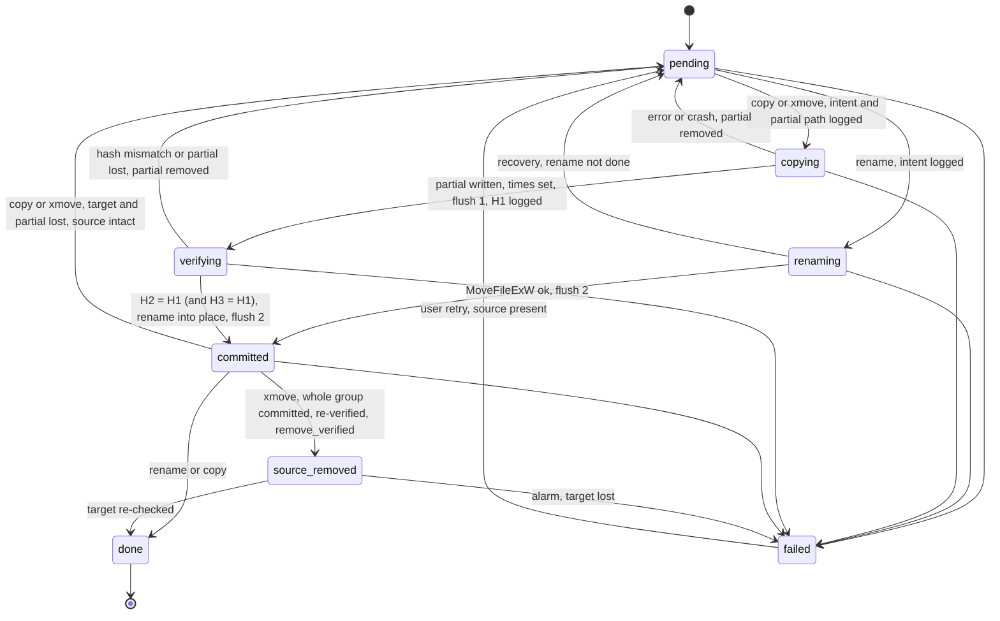

# File engine design

Status: draft, 24 Nov 2026. Owner of: data model, scan and grouping rules, decision log semantics, reconciliation, plan building, preflight, operation state machine, apply and resume. Decisions it implements: [ADR 0003](../adr/0003-stage-decisions-in-a-queue-until-explicit-apply.md), [0004](../adr/0004-never-delete-or-overwrite.md), [0005](../adr/0005-decision-state-as-append-only-event-log.md), [0006](../adr/0006-arrow-keys-do-not-change-an-existing-decision.md), [0007](../adr/0007-pair-files-by-basename-within-one-folder.md), [0008](../adr/0008-key-sessions-and-caches-by-volume-serial-and-relative-path.md), [0009](../adr/0009-sqlite-per-source-for-sessions-and-journal.md), [0010](../adr/0010-journaled-apply-with-roll-forward-only.md). Quality goals (zero data loss) are in [nfr.md](../nfr.md); containers and runtime views in [architecture.md](../architecture.md); attacks in [threat-model.md](../threat-model.md).

The file engine is the part that must never lose a photo. Everything below serves one rule: at every instant, every photo exists in at least one complete, durable copy, and no existing file is ever replaced.

## 1. Where the code lives

| Crate | Owns | I/O |
|---|---|---|
| `crates/core` (`culla-core`) | Domain types, port traits (`FileSystem`, `SessionStore`, `Clock`), grouping, `fold()`, reconciliation, `plan()`, preflight rules, journal state machine, apply executor and recovery, driven through ports | None. `#![forbid(unsafe_code)]`. Tested with in-memory fakes on any OS |
| `crates/adapters` (`culla-adapters`) | `winfs` (walk, no-replace rename, verified copy, hashing, `remove_verified`), SQLite store, volume identity, EXIF/NEF parsing | All real I/O. Win32 `unsafe` confined to `winfs` |
| `src-tauri` | Wiring only: builds adapters, injects them into core services, exposes commands | None of its own |

The core decides *what* to do and in which state; the adapter performs one primitive per call and reports the outcome. The fake `FileSystem` in core tests can inject a crash or an error after any primitive.

## 2. Data model

### 2.1 Entities

Types are Rust. `RelPath` is a validated relative path (see §3.4), stored as text with `\` separators. Times are Unix milliseconds (UTC) unless noted.

| Entity | Fields | Notes |
|---|---|---|
| `VolumeId` | `serial: u32`, `fs_name: String` (`FAT32`, `exFAT`, `NTFS`…), `label: Option<String>`, `last_mount: Option<String>` | Identity is `serial` only ([ADR 0008](../adr/0008-key-sessions-and-caches-by-volume-serial-and-relative-path.md)). `last_mount` (e.g. `F:\`) is display only, never used to find a file. |
| `Source` | `volume: VolumeId`, `rel: RelPath` (from the volume root), `rel_key: String` (case-folded) | One per session database. |
| `Session` | `id: i64`, `status: Active \| Archived`, `created_at`, `include_subfolders: bool`, `raw_follows: bool`, `keep_mode: Move \| Copy`, `dest: Option<(VolumeId, RelPath)>`, `order_frozen: bool` | At most one active session per source. "Start fresh" archives the active one. |
| `Group` | `id: i64`, `session_id`, `folder: RelPath` (from the source root), `folder_key`, `stem: String`, `stem_key`, `status: Ok \| Ambiguous`, `capture_time: Option<i64>`, `display_ord: Option<i64>` | Unit of decision. Identity is (`folder_key`, `stem_key`) within a session. |
| `FileMember` | `id: i64`, `group_id`, `kind: Jpeg \| Nef \| Sidecar`, `role: Primary \| Raw \| Sidecar`, `sidecar: Option<SidecarKind>`, `describes: Option<member_id>`, `rel: RelPath`, `name: String`, `size: u64`, `mtime_ns: i64`, `present: bool`, `changed: bool`, `last_seen_scan` | `describes` is set for sidecars bound to one file (`X.NEF.xmp`); empty for group sidecars (`X.xmp`). See §3.3. |
| `DecisionEvent` | `seq: i64`, `session_id`, `ts`, `body: Decided {group_id, verdict: Keep \| Reject} \| Cleared {group_id} \| Undo {target_seq} \| Redo {target_seq}` | Shape from [ADR 0005](../adr/0005-decision-state-as-append-only-event-log.md). Append-only. |
| `Plan` | `id`, `session_id`, `status` (§9.1), `created_at`, `confirmed_at`, `decisions_upto_seq`, `keep_mode`, `raw_follows`, `source: Source`, `dest: Option<(VolumeId, RelPath)>`, counts and bytes per kind | Settings are snapshotted, so a plan never depends on later edits. |
| `Operation` | `id`, `plan_id`, `group_id`, `member_id`, `ord`, `action: Keep \| Reject`, `kind: Rename \| Copy \| XMove`, `src: RelPath`, `dst_root: Dest \| Rejected`, `dst: RelPath`, `dst_key`, `partial: Option<RelPath>`, `expected_size`, `src_mtime_ns`, `hash: Option<[u8; 32]>`, `state: OpState`, `attempts: u32`, `last_error: Option<IoErrorKind>` | One file. `hash` is H1, the source hash taken during the copy. |
| `JournalEntry` | `id`, `op_id`, `ts`, `from: OpState`, `to: OpState`, `detail: Json` (hashes, error code, attempt, leftover partial) | Append-only. Inserting an entry is what changes `Operation.state` (trigger, §2.3). |
| `Scan`, `ScanIssue` | `Scan {id, session_id, started_at, finished_at, counts}`; `ScanIssue {scan_id, rel, kind, detail}` | Issue kinds: `unknown_ext`, `orphan_sidecar`, `ambiguous`, `reparse_point`, `hidden_or_system`, `invalid_name`, `unreadable`, `foreign_partial`, `same_basename_unknown`. Listed in the review screen. |

`OpState = Pending | Renaming | Copying | Verifying | Committed | SourceRemoved | Done | Failed`.

Group decision state (`undecided | kept | rejected`) and the undo/redo stacks are never stored; they are `fold(events)` (§5). A group's lock (§5.4) is derived from the plans and operations that reference it.

### 2.2 Storage

- One database per source: `%LOCALAPPDATA%\Culla\sessions\<key>.sqlite`, where `<key>` is the hex of `blake3(serial ‖ rel_key)`, first 16 bytes. Always on the internal disk, never on the card, so the journal survives a pulled card and a write-protected card still gets a session.
- Pragmas on open: `journal_mode=WAL`, `synchronous=FULL`, `foreign_keys=ON`, `application_id=0x43554C4C`, `user_version` for migrations. `mmap_size` stays 0.
- Every decision event and every journal transition is its own transaction, committed before the next file system step starts (write-ahead).
- The plain-text apply log goes to `%LOCALAPPDATA%\Culla\logs\<date>-plan<id>.log`. To decide: whether a copy is also written into the destination ([critique.md §2](../research/critique.md) suggested it; it is an extra write on the user's volume).

### 2.3 Schema (session database, v1)

```sql
PRAGMA journal_mode = WAL;
PRAGMA synchronous = FULL;
PRAGMA foreign_keys = ON;
PRAGMA application_id = 0x43554C4C;   -- 'CULL'
PRAGMA user_version = 1;

CREATE TABLE volume (
  id          INTEGER PRIMARY KEY,
  serial      INTEGER NOT NULL CHECK (serial BETWEEN 0 AND 4294967295),
  fs_name     TEXT NOT NULL,
  label       TEXT,
  last_mount  TEXT,                         -- display only
  UNIQUE (serial, fs_name)
) STRICT;

CREATE TABLE source (
  id         INTEGER PRIMARY KEY CHECK (id = 1),
  volume_id  INTEGER NOT NULL REFERENCES volume(id),
  rel_path   TEXT NOT NULL,                 -- '' = volume root
  rel_key    TEXT NOT NULL,                 -- case-folded
  created_at INTEGER NOT NULL
) STRICT;

CREATE TABLE session (
  id                 INTEGER PRIMARY KEY,
  status             TEXT NOT NULL CHECK (status IN ('active','archived')),
  created_at         INTEGER NOT NULL,
  include_subfolders INTEGER NOT NULL CHECK (include_subfolders IN (0,1)),
  raw_follows        INTEGER NOT NULL CHECK (raw_follows IN (0,1)),
  keep_mode          TEXT NOT NULL CHECK (keep_mode IN ('move','copy')),
  dest_volume_id     INTEGER REFERENCES volume(id),
  dest_rel_path      TEXT,
  order_frozen       INTEGER NOT NULL DEFAULT 0 CHECK (order_frozen IN (0,1)),
  CHECK ((dest_volume_id IS NULL) = (dest_rel_path IS NULL))
) STRICT;
CREATE UNIQUE INDEX session_one_active ON session(status) WHERE status = 'active';

CREATE TABLE scan (
  id          INTEGER PRIMARY KEY,
  session_id  INTEGER NOT NULL REFERENCES session(id),
  started_at  INTEGER NOT NULL,
  finished_at INTEGER,
  n_groups    INTEGER, n_new INTEGER, n_missing INTEGER, n_changed INTEGER
) STRICT;

CREATE TABLE scan_issue (
  scan_id  INTEGER NOT NULL REFERENCES scan(id),
  rel_path TEXT NOT NULL,
  kind     TEXT NOT NULL CHECK (kind IN ('unknown_ext','orphan_sidecar','ambiguous',
             'reparse_point','hidden_or_system','invalid_name','unreadable',
             'foreign_partial','same_basename_unknown')),
  detail   TEXT
) STRICT;

CREATE TABLE photo_group (
  id              INTEGER PRIMARY KEY,
  session_id      INTEGER NOT NULL REFERENCES session(id),
  folder_rel      TEXT NOT NULL,            -- '' = source root
  folder_key      TEXT NOT NULL,
  stem            TEXT NOT NULL,
  stem_key        TEXT NOT NULL,
  status          TEXT NOT NULL CHECK (status IN ('ok','ambiguous')),
  capture_time    INTEGER,                  -- DateTimeOriginal, camera-local, ms
  display_ord     INTEGER,
  first_seen_scan INTEGER NOT NULL REFERENCES scan(id),
  UNIQUE (session_id, folder_key, stem_key)
) STRICT;

CREATE TABLE member (
  id             INTEGER PRIMARY KEY,
  group_id       INTEGER NOT NULL REFERENCES photo_group(id),
  kind           TEXT NOT NULL CHECK (kind IN ('jpeg','nef','sidecar')),
  role           TEXT NOT NULL CHECK (role IN ('primary','raw','sidecar')),
  sidecar_kind   TEXT CHECK (sidecar_kind IN ('xmp','pp3','file_xmp','file_pp3','nksc')),
  describes_id   INTEGER REFERENCES member(id),   -- NULL for group sidecars
  rel_path       TEXT NOT NULL,             -- from source root
  rel_key        TEXT NOT NULL,
  file_name      TEXT NOT NULL,
  size           INTEGER NOT NULL CHECK (size >= 0),
  mtime_ns       INTEGER NOT NULL,
  present        INTEGER NOT NULL CHECK (present IN (0,1)),
  changed        INTEGER NOT NULL DEFAULT 0 CHECK (changed IN (0,1)),
  last_seen_scan INTEGER NOT NULL REFERENCES scan(id),
  CHECK ((kind = 'sidecar') = (role = 'sidecar')),
  CHECK ((role = 'sidecar') = (sidecar_kind IS NOT NULL)),
  CHECK (sidecar_kind IS NULL
         OR ((sidecar_kind IN ('file_xmp','file_pp3','nksc')) = (describes_id IS NOT NULL))),
  CHECK (role <> 'raw' OR kind = 'nef')
) STRICT;
CREATE UNIQUE INDEX member_rel ON member(group_id, rel_key);
CREATE UNIQUE INDEX member_one_primary ON member(group_id) WHERE role = 'primary';

CREATE TABLE decision_event (
  seq        INTEGER PRIMARY KEY AUTOINCREMENT,
  session_id INTEGER NOT NULL REFERENCES session(id),
  ts         INTEGER NOT NULL,
  type       TEXT NOT NULL CHECK (type IN ('decided','cleared','undo','redo')),
  group_id   INTEGER REFERENCES photo_group(id),
  verdict    TEXT CHECK (verdict IN ('keep','reject')),
  target_seq INTEGER REFERENCES decision_event(seq),
  CHECK ((type = 'decided') = (verdict IS NOT NULL)),
  CHECK ((type IN ('decided','cleared')) = (group_id IS NOT NULL)),
  CHECK ((type IN ('undo','redo')) = (target_seq IS NOT NULL))
) STRICT;

CREATE TABLE plan (
  id                 INTEGER PRIMARY KEY,
  session_id         INTEGER NOT NULL REFERENCES session(id),
  status             TEXT NOT NULL CHECK (status IN ('draft','confirmed','applying',
                       'paused','interrupted','completed','cancelled','superseded')),
  created_at         INTEGER NOT NULL,
  confirmed_at       INTEGER,
  decisions_upto_seq INTEGER NOT NULL,
  keep_mode          TEXT NOT NULL CHECK (keep_mode IN ('move','copy')),
  raw_follows        INTEGER NOT NULL CHECK (raw_follows IN (0,1)),
  src_volume_id      INTEGER NOT NULL REFERENCES volume(id),
  src_rel_path       TEXT NOT NULL,
  dest_volume_id     INTEGER REFERENCES volume(id),
  dest_rel_path      TEXT,
  pause_reason       TEXT,                  -- 'user','volume_lost','disk_full','write_protected'
  bytes_copy         INTEGER NOT NULL DEFAULT 0,
  bytes_xmove        INTEGER NOT NULL DEFAULT 0
) STRICT;
CREATE UNIQUE INDEX plan_one_open ON plan(session_id)
  WHERE status IN ('confirmed','applying','paused','interrupted','cancelled');

CREATE TABLE operation (
  id            INTEGER PRIMARY KEY,
  plan_id       INTEGER NOT NULL REFERENCES plan(id),
  group_id      INTEGER NOT NULL REFERENCES photo_group(id),
  member_id     INTEGER NOT NULL REFERENCES member(id),
  ord           INTEGER NOT NULL,
  action        TEXT NOT NULL CHECK (action IN ('keep','reject')),
  kind          TEXT NOT NULL CHECK (kind IN ('rename','copy','xmove')),
  src_rel       TEXT NOT NULL,              -- from source root
  dst_root      TEXT NOT NULL CHECK (dst_root IN ('dest','rejected')),
  dst_rel       TEXT NOT NULL,              -- from dst root
  dst_key       TEXT NOT NULL,              -- case-folded
  partial_rel   TEXT,                       -- from dst root; copy and xmove only
  expected_size INTEGER NOT NULL,
  src_mtime_ns  INTEGER NOT NULL,
  hash          BLOB CHECK (hash IS NULL OR length(hash) = 32),   -- H1, BLAKE3
  state         TEXT NOT NULL DEFAULT 'pending' CHECK (state IN ('pending','renaming',
                  'copying','verifying','committed','source_removed','done','failed')),
  attempts      INTEGER NOT NULL DEFAULT 0,
  last_error    TEXT,
  CHECK ((kind = 'rename') = (partial_rel IS NULL)),
  CHECK (action = 'keep' OR (kind = 'rename' AND dst_root = 'rejected')),
  UNIQUE (plan_id, ord),
  UNIQUE (plan_id, member_id),
  UNIQUE (plan_id, dst_root, dst_key)
) STRICT;

CREATE TABLE op_transition (            -- seeded with the edges of §9.2
  kind TEXT NOT NULL, from_state TEXT NOT NULL, to_state TEXT NOT NULL,
  PRIMARY KEY (kind, from_state, to_state)
) STRICT, WITHOUT ROWID;

CREATE TABLE journal_entry (
  id         INTEGER PRIMARY KEY AUTOINCREMENT,
  op_id      INTEGER NOT NULL REFERENCES operation(id),
  ts         INTEGER NOT NULL,
  from_state TEXT NOT NULL,
  to_state   TEXT NOT NULL,
  detail     TEXT                         -- JSON
) STRICT;

-- A journal entry must be a legal edge from the operation's current state.
CREATE TRIGGER journal_check BEFORE INSERT ON journal_entry BEGIN
  SELECT RAISE(ABORT, 'illegal transition')
  WHERE NOT EXISTS (
    SELECT 1 FROM operation o JOIN op_transition t
      ON t.kind = o.kind AND t.from_state = o.state AND t.to_state = NEW.to_state
    WHERE o.id = NEW.op_id AND o.state = NEW.from_state);
END;
CREATE TRIGGER journal_apply AFTER INSERT ON journal_entry BEGIN
  UPDATE operation SET state = NEW.to_state WHERE id = NEW.op_id;
END;

-- Append-only logs.
CREATE TRIGGER decision_event_no_update BEFORE UPDATE ON decision_event
  BEGIN SELECT RAISE(ABORT, 'append-only'); END;
CREATE TRIGGER decision_event_no_delete BEFORE DELETE ON decision_event
  BEGIN SELECT RAISE(ABORT, 'append-only'); END;
CREATE TRIGGER journal_no_update BEFORE UPDATE ON journal_entry
  BEGIN SELECT RAISE(ABORT, 'append-only'); END;
CREATE TRIGGER journal_no_delete BEFORE DELETE ON journal_entry
  BEGIN SELECT RAISE(ABORT, 'append-only'); END;
```

`operation.state` is only changed by `journal_apply`. The store adapter never issues `UPDATE operation SET state`; a test greps for it.

## 3. Scanning and grouping

### 3.1 Walk

1. Resolve the chosen folder once: open it, take its final path (`std::fs::canonicalize`), the volume root (`GetVolumePathNameW`) and the volume serial and file system name (`GetVolumeInformationByHandleW`). The source is (serial, path from the volume root). A junction *above* the chosen folder is resolved here, once; nothing inside the tree is followed.
2. Walk depth-first with `follow_links(false)`, or only the root folder if "include subfolders" is off. Use the attributes from the directory listing; never call a following `metadata()`.
3. Each folder is listed completely, then grouped (§3.2), then its groups are emitted in filename order. This is what makes the scan streamed: the first folder's groups reach the UI before the rest of the tree is listed.
4. The EXIF pass (first ~128 KB per primary, buffered reads, never mmap) runs after, as described in [architecture.md](../architecture.md). It only fills `capture_time`.

### 3.2 Exclusions

| Entry | Rule | Reported as |
|---|---|---|
| A folder named `_rejected` (case-insensitive), at any depth | Not entered | — (count only) |
| The destination folder, if it is inside the source | Not entered (compared on resolved paths and volume serial) | — |
| Any reparse point (symlink, junction, mount point, cloud placeholder such as OneDrive) | Not entered, not grouped, never touched | `reparse_point` |
| Files or folders with the hidden or system attribute, or a name starting with `.` (covers macOS `._*` files), `System Volume Information`, `$RECYCLE.BIN` | Skipped | `hidden_or_system` (files only) |
| `NKSC_PARAM` folder | Not a photo folder. Its `*.nksc` files are matched against the parent folder (§3.3), even if the folder is hidden | other content: `unknown_ext` |
| `*.culla-partial` | Never grouped. If the journal of this source lists it, recovery owns it (§10); otherwise reported, never touched | `foreign_partial` |
| A file whose name fails validation (§3.4) | Skipped, never touched | `invalid_name` |
| An entry that cannot be read | Skipped | `unreadable` |

`_rejected` is excluded at any depth, not only at the source root, so that opening a parent folder never offers photos rejected in an earlier session on a subfolder. To confirm with the author (SPEC §3.3 does not say which depth).

### 3.3 Grouping rules

All matching is within one folder. Extensions compare ASCII case-insensitively; stems compare with `fold()` (§3.4). Let `X` be a stem.

| File in folder `F` | Kind | Role and binding |
|---|---|---|
| `X.jpg`, `X.jpeg` | `jpeg` | Primary of group `(F, X)` |
| `X.nef` | `nef` | `raw` of group `(F, X)`; primary if the group has no JPEG (lone NEF) |
| `X.xmp` | sidecar `xmp` | Group sidecar of `(F, X)`: follows the group |
| `X.pp3` | sidecar `pp3` | Group sidecar of `(F, X)`: follows the group |
| `X.E.xmp`, where `X.E` is a JPEG or NEF in `F` | sidecar `file_xmp` | Describes the file `X.E`: follows that file |
| `X.E.pp3`, where `X.E` is a JPEG or NEF in `F` | sidecar `file_pp3` | Describes the file `X.E`: follows that file |
| `F\NKSC_PARAM\X.E.nksc`, where `X.E` is a JPEG or NEF in `F` | sidecar `nksc` | Describes the file `X.E`: follows that file |
| Any other file whose stem folds to an existing group's `X` (e.g. `X.WAV` voice memo, `X.MOV`) | — | Not a member. Listed against the group as `same_basename_unknown`, never touched |
| Any other extension | — | `unknown_ext` |

Precise matching, in this order, for a file name `N` in folder `F`:

1. If `N` ends in `.xmp` or `.pp3` (or `.nksc` inside `NKSC_PARAM`), strip that suffix to get `M`. If `M` names an existing JPEG or NEF in `F` (whole name, extension included, folded), the sidecar describes that file. Otherwise, for `.xmp` and `.pp3` only, if `M` has no further extension and a group `(F, M)` exists, it is a group sidecar. Otherwise it is an orphan (`orphan_sidecar`), never touched.
2. Otherwise, take the stem as the name up to the last `.`, and the extension after it.

Consequences of "follows":

- A sidecar that describes the NEF (`X.NEF.xmp`, `X.NEF.pp3`, `NKSC_PARAM\X.NEF.nksc`) moves only if the NEF moves. With "RAW follows JPEG" off, the NEF and these sidecars stay put.
- A sidecar that describes the JPEG (`X.JPG.xmp`, `NKSC_PARAM\X.JPG.nksc`) moves with the JPEG.
- A group sidecar (`X.xmp`, `X.pp3`) moves whenever the group moves, including when "RAW follows JPEG" is off. This follows [ADR 0007](../adr/0007-pair-files-by-basename-within-one-folder.md). Note that Lightroom writes `X.xmp` for the RAW, so with "RAW follows" off the NEF's Lightroom edits leave without it. To confirm with the author.
- To verify on real files: NX Studio's exact `.nksc` naming (`X.NEF.nksc` assumed) and whether it marks `NKSC_PARAM` hidden.

Ambiguity is never resolved by guessing. If a folder has two JPEGs or two NEFs that fold to the same stem (`X.JPG` and `X.jpeg`, or case variants in a case-sensitive folder), the group is `ambiguous`: it is shown, it can be decided, but `plan()` gives it no operations and the review lists it.

### 3.4 Names, paths and case folding

- A name component is valid if it is valid UTF-16 that converts to UTF-8 losslessly, is not `.` or `..`, contains no `\ / : * ? " < > |` and no control character, has no trailing space or dot, is not a DOS device name (`CON`, `NUL`, `COM1`… with or without extension), and is at most 255 UTF-16 units. Names from the card normally pass; a crafted card image may not.
- `RelPath` is built only from valid components. Absolute paths are built as `\\?\<volume root><rel>` by the adapter. Because `\\?\` turns off Win32 normalization, the validation above is what keeps `..` and device names out ([threat-model.md](../threat-model.md)).
- `fold(s)` maps each character to its simple uppercase when that is a single character, else keeps it. It approximates the NTFS upcase table and is used for grouping, keys and in-plan collision checks. The file system's own no-replace behaviour (§9) remains the final guard against case collisions.

## 4. Inputs from the UI

The webview never supplies a path. Source and destination folders are picked through a native dialog opened from Rust; the UI gets an opaque handle and a display string. All other commands take group IDs, event payloads or a plan ID. The core treats every command argument as untrusted and re-derives paths from the session database ([threat-model.md](../threat-model.md)). Preview caching is outside the file engine ([architecture.md](../architecture.md)).

## 5. Decision log

### 5.1 Events and derivation

Events as in [ADR 0005](../adr/0005-decision-state-as-append-only-event-log.md). `fold(events) → (state: Map<GroupId, State>, done: Vec<seq>, undone: Vec<seq>)`:

| Event | Precondition (checked by the core before appending) | Effect in `fold` |
|---|---|---|
| `Decided {g, v}` | `state[g] = undecided`, `g` not locked | `state[g] = kept/rejected`; push seq on `done`; clear `undone` |
| `Cleared {g}` | `state[g] ≠ undecided`, `g` not locked | `state[g] = undecided`; push seq on `done`; clear `undone` |
| `Undo {t}` | `t = top(done)`, target group not locked | Revert event `t` (`Decided` → undecided; `Cleared` → the state before it); move `t` from `done` to `undone` |
| `Redo {t}` | `t = top(undone)`, target group not locked | Re-apply event `t`; move `t` from `undone` to `done` |

"The state before a `Cleared`" is recomputed by folding up to that event; it is well defined because each group's history is a strict alternation enforced by the preconditions. A precondition failure means no event is appended. `fold` treats a log that breaks a precondition as corrupt and stops at that event (it cannot happen through the core; it is tested with fixtures).

### 5.2 Key behaviour

- ←/→ (and drag, and the Keep/Reject buttons) on a decided group append nothing. The UI plays the shake and shows "Press U to undo" ([ADR 0006](../adr/0006-arrow-keys-do-not-change-an-existing-decision.md)). The core also rejects such a `Decided`, so the rule holds even if the UI has a bug.
- U on an undecided group appends nothing.
- Ctrl+Z with an empty `done`, or Ctrl+Shift+Z with an empty `undone`, appends nothing.
- Undo and redo jump to the target group.
- Key auto-repeat is filtered in the UI; the core does not see repeats.

### 5.3 Persistence

Each event is one `INSERT` in its own transaction. The TS reducer and the Rust `fold` run the same golden fixtures. On resume, `fold` of the stored log gives the same state and the same undo/redo stacks.

### 5.4 Locks after a plan is confirmed

A group is locked from the moment it belongs to a confirmed plan until that plan is superseded with the group's operations all still `pending` (§9.6). While locked, its decision cannot change: `Decided`, `Cleared`, `Undo` and `Redo` that touch it are refused. If the top of `done` targets a locked group, Ctrl+Z does nothing and the UI says "Already applied". This is needed because undoing an apply is a v2 candidate; a decision that no longer matches the disk would make the next plan wrong. To confirm with the author: this also blocks Ctrl+Z on older, unapplied decisions behind it (U still works on them).

## 6. Sessions, identity and reconciliation

### 6.1 Opening a folder

1. Resolve the source identity (§3.1) and open `sessions\<key>.sqlite`, creating it if absent.
2. If an open plan exists (`confirmed`, `applying`, `paused`, `interrupted`, `cancelled`), recovery and resume come first (§10). "Start fresh" is not offered until that plan is `completed` or `superseded`.
3. Otherwise, if an active session exists, offer resume or start fresh. Start fresh archives it; its events and journal stay in the database.
4. Scan and reconcile.

### 6.2 Reconciliation

Members are matched by (`folder_key`, file name folded). For each stored member:

| On disk | Result |
|---|---|
| Present, same size and mtime | `present = 1` |
| Present, size or mtime differs | `present = 1`, `changed = 1`; decision kept; listed in review as "changed since scan" |
| Absent, and a `done` operation moved it (§9) | Expected; not reported as missing |
| Absent otherwise | `present = 0`; listed as missing; no operation for it |

New files join an existing group if their folder and stem match (a sidecar NX Studio wrote since the last session joins, and follows), otherwise they form new undecided groups appended after the current order. If a new JPEG joins a lone-NEF group, the JPEG becomes primary and the group is marked `changed`. Renames show as one missing plus one new.

mtime comparison on FAT32 volumes accepts a difference of exactly ±3600 s (Windows converts FAT local timestamps with the current DST rule, so every file shifts by an hour across a DST change) and ±2 s granularity. exFAT and NTFS compare exactly.

To decide: a threshold above which a reopened source is treated as "probably a different card with the same serial" (for example more than half the members missing and the same number new), and what the UI then asks. This is the residual risk of a 32-bit serial ([ADR 0008](../adr/0008-key-sessions-and-caches-by-volume-serial-and-relative-path.md)). Whatever the answer, operations never trust the session alone: each one re-checks the file on disk before acting (§9).

To decide: network shares and volumes without a serial. Proposal: refuse them as sources and destinations in v1.

## 7. Plan building

`plan(groups, members, state, settings, exists: &dyn Fn(Root, &RelPath) -> bool) -> Plan` is pure. `exists` is answered by the `FileSystem` port and is only a hint; the OS has the last word at execution.

### 7.1 Which files

For each group with `state = kept` or `rejected`, status `ok`, not already done in an earlier plan:

1. The primary, if present.
2. The NEF, if present, and either it is the primary (lone NEF) or `raw_follows` is on.
3. Each present group sidecar (`X.xmp`, `X.pp3`).
4. Each present sidecar that describes a file selected in 1–2.

Undecided groups get nothing. Missing members get nothing and are listed.

### 7.2 Targets

Let `rel(F)` be the member's folder relative to the source root and `n` the group's suffix.

| Action | Target root | Target folder |
|---|---|---|
| Keep | Destination root | `rel(F)`; `rel(F)\NKSC_PARAM` for `.nksc` |
| Reject | `<source root>\_rejected` | `rel(F)`; `rel(F)\NKSC_PARAM` for `.nksc` |

Target name: the stem `X` is replaced by `X` (n = 0) or `X_n`, and the rest of the name is kept with its original case: `X.JPG → X_1.JPG`, `X.NEF → X_1.NEF`, `X.xmp → X_1.xmp`, `X.NEF.xmp → X_1.NEF.xmp`, `NKSC_PARAM\X.NEF.nksc → NKSC_PARAM\X_1.NEF.nksc`. File contents are never rewritten, so a reference inside an XMP to the old file name stays as it was.

Operation kind:

| Action | keep_mode | Source and target on the same volume | Kind |
|---|---|---|---|
| Reject | any | always (same source tree; reparse points are refused) | `rename` |
| Keep | move | yes | `rename` |
| Keep | move | no | `xmove` |
| Keep | copy | either | `copy` |

The kind is fixed at plan time. If a `rename` meets `ERROR_NOT_SAME_DEVICE` at execution, the operation fails; it is never silently turned into a copy.

Partial name, for `copy` and `xmove`: `<target name>.<op id>.culla-partial` in the target folder. The op id makes it provably Culla's and unique.

### 7.3 Collision suffix

Groups are processed in plan order (§9.5). For each group, choose the smallest `n` in `0, 1, 2, …, 9999` such that for every planned member target `t` and partial `p`:

- `exists(t)` and `exists(p)` are false, and
- `fold(t)` and `fold(p)` are not already claimed by another operation in this plan.

Then claim them. If no `n` works, the group gets no operations and is listed. The same `n` applies to every member of the group, whatever its root (a group is either all-keep or all-reject, so all its members share a root). Every suffix is shown in the review.

### 7.4 Re-planning

Plans are built on the review screen and rebuilt whenever decisions or settings change; only the last draft can be confirmed (older drafts become `superseded`). Confirming records `decisions_upto_seq` and locks the groups (§5.4). Preflight runs on the draft and again at confirm.

## 8. Preflight

Preflight is read-only on user volumes: it creates no folder, no probe file and opens nothing for writing. It runs at review and again in the instant before the first operation.

| # | Check | On failure |
|---|---|---|
| P1 | Source volume present, serial matches the plan | Blocks apply |
| P2 | Destination volume present, serial matches, root exists or its parent exists (keep only) | Blocks apply |
| P3 | Source volume writable (`FILE_READ_ONLY_VOLUME` not set: covers the SD lock switch), needed if any `rename` or `xmove` | Blocks apply, message names the lock switch |
| P4 | Destination volume writable | Blocks apply |
| P5 | Free space per destination volume ≥ Σ (size rounded up to the cluster size) of `copy` and `xmove` operations on it, plus a margin. To decide: the margin (proposal: max(1 GiB, 2 %)) | Blocks apply |
| P6 | Destination is not the source, not inside any `_rejected`, and not on a refused volume type | Blocks apply |
| P7 | Every target and partial is under its root (normalized absolute comparison), differs from every source path, and is unique in the plan (folded) | Blocks apply. A failure here is a bug: logged as such |
| P8 | Every target path ≤ 32,767 UTF-16 units and every component ≤ 255; names valid on the destination file system | Group held back and listed |
| P9 | No source member, target folder or ancestor up to the root is a reparse point (`symlink_metadata`) | Group held back and listed |
| P10 | Each source member still exists with the scanned size and mtime | Group held back, listed as "changed since scan, rescan" |
| P11 | Each target and partial is still free (the suffix is recomputed if not; the review then shows the new name before confirm) | Re-plan |
| P12 | Locks: each source opens with `share_mode(FILE_SHARE_READ)` and no write or delete sharing | Warning listed; the apply retries (§9.4) |
| P13 | Source files with the read-only attribute (camera "protect") in `rename` or `xmove` operations | To decide: block, skip, or keep the source for `xmove`. Default until decided: group held back and listed |
| P14 | Files over 4 GiB going to a FAT32 destination | Group held back and listed |
| P15 | Target paths over 260 characters | Warning: Explorer and some apps may fail to open them |
| P16 | Culla's own preview pipeline is stopped and holds no handle on any planned file | Internal precondition; apply waits for it |

## 9. Executing operations

### 9.1 Plan states

`draft → confirmed → applying ⇄ paused → completed | cancelled`. A plan found in `applying` at launch is set to `interrupted` and goes through recovery (§10). `cancelled` keeps its unfinished operations for "Apply remaining". At most one open plan per session (index `plan_one_open`).

### 9.2 Operation state machine



Edges by kind (seeded into `op_transition`):

| Kind | Edges |
|---|---|
| `rename` | pending→renaming, renaming→committed, renaming→pending, committed→done, {pending, renaming, committed}→failed, failed→pending |
| `copy` | pending→copying, copying→verifying, copying→pending, verifying→committed, verifying→pending, committed→done, committed→pending, {pending, copying, verifying, committed}→failed, failed→pending |
| `xmove` | as `copy`, but committed→source_removed and source_removed→done instead of committed→done, plus source_removed→failed |

A state is written *before* the step it names starts (`renaming`, `copying`) or *after* the step it names has completed and been flushed (`verifying`, `committed`, `source_removed`, `done`). So the journal is at most one step behind the disk, never ahead of it, and recovery decides which by inspecting the disk.

### 9.3 Steps per kind

Adapter primitives (`culla-adapters::winfs`). All paths are `\\?\` absolute. All opens use `FILE_FLAG_OPEN_REPARSE_POINT` and reject a handle whose attributes show a reparse point or a directory.

| Primitive | Behaviour |
|---|---|
| `rename_noreplace(a, b)` | `MoveFileExW(a, b, MOVEFILE_WRITE_THROUGH)`: no `MOVEFILE_REPLACE_EXISTING` (an existing `b` fails atomically with `ERROR_ALREADY_EXISTS`), no `MOVEFILE_COPY_ALLOWED` (a cross-volume call fails with `ERROR_NOT_SAME_DEVICE`). No check-then-rename. |
| `create_new(p)` | `OpenOptions::new().write(true).create_new(true)`. Never opens an existing file for writing. |
| `copy_hashing(s, p)` | Buffered sequential read of `s` in 1 MiB chunks, write to `p`, BLAKE3 of the bytes read → H1. |
| `set_times(p, s)` | Modified, accessed and created times of `s` set on the open `p` handle (`File::set_times`, `FileTimesExt::set_created`). |
| `flush(h)` | `File::sync_all` (`FlushFileBuffers`). |
| `hash_unbuffered(f)` | Open read-only with `FILE_FLAG_NO_BUFFERING`, sector-aligned buffer, BLAKE3. Bypasses the OS cache so it reads the media. |
| `make_dirs(root, rel)` | Create missing folders one component at a time with `create_dir`, refusing any existing component that is a reparse point. Never removes a folder. |
| `remove_verified(…)` | §9.7. |

`rename` (same-volume move, and every reject):

1. Re-check P9 and P10 for this file. Journal `pending → renaming`.
2. `make_dirs` for the target folder.
3. `rename_noreplace(src, dst)`. Open `dst`, `flush`. Journal `renaming → committed`.
4. Journal `committed → done`.

`copy` and `xmove`:

1. Re-check P9 and P10. Journal `pending → copying` with `partial_rel` and `attempts + 1`.
2. `make_dirs`; `create_new(partial)`; `copy_hashing`; `set_times`; `flush` (**flush 1**). Journal `copying → verifying` with H1 and the size written. Size ≠ `expected_size` → back to `pending` (step 1 of the error path below).
3. `hash_unbuffered(partial)` → H2. For `xmove` (and, to decide, for `copy`): `hash_unbuffered(src)` → H3 ([ADR 0004](../adr/0004-never-delete-or-overwrite.md) requires the source re-read for a move). Require H2 = H1 (and H3 = H1).
4. `rename_noreplace(partial, dst)`. Open `dst`, `flush` (**flush 2**). Journal `verifying → committed`.
5. `copy`: journal `committed → done`.
6. `xmove`: wait until every operation of the group is `committed` (§9.5). Then `remove_verified(src)` (§9.7). Journal `committed → source_removed`. Check `dst` exists with `expected_size`. Journal `source_removed → done`.

Hash: **BLAKE3** (`blake3` crate, CC0-1.0 / Apache-2.0). Both BLAKE3 and xxh3 hash several GB/s on one core, far above SD (≈90 MB/s) and USB speeds, so speed does not decide. BLAKE3 has no practical collision risk, even for crafted input, and the same crate already derives session file names (§2.2). xxh3-128 would be enough against random corruption; it is the fallback if benchmarks ([benchmarks.md](../benchmarks.md)) show BLAKE3 on the critical path.

Durability points:

| Point | What is durable after it |
|---|---|
| Journal commit (every transition) | The state, in SQLite on the internal disk (`synchronous=FULL`) |
| Flush 1 (partial) | Partial's data, size and times on the destination media |
| Flush 2 (target after rename) | Target's metadata, so the rename survives power loss on NTFS (log flush) and FAT/exFAT (directory entry). Windows has no directory fsync; if a file system still loses the rename, recovery finds the verified partial and renames it again (§10) |
| Source removal | Not flushed: if it is lost, recovery sees the source again and removes it again after re-verifying |

These depend on the device honouring flush requests. A device that acknowledges writes it has not stored defeats any software (listed in [threat-model.md](../threat-model.md), out of scope).

### 9.4 Errors and retry

| Error | Handling |
|---|---|
| `ERROR_SHARING_VIOLATION` (32), `ERROR_LOCK_VIOLATION` (33) | Retry the same step with backoff: 100, 200, 400, 800, 1600 ms. Then `failed (locked)`, continue with the next group |
| `ERROR_ALREADY_EXISTS` (183), `ERROR_FILE_EXISTS` (80) on rename or create | `failed (conflict)`. Never retried with another name inside the same plan; the next plan picks a new suffix |
| `ERROR_NOT_SAME_DEVICE` (17) on a `rename` | `failed (plan stale)` |
| Volume lost: `ERROR_NOT_READY` (21), `ERROR_DEVICE_NOT_CONNECTED` (1167), `ERROR_GEN_FAILURE` (31), `ERROR_NO_SUCH_DEVICE` (433), or a path error while the root is gone | Check the root and serial. If gone: the current operation goes back per §10, plan `paused (volume_lost)`. Resumes when the same serial returns |
| `ERROR_WRITE_PROTECT` (19) | Plan `paused (write_protected)` |
| `ERROR_DISK_FULL` (112), `ERROR_HANDLE_DISK_FULL` (39) | Current op back per §10, plan `paused (disk_full)` |
| `ERROR_ACCESS_DENIED` (5) | `failed (access_denied)` for this file |
| H2 ≠ H1 or H3 ≠ H1 | Partial removed, back to `pending`, one more attempt. A second mismatch: `failed (verify_mismatch)`, shown first in the report (it points at a bad reader or card) |
| Anything else | `failed (io)` with the code |

"Back to `pending`" from `copying` or `verifying`: close every handle, `remove_verified(partial)` if the partial exists, journal the edge with the error in `detail`.

While applying, the app asks Windows not to sleep (`SetThreadExecutionState(ES_CONTINUOUS | ES_SYSTEM_REQUIRED)`). If the machine sleeps anyway, I/O errors after wake are handled by the table above.

### 9.5 Ordering, pause and cancel

- One worker thread runs operations sequentially (parallel I/O slows SD cards).
- Plan order: rejects before keeps (rejects are instant renames, so the card's state settles first), then by `folder_key`, `stem_key`, then member order: primary, raw, group sidecars, file sidecars.
- Group discipline for `xmove`: every member of a group is copied, verified and committed before any of the group's sources is removed. The verified source handles are kept open (deny write and delete sharing) until removal, so the bytes that were hashed are the bytes that are removed.
- For `rename` groups, all targets are re-checked just before the group's first rename. A race lost after that leaves a split group (some members moved, others `failed (conflict)`), never an overwrite.
- Pause and cancel are checked between steps. The current operation finishes its current step and stops in a stable state (`pending`, `committed`, `done` or `failed`). Cancel then stops starting new operations (SPEC: "cancel stops after the current file"). An `xmove` group cancelled before its source removals keeps its sources: the files then exist in both places, which is reported, and "Apply remaining" finishes them.

### 9.6 After the apply

The report lists per group: done, split, failed with reason, held back, and leftover space. A completed plan's groups stay locked. If a plan is cancelled and the user builds a new plan instead of "Apply remaining", groups whose operations are all still `pending` are released (their decisions unlock); groups with any operation past `pending` are carried into the new plan with their targets and suffix frozen.

To decide: whether a session continues after a completed apply (cull the remaining undecided photos, apply again) or closes.

### 9.7 The single audited removal function

`culla-adapters::winfs::remove_verified` is the only code that removes a file. It has two entry points and nothing else:

```rust
pub fn remove_verified_source(proof: VerifiedMove) -> Result<(), RemoveError>;
pub fn remove_own_partial(proof: OwnPartial) -> Result<(), RemoveError>;
```

- `VerifiedMove` has private fields and can only be built by `winfs::verify_move`, in the same process run. It holds the source handle (opened with `DELETE | FILE_READ_DATA`, sharing read only), the source volume serial, the target path, `expected_size` and H1, H2, H3. `remove_verified_source` checks again: source and target volume serials differ; the target exists, is a regular file, has `expected_size`; the handle's file is not a reparse point and has `expected_size`; H1 = H2 = H3. Then it sets delete-on-close on that same handle (`SetFileInformationByHandle`, `FileDispositionInfo`) and closes it. Checking and removing through one handle leaves no window for the file to be swapped.
- `OwnPartial` can only be built from a journal row in `copying` or `verifying` whose `partial_rel` equals the path, inside the operation's target folder, with the `.<op id>.culla-partial` suffix. The function opens it without following reparse points, checks it is a regular file, and removes it the same way.
- A `*.culla-partial` not listed in this source's journal is never removed (`foreign_partial`).

Enforcement:

- `clippy.toml` at the workspace root, with `-D warnings` in CI:

  ```toml
  disallowed-methods = [
    { path = "std::fs::remove_file",       reason = "use winfs::remove_verified" },
    { path = "std::fs::remove_dir",        reason = "Culla never removes folders" },
    { path = "std::fs::remove_dir_all",    reason = "Culla never removes folders" },
    { path = "std::fs::rename",            reason = "replaces the target on Windows; use winfs::rename_noreplace" },
    { path = "std::fs::copy",              reason = "replaces the target; use winfs copy steps" },
    { path = "std::fs::write",             reason = "truncates an existing file" },
    { path = "std::fs::File::create",      reason = "truncates; use OpenOptions::create_new" },
    { path = "std::fs::OpenOptions::truncate", reason = "Culla never truncates" },
    { path = "std::fs::set_permissions",   reason = "Culla never changes attributes" },
    { path = "tokio::fs::remove_file",     reason = "use winfs::remove_verified" },
    { path = "tokio::fs::remove_dir_all",  reason = "Culla never removes folders" },
    { path = "tokio::fs::rename",          reason = "use winfs::rename_noreplace" },
    { path = "windows_sys::Win32::Storage::FileSystem::DeleteFileW", reason = "use winfs::remove_verified" },
    { path = "windows_sys::Win32::Storage::FileSystem::MoveFileExW", reason = "use winfs::rename_noreplace" },
    { path = "windows_sys::Win32::Storage::FileSystem::SetFileInformationByHandle", reason = "winfs only" },
  ]
  ```
- `#[allow(clippy::disallowed_methods)]` may appear only in `crates/adapters/src/winfs/`. A CI step greps the workspace and fails otherwise, because an `allow` is easy to add. Test code is not exempt; tests use the same primitives.
- `cargo-deny` bans crates that remove or move files on our behalf (`remove_dir_all`, `fs_extra`, `trash`) and `memmap2` in `culla-adapters`.
- Changes under `winfs/` and `clippy.toml` need the author's review (CODEOWNERS, and the agent hook described in [practices.md](../research/practices.md)).
- Tests prove that no other path removes anything: the core's fake `FileSystem` has no remove method except these two, and property tests assert that every removal happened with a valid proof.

## 10. Crash recovery and resume

### 10.1 When

At launch, the app opens each session database read-only and looks for open plans. A plan in `applying` becomes `interrupted`. For each open plan, recovery waits until the source and destination volumes are present with matching serials ("Insert the card <label>"). SPEC §5.2 says it rolls forward the next time the app opens; to decide whether it starts on its own or after a confirm (also listed in [architecture.md](../architecture.md)).

The app is single-instance, and the apply worker holds an exclusive lock on the session database (`BEGIN EXCLUSIVE` around each transition plus a lock file), so two processes never apply the same plan.

### 10.2 Algorithm

For each operation in plan order whose state is not `done` or `failed`, inspect the disk (S = source, P = partial, F = target), then set the true state. Inspection only reads, except for the removals named below. Then continue normal execution (§9.3) from that state.

| Journal state | Disk | Action |
|---|---|---|
| `pending` | any | Nothing. Normal execution re-checks everything |
| `renaming` | S present, F absent | → `pending` |
| `renaming` | S absent, F present, size and mtime match | `flush` F, → `committed` |
| `renaming` | both present, or neither | → `failed (conflict)` or `failed (lost)`; touch nothing; report |
| `copying` | any P | `remove_verified(P)` if present, → `pending` |
| `copying` | F present | → `failed (conflict)` (F is not ours: we only rename after `verifying`) |
| `verifying` | P present, F absent | Re-run steps 3–4 |
| `verifying` | P absent, F present | `hash_unbuffered(F)` = H1 → `committed`; else `failed (conflict)` |
| `verifying` | P and F present | F is foreign: `remove_verified(P)`, → `failed (conflict)` |
| `verifying` | neither | → `pending` (S is intact: it is never removed before `committed`) |
| `committed` | F present, size ok | `copy`/`rename`: → `done`. `xmove`: wait for the group, re-open S, `verify_move` again (H2' from F, H3' from S, both = H1), `remove_verified_source`, → `source_removed` |
| `committed` | F absent, P present with hash = H1 | Rename lost: `rename_noreplace(P, F)`, flush 2, stay `committed` |
| `committed` | F and P absent, S present | → `pending` |
| `committed` (`xmove`) | S absent, F present | Removal happened, journal not written: check F = H1, → `source_removed` |
| `source_removed` | F present, S absent | → `done` |
| `source_removed` | F present, S present | Removal not durable: `verify_move` again, `remove_verified_source`, → `done` |
| `source_removed` | F absent, P present with hash = H1 | `rename_noreplace(P, F)`, flush 2, → `done` |
| `source_removed` | F and P absent | → `failed (lost)`. Should be impossible (INV-11); alarm in the report and log |

Every row is idempotent: running it again after a crash part-way through lands in a row of the same table and converges to the same end state.

### 10.3 Card pulled, per state

Source card pulled while the destination is the internal disk (the common case), or the destination drive pulled:

| State at the moment | Source card pulled | Destination drive pulled |
|---|---|---|
| `pending` | Plan pauses. Nothing changed | Same |
| `renaming` (reject or same-volume keep, on the card) | The rename is atomic for Windows, but a FAT/exFAT directory update can be cut in the middle. On return: recovery finds S or F (normal), or both or neither (`failed`, reported, nothing touched; Windows marks the volume dirty, the report advises `chkdsk`) | n/a (same volume) |
| `copying` | Read fails. P removed when reachable, op → `pending`, plan pauses. S intact | Write fails. Op → `pending`; P removed on return. S intact |
| `verifying` | Re-read of S fails, op stays `verifying`, plan pauses; on return verification re-runs | P may be lost or torn; on return re-verify or → `pending`. S intact |
| `committed` (`xmove`, waiting for group) | S intact, F durable. On return: re-verify, remove S | F durable after flush 2, unless the device ignored the flush; on return F is checked before S is removed |
| During `remove_verified_source` | The FAT entry may be half-updated; F is already durable, so the photo is safe | n/a |
| `source_removed` | Nothing left to do on S | F was durable before S was removed; on return → `done` |

## 11. Invariants

Each invariant has at least one test in [testing.md](../testing.md): property tests on `plan()` and `fold()`, fault-injection tests on the core with the fake `FileSystem` (crash after every primitive of every operation, then recovery, repeated), and adapter tests on `windows-latest`.

| ID | Invariant |
|---|---|
| INV-01 | No file is removed except by `remove_verified_source` with a valid `VerifiedMove`, or by `remove_own_partial` with a valid `OwnPartial`. No folder is ever removed. |
| INV-02 | No existing file is ever overwritten, truncated or opened for writing. Renames use `rename_noreplace`, new files use `create_new`. |
| INV-03 | Nothing on a user volume is written before the user confirms a plan. Scan, reconcile, preview, plan and preflight are read-only on user volumes. |
| INV-04 | Undecided, ambiguous, held-back and missing groups get no operations. |
| INV-05 | Every target and partial lies under its root (destination root for keep, `<source>\_rejected` for reject) and equals no source path. |
| INV-06 | No two operations in a plan share a folded target or partial path. |
| INV-07 | All members of a group in a plan share one suffix `n`, applied to the stem inside every name, sidecars included. |
| INV-08 | With "RAW follows JPEG" off, no operation touches a NEF in role `raw` or a sidecar that describes it. |
| INV-09 | A sidecar has an operation if and only if what it follows has one: group sidecars with the group, file sidecars with the file they describe; same root, same folder (or its `NKSC_PARAM`), same suffix. |
| INV-10 | No reparse point is followed, grouped or operated on. |
| INV-11 | At every instant, the content of every planned file exists completely and durably in at least one of: S; F; or P with hash H1 and state ≥ `verifying`. |
| INV-12 | A source is removed only after every member of its group is `committed` and after H1 = H2 = H3 in the same process run. |
| INV-13 | The journal state of an operation is never ahead of the disk; it is equal to it or one step behind. |
| INV-14 | Recovery is idempotent: interrupting recovery or execution at any point, any number of times, ends in the same disk state as one uninterrupted apply. |
| INV-15 | Decision state and undo/redo stacks are a pure function of the event log, identical in Rust and TS for every golden fixture. |
| INV-16 | The event log and the journal are append-only (enforced by triggers). |
| INV-17 | ←/→ on a decided group, U on an undecided group, and undo/redo with an empty stack append no event. No event changes a locked group. |
| INV-18 | Session identity does not depend on the drive letter. |
| INV-19 | `_rejected` folders, an in-source destination, hidden or system entries and reparse points never produce groups. |
| INV-20 | Unknown extensions, orphan sidecars, same-basename unknown files, invalid names and foreign partials are never in a plan and are always listed in the review. |
| INV-21 | During an apply, Culla holds no handle on a planned file except the one used by the current step, and never memory-maps a file on removable media. |
| INV-22 | A committed copy has the source's modified and created times, within the destination file system's granularity. |
| INV-23 | Before the first operation and after any I/O error, the source and destination volume serials are checked against the plan. |
| INV-24 | `plan()` is deterministic: same inputs give the same plan (snapshot tests). |

## 12. Failure scenarios

| Scenario | Expected outcome |
|---|---|
| Destination already has `DSC_0001.JPG` | Group planned as `DSC_0001_1.*`, shown in review |
| A file appears at the target between plan and execution | `MoveFileExW` or `create_new` fails; op `failed (conflict)`; nothing replaced; report lists it |
| Power cut during a cross-volume copy | Next launch: partial removed, op re-run; source untouched |
| Power cut after flush 2, before the journal says `committed` | Recovery finds F (or P) matching H1, marks `committed`, continues |
| Power cut after the source removal, before the journal says so | Recovery sees S absent and F = H1, marks `source_removed`, then `done` |
| Card pulled mid-copy | Plan pauses with "Insert the card"; resumes on the same serial, under any drive letter |
| Card returns as another drive letter | Same session and plan found by serial; apply resumes |
| Another card with the same serial and folder | Reconcile shows many missing and new files; operations fail their per-file checks (P10, recovery hashes); nothing is removed |
| Flaky reader returns wrong bytes once | H1, H2 or H3 differ; retried once, then `failed (verify_mismatch)`; source kept |
| Explorer or Defender holds the file | Retried 5 times with backoff, then `failed (locked)`; apply continues |
| Lightroom has the file open for the whole apply | `failed (locked)`; source kept; "Retry failed" later |
| SD lock switch on | Preflight P3 blocks apply with a message naming the switch |
| Destination full mid-apply (another app filled it) | Current op back to `pending`, plan `paused (disk_full)` |
| Camera-protected (read-only) file | Held back and listed (until P13 is decided) |
| A junction inside the source pointing to `C:\Windows` | Not followed at scan, reported; never in a plan |
| A crafted card with a name containing `..` or a device name | `invalid_name`, never touched |
| Two `DSC_0001` shots in `100NIKON` and `101NIKON` | Two separate groups; mirrored targets in two folders, no suffix needed |
| `X.JPG`, `X.NEF`, `X.NEF.xmp`, `NKSC_PARAM\X.NEF.nksc`, `X.xmp`, RAW follows off, keep | JPEG and `X.xmp` move; NEF, `X.NEF.xmp` and the `.nksc` stay |
| `X.WAV` voice memo next to `X.JPG` | Listed against the group; not moved |
| Orphan `Y.xmp` with no `Y` photo | Listed; not moved |
| User cancels during an `xmove` group | Committed members keep their sources; report shows "copied, source kept"; "Apply remaining" finishes them |
| App crashes twice during recovery | Recovery restarts from the journal and converges (INV-14) |
| Laptop sleeps mid-apply | Sleep is inhibited; if it happens anyway, errors after wake pause the plan, then it resumes |
| Undo pressed after the apply | Nothing changes; "Already applied" |
| ←/→ on a kept photo | No event; shake and "Press U to undo" |
| Two Culla windows or processes on one source | Single instance and the database lock prevent a second apply |

## 13. Open questions

- Hash the source a second time for `copy` too (same code path as `xmove`, longer apply), or only for `xmove` as [ADR 0004](../adr/0004-never-delete-or-overwrite.md) requires.
- BLAKE3 recommended over xxh3 (§9.3); to record in ADR 0010, which leaves it open.
- Camera-protected files (P13).
- Free-space margin (P5).
- Same-serial threshold on reopen, and network shares (§6.2).
- `_rejected` excluded at any depth (§3.2).
- `X.xmp` follows the group even when "RAW follows" is off (§3.3).
- Undo blocked behind a locked group (§5.4).
- Session after a completed apply (§9.6); auto-resume or confirm (§10.1); log copy in the destination (§2.2).
- NX Studio `.nksc` naming and `NKSC_PARAM` attributes, to verify on real files.
