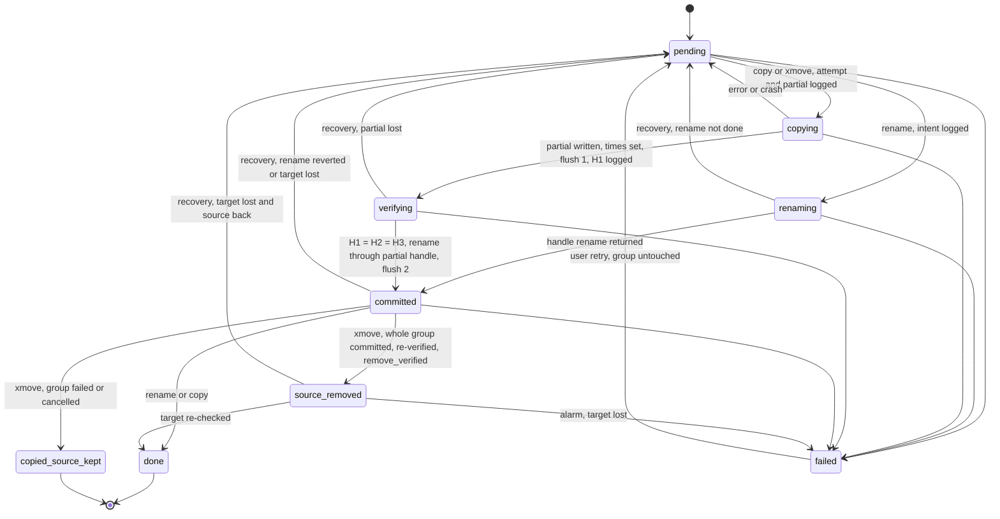

# File engine design

Status: draft, 24 Nov 2026. Owner of: data model, scan and grouping rules, decision log semantics, reconciliation, plan building, preflight, operation state machine, apply and resume. Decisions it implements: [ADR 0003](../adr/0003-stage-decisions-in-a-queue-until-explicit-apply.md), [0004](../adr/0004-never-delete-or-overwrite.md), [0005](../adr/0005-decision-state-as-append-only-event-log.md), [0006](../adr/0006-arrow-keys-do-not-change-an-existing-decision.md), [0007](../adr/0007-pair-files-by-basename-within-one-folder.md), [0008](../adr/0008-key-sessions-and-caches-by-volume-serial-and-relative-path.md), [0009](../adr/0009-sqlite-per-source-for-sessions-and-journal.md), [0010](../adr/0010-journaled-apply-with-roll-forward-only.md). The journal states and recovery rules here supersede the ones quoted in ADR 0010 and ADR 0004 (rename call); an ADR update will follow. Quality goals (zero data loss) are in [nfr.md](../nfr.md); containers and runtime views in [architecture.md](../architecture.md); attacks in [threat-model.md](../threat-model.md).

The file engine is the part that must never lose a photo. Everything below serves two rules: at every instant, every photo exists in at least one complete, durable copy; and Culla never writes the content of a user's file or replaces one.

## 1. Where the code lives

| Crate | Owns | I/O |
|---|---|---|
| `crates/core` (`culla-core`) | Domain types, port traits (`FileSystem`, `SessionStore`, `Clock`), grouping, `fold()`, reconciliation, `plan()`, preflight rules, journal state machine, the recovery table, apply executor, all driven through ports | None. `#![forbid(unsafe_code)]`. Tested with in-memory fakes on any OS |
| `crates/adapters` (`culla-adapters`) | `winfs` (volume mapping, walk, handle-based no-replace rename, verified copy, hashing, `remove_verified`), SQLite store, EXIF/NEF parsing | All real I/O. Win32 `unsafe` confined to `winfs` |
| `src-tauri` | Wiring only: builds adapters, injects them into core services, exposes commands | None of its own |

The core decides *what* to do and in which state; the adapter performs one primitive per call and reports the outcome.

The fake `FileSystem` used by the core tests models durability, because INV-11, INV-13 and INV-14 are only meaningful against it. Every write, rename and removal is "unflushed" until a flush covers it. A simulated crash may revert any unflushed change. On a volume marked FAT, a simulated crash during a rename may also tear it (the file shows in both places, or in neither). Tests crash after every primitive and also between a primitive and its journal write.

## 2. Data model

### 2.1 Entities

Types are Rust. `RelPath` is a validated relative path (see §3.4), stored as text with `\` separators. Times are Unix milliseconds (UTC) unless noted.

| Entity | Fields | Notes |
|---|---|---|
| `VolumeId` | `serial: u32`, `fs_name: String` (`FAT32`, `exFAT`, `NTFS`…), `label: Option<String>`, `last_mount: Option<String>`, `last_guid: Option<String>` | Identity is `serial` only ([ADR 0008](../adr/0008-key-sessions-and-caches-by-volume-serial-and-relative-path.md)). `last_mount` (`F:\`) and `last_guid` are informational; a run binds the serial to a GUID path afresh (§6.3). |
| `Source` | `volume: VolumeId`, `rel: RelPath` (from the volume root), `rel_key: String` (case-folded) | One per session database. |
| `Session` | `id: i64`, `status: Active \| Archived`, `created_at`, `include_subfolders: bool`, `raw_follows: bool`, `keep_mode: Move \| Copy`, `dest: Option<(VolumeId, RelPath)>`, `order_frozen: bool` | At most one active session per source. "Start fresh" archives the active one. |
| `Group` | `id: i64`, `session_id`, `folder: RelPath` (from the source root), `folder_key`, `stem: String`, `stem_key`, `status: Ok \| Ambiguous`, `capture_time: Option<i64>`, `display_ord: Option<i64>` | Unit of decision. Identity is (`folder_key`, `stem_key`) within a session. |
| `FileMember` | `id: i64`, `group_id`, `kind: Jpeg \| Nef \| Sidecar`, `role: Primary \| Raw \| Sidecar`, `sidecar: Option<SidecarKind>`, `describes: Option<member_id>`, `rel: RelPath`, `name: String`, `size: u64`, `mtime_ns: i64`, `present: bool`, `changed: bool`, `last_seen_scan` | `describes` is set for sidecars bound to one file (`X.NEF.xmp`); empty for group sidecars (`X.xmp`). See §3.3. |
| `DecisionEvent` | `seq: i64`, `session_id`, `ts`, `cause: User \| Reconcile`, `body: Decided {group_id, verdict: Keep \| Reject} \| Cleared {group_id} \| Undo {target_seq} \| Redo {target_seq}` | Shape from [ADR 0005](../adr/0005-decision-state-as-append-only-event-log.md), plus `cause` (§6.2). Append-only. |
| `Plan` | `id`, `session_id`, `status` (§9.1), `created_at`, `confirmed_at`, `decisions_upto_seq`, `keep_mode`, `raw_follows`, `source: Source`, `dest: Option<(VolumeId, RelPath)>`, run binding `src_guid`, `dest_guid`, counts and bytes per kind | Settings are snapshotted, so a plan never depends on later edits. |
| `Operation` | `id`, `plan_id`, `group_id`, `member_id`, `ord`, `action: Keep \| Reject`, `kind: Rename \| Copy \| XMove`, `src: RelPath`, `dst_root: Dest \| Rejected`, `dst: RelPath`, `dst_key`, `partial: Option<RelPath>` (current attempt), `expected_size`, `src_mtime_ns`, `hash: Option<[u8; 32]>`, `state: OpState`, `attempts: u32`, `last_error: Option<FailReason>` | One file. `hash` is H1, the source hash taken during the copy. |
| `JournalEntry` | `id`, `op_id`, `ts`, `from: OpState`, `to: OpState`, `detail: Json` (attempt, partial path of that attempt, hashes, error code) | Append-only. Inserting an entry is what changes `Operation.state` (triggers, §2.3). The set of partial paths an operation ever used is read from its entries. |
| `Scan`, `ScanIssue` | `Scan {id, session_id, started_at, finished_at, counts}`; `ScanIssue {scan_id, rel, kind, detail}` | Issue kinds in the schema. Listed in the review screen. |

`OpState = Pending | Renaming | Copying | Verifying | Committed | SourceRemoved | Done | CopiedSourceKept | Failed`. `Done`, `CopiedSourceKept` and `Failed` are terminal (`Failed` can be retried, §9.6).

Group decision state (`undecided | kept | rejected`) and the undo/redo stacks are never stored; they are `fold(events)` (§5). Whether a group is locked or applied (§5.4) is derived from the plans and operations that reference it.

### 2.2 Storage

- One database per source: `%LOCALAPPDATA%\Culla\sessions\<key>.sqlite`, where `<key>` is the hex of the first 16 bytes of `blake3(serial ‖ rel_key)`. Always on the internal disk, never on the card, so the journal survives a pulled card and a write-protected card still gets a session.
- Pragmas on open: `journal_mode=WAL`, `synchronous=FULL`, `foreign_keys=ON`, `application_id=0x43554C4C`, `user_version` for migrations. `mmap_size` stays 0. WAL with `synchronous=FULL` is proposed in ADR 0009 and NFR-REL-10; to confirm (§13).
- Every decision event and every journal transition is its own transaction, committed before the next file system step starts (write-ahead).
- Next to each database, `<key>.lock`: recovery and apply open it with share mode 0 and hold it for their whole duration, so no second process can recover or apply the same source. It is taken before any plan status change (including `applying → interrupted` at launch). If it is already held, the plan is being applied by another instance: this instance changes nothing in that database and shows the source as busy. The app is also single-instance.
- The plain-text apply log goes to `%LOCALAPPDATA%\Culla\logs\<date>-plan<id>.log`. To decide: whether a copy is also written into the destination (an extra write on the user's volume).

### 2.3 Schema (session database, v1)

```sql
PRAGMA journal_mode = WAL;
PRAGMA synchronous = FULL;
PRAGMA foreign_keys = ON;
PRAGMA application_id = 0x43554C4C;   -- 'CULL'
PRAGMA user_version = 1;

CREATE TABLE volume (
  id          INTEGER PRIMARY KEY,
  serial      INTEGER NOT NULL UNIQUE CHECK (serial BETWEEN 0 AND 4294967295),  -- identity
  fs_name     TEXT NOT NULL,              -- informational
  label       TEXT,
  last_mount  TEXT,                       -- display only
  last_guid   TEXT                        -- informational; runs re-bind (§6.3)
) STRICT;

CREATE TABLE source (
  id         INTEGER PRIMARY KEY CHECK (id = 1),
  volume_id  INTEGER NOT NULL REFERENCES volume(id),
  rel_path   TEXT NOT NULL,                 -- '' = volume root
  rel_key    TEXT NOT NULL,                 -- case-folded
  created_at INTEGER NOT NULL
) STRICT;

CREATE TABLE session (
  id                 INTEGER PRIMARY KEY,
  status             TEXT NOT NULL CHECK (status IN ('active','archived')),
  created_at         INTEGER NOT NULL,
  include_subfolders INTEGER NOT NULL CHECK (include_subfolders IN (0,1)),
  raw_follows        INTEGER NOT NULL CHECK (raw_follows IN (0,1)),
  keep_mode          TEXT NOT NULL CHECK (keep_mode IN ('move','copy')),
  dest_volume_id     INTEGER REFERENCES volume(id),
  dest_rel_path      TEXT,
  order_frozen       INTEGER NOT NULL DEFAULT 0 CHECK (order_frozen IN (0,1)),
  CHECK ((dest_volume_id IS NULL) = (dest_rel_path IS NULL))
) STRICT;
CREATE UNIQUE INDEX session_one_active ON session(status) WHERE status = 'active';

CREATE TABLE scan (
  id          INTEGER PRIMARY KEY,
  session_id  INTEGER NOT NULL REFERENCES session(id),
  started_at  INTEGER NOT NULL,
  finished_at INTEGER,
  n_groups    INTEGER, n_new INTEGER, n_missing INTEGER, n_changed INTEGER
) STRICT;

CREATE TABLE scan_issue (
  scan_id  INTEGER NOT NULL REFERENCES scan(id),
  rel_path TEXT NOT NULL,
  kind     TEXT NOT NULL CHECK (kind IN ('unknown_ext','orphan_sidecar','ambiguous',
             'reparse_point','cloud_placeholder','hidden_or_system','invalid_name',
             'unreadable','foreign_partial','same_basename_unknown',
             'joins_applied_group','reverted_move')),
  detail   TEXT
) STRICT;

CREATE TABLE photo_group (
  id              INTEGER PRIMARY KEY,
  session_id      INTEGER NOT NULL REFERENCES session(id),
  folder_rel      TEXT NOT NULL,            -- '' = source root
  folder_key      TEXT NOT NULL,
  stem            TEXT NOT NULL,
  stem_key        TEXT NOT NULL,
  status          TEXT NOT NULL CHECK (status IN ('ok','ambiguous')),
  capture_time    INTEGER,                  -- DateTimeOriginal, camera-local, ms
  display_ord     INTEGER,
  first_seen_scan INTEGER NOT NULL REFERENCES scan(id),
  UNIQUE (session_id, folder_key, stem_key)
) STRICT;

CREATE TABLE member (
  id             INTEGER PRIMARY KEY,
  group_id       INTEGER NOT NULL REFERENCES photo_group(id),
  kind           TEXT NOT NULL CHECK (kind IN ('jpeg','nef','sidecar')),
  role           TEXT NOT NULL CHECK (role IN ('primary','raw','sidecar')),
  sidecar_kind   TEXT CHECK (sidecar_kind IN ('xmp','pp3','file_xmp','file_pp3','nksc')),
  describes_id   INTEGER REFERENCES member(id),   -- NULL for group sidecars
  rel_path       TEXT NOT NULL,             -- from source root
  rel_key        TEXT NOT NULL,
  file_name      TEXT NOT NULL,
  size           INTEGER NOT NULL CHECK (size >= 0),
  mtime_ns       INTEGER NOT NULL,
  present        INTEGER NOT NULL CHECK (present IN (0,1)),
  changed        INTEGER NOT NULL DEFAULT 0 CHECK (changed IN (0,1)),
  last_seen_scan INTEGER NOT NULL REFERENCES scan(id),
  CHECK ((kind = 'sidecar') = (role = 'sidecar')),
  CHECK ((role = 'sidecar') = (sidecar_kind IS NOT NULL)),
  CHECK (sidecar_kind IS NULL
         OR ((sidecar_kind IN ('file_xmp','file_pp3','nksc')) = (describes_id IS NOT NULL))),
  CHECK (role <> 'raw' OR kind = 'nef')
) STRICT;
CREATE UNIQUE INDEX member_rel ON member(group_id, rel_key);
CREATE UNIQUE INDEX member_one_primary ON member(group_id) WHERE role = 'primary';

CREATE TABLE decision_event (
  seq        INTEGER PRIMARY KEY AUTOINCREMENT,
  session_id INTEGER NOT NULL REFERENCES session(id),
  ts         INTEGER NOT NULL,
  cause      TEXT NOT NULL DEFAULT 'user' CHECK (cause IN ('user','reconcile')),
  type       TEXT NOT NULL CHECK (type IN ('decided','cleared','undo','redo')),
  group_id   INTEGER REFERENCES photo_group(id),
  verdict    TEXT CHECK (verdict IN ('keep','reject')),
  target_seq INTEGER REFERENCES decision_event(seq),
  CHECK ((type = 'decided') = (verdict IS NOT NULL)),
  CHECK ((type IN ('decided','cleared')) = (group_id IS NOT NULL)),
  CHECK ((type IN ('undo','redo')) = (target_seq IS NOT NULL)),
  CHECK (cause = 'user' OR type = 'cleared')
) STRICT;

CREATE TABLE plan (
  id                 INTEGER PRIMARY KEY,
  session_id         INTEGER NOT NULL REFERENCES session(id),
  status             TEXT NOT NULL CHECK (status IN ('draft','confirmed','applying',
                       'paused','interrupted','completed','cancelled','superseded')),
  created_at         INTEGER NOT NULL,
  confirmed_at       INTEGER,
  decisions_upto_seq INTEGER NOT NULL,
  keep_mode          TEXT NOT NULL CHECK (keep_mode IN ('move','copy')),
  raw_follows        INTEGER NOT NULL CHECK (raw_follows IN (0,1)),
  src_volume_id      INTEGER NOT NULL REFERENCES volume(id),
  src_rel_path       TEXT NOT NULL,
  dest_volume_id     INTEGER REFERENCES volume(id),
  dest_rel_path      TEXT,
  src_guid           TEXT,                  -- run binding, refreshed on each start (§6.3)
  dest_guid          TEXT,
  pause_reason       TEXT CHECK (pause_reason IN ('user','volume_lost','volume_ambiguous',
                       'disk_full','write_protected')),
  bytes_copy         INTEGER NOT NULL DEFAULT 0,
  bytes_xmove        INTEGER NOT NULL DEFAULT 0
) STRICT;
CREATE UNIQUE INDEX plan_one_open ON plan(session_id)
  WHERE status IN ('confirmed','applying','paused','interrupted');

CREATE TABLE operation (
  id            INTEGER PRIMARY KEY,
  plan_id       INTEGER NOT NULL REFERENCES plan(id),
  group_id      INTEGER NOT NULL REFERENCES photo_group(id),
  member_id     INTEGER NOT NULL REFERENCES member(id),
  ord           INTEGER NOT NULL,
  action        TEXT NOT NULL CHECK (action IN ('keep','reject')),
  kind          TEXT NOT NULL CHECK (kind IN ('rename','copy','xmove')),
  src_rel       TEXT NOT NULL,              -- from source root
  dst_root      TEXT NOT NULL CHECK (dst_root IN ('dest','rejected')),
  dst_rel       TEXT NOT NULL,              -- from dst root
  dst_key       TEXT NOT NULL,              -- case-folded
  partial_rel   TEXT,                       -- current attempt: <target>.<op id>-<attempt>.culla-partial
  expected_size INTEGER NOT NULL,
  src_mtime_ns  INTEGER NOT NULL,
  hash          BLOB CHECK (hash IS NULL OR length(hash) = 32),   -- H1, BLAKE3
  state         TEXT NOT NULL DEFAULT 'pending' CHECK (state IN ('pending','renaming',
                  'copying','verifying','committed','source_removed','done',
                  'copied_source_kept','failed')),
  attempts      INTEGER NOT NULL DEFAULT 0,
  last_error    TEXT,
  CHECK ((kind = 'rename') = (partial_rel IS NULL)),
  CHECK (action = 'keep' OR (kind = 'rename' AND dst_root = 'rejected')),
  UNIQUE (plan_id, ord),
  UNIQUE (plan_id, member_id),
  UNIQUE (plan_id, dst_root, dst_key)
) STRICT;

CREATE TABLE op_transition (            -- seeded with the edges of §9.2
  kind TEXT NOT NULL, from_state TEXT NOT NULL, to_state TEXT NOT NULL,
  PRIMARY KEY (kind, from_state, to_state)
) STRICT, WITHOUT ROWID;

CREATE TABLE journal_entry (
  id         INTEGER PRIMARY KEY AUTOINCREMENT,
  op_id      INTEGER NOT NULL REFERENCES operation(id),
  ts         INTEGER NOT NULL,
  from_state TEXT NOT NULL,
  to_state   TEXT NOT NULL,
  detail     TEXT                         -- JSON
) STRICT;

-- A journal entry must be a legal edge from the operation's current state.
CREATE TRIGGER journal_check BEFORE INSERT ON journal_entry BEGIN
  SELECT RAISE(ABORT, 'illegal transition')
  WHERE NOT EXISTS (
    SELECT 1 FROM operation o JOIN op_transition t
      ON t.kind = o.kind AND t.from_state = o.state AND t.to_state = NEW.to_state
    WHERE o.id = NEW.op_id AND o.state = NEW.from_state);
END;
CREATE TRIGGER journal_apply AFTER INSERT ON journal_entry BEGIN
  UPDATE operation SET state = NEW.to_state WHERE id = NEW.op_id;
END;
-- operation.state always equals the last journal entry's to_state.
CREATE TRIGGER operation_state_guard BEFORE UPDATE OF state ON operation
WHEN NEW.state IS NOT (SELECT to_state FROM journal_entry
                       WHERE op_id = NEW.id ORDER BY id DESC LIMIT 1)
BEGIN SELECT RAISE(ABORT, 'state changes only through the journal'); END;

-- Append-only logs.
CREATE TRIGGER decision_event_no_update BEFORE UPDATE ON decision_event
  BEGIN SELECT RAISE(ABORT, 'append-only'); END;
CREATE TRIGGER decision_event_no_delete BEFORE DELETE ON decision_event
  BEGIN SELECT RAISE(ABORT, 'append-only'); END;
CREATE TRIGGER journal_no_update BEFORE UPDATE ON journal_entry
  BEGIN SELECT RAISE(ABORT, 'append-only'); END;
CREATE TRIGGER journal_no_delete BEFORE DELETE ON journal_entry
  BEGIN SELECT RAISE(ABORT, 'append-only'); END;
```

## 3. Scanning and grouping

### 3.1 Walk

1. Resolve the chosen folder once: open it, take its final path (`std::fs::canonicalize`), the volume root (`GetVolumePathNameW`), the volume GUID path (`GetVolumeNameForVolumeMountPointW`), the serial and file system name (`GetVolumeInformationByHandleW`). The source is (serial, path from the volume root). A junction *above* the chosen folder is resolved here, once; nothing inside the tree is followed.
2. Walk depth-first with `follow_links(false)`, or only the root folder if "include subfolders" is off. Use the attributes from the directory listing; never call a following `metadata()`.
3. Each folder is listed completely, then grouped (§3.3), then its groups are emitted in filename order. This is what makes the scan streamed: the first folder's groups reach the UI before the rest of the tree is listed.
4. The EXIF pass (first ~128 KB per primary, buffered reads, never mmap) runs after, as described in [architecture.md](../architecture.md). It only fills `capture_time`.

### 3.2 Exclusions

| Entry | Rule | Reported as |
|---|---|---|
| A folder named `_rejected` (case-insensitive), at any depth | Not entered | — (count only) |
| The destination folder, if it is inside the source | Not entered (compared on resolved paths and volume GUID) | — |
| Any reparse point (symlink, junction, mount point) | Not entered, not grouped, never touched | `reparse_point` |
| Cloud placeholders: a cloud reparse tag (`IO_REPARSE_TAG_CLOUD*`), or the attribute `FILE_ATTRIBUTE_RECALL_ON_DATA_ACCESS`, `FILE_ATTRIBUTE_RECALL_ON_OPEN` or `FILE_ATTRIBUTE_OFFLINE` (OneDrive, other sync clients) | Not entered, not grouped, never touched. A source folder that is itself a placeholder is refused | `cloud_placeholder` |
| Files or folders with the hidden or system attribute, or a name starting with `.` (covers macOS `._*` files), `System Volume Information`, `$RECYCLE.BIN` | Skipped | `hidden_or_system` (files only) |
| `NKSC_PARAM` folder | Not a photo folder. Its `*.nksc` files are matched against the parent folder (§3.3), even if the folder is hidden | other content: `unknown_ext` |
| `*.culla-partial` | Never grouped. If this source's journal lists it, recovery owns it (§10); otherwise reported, never touched | `foreign_partial` |
| A file whose name fails validation (§3.4) | Skipped, never touched | `invalid_name` |
| An entry that cannot be read | Skipped | `unreadable` |

`_rejected` is excluded at any depth, not only at the source root, so that opening a parent folder never offers photos rejected in an earlier session on a subfolder. To confirm with the author (SPEC §3.3 does not say which depth).

### 3.3 Grouping rules

All matching is within one folder `F`. Extensions compare ASCII case-insensitively; names and stems compare with `fold()` (§3.4).

Definitions:

- A **photo file** is a file whose extension is `.jpg`, `.jpeg` or `.nef`. Its **stem** is its name up to the last `.`. Stems may contain dots: `DSC_0001.edit.JPG` has the stem `DSC_0001.edit`.
- A **sidecar name** ends in `.xmp` or `.pp3`, or ends in `.nksc` and sits in `F\NKSC_PARAM\`. Its **base** `M` is the name with that last suffix removed.

Matching, applied to every non-photo file, in this order:

1. If `M` equals the full name of a photo file in `F` (`M` = `X.NEF`, `X.JPG`…), the sidecar **describes that file** (`file_xmp`, `file_pp3`, `nksc`) and follows it.
2. Else, for `.xmp` and `.pp3` only: if `M` equals the stem of a group in `F`, it is a **group sidecar** (`xmp`, `pp3`) of that group.
3. Else it is an orphan (`orphan_sidecar`), listed, never touched. This includes `.nksc` files whose base is not a photo file, and `X.NEF.xmp` when there is no `X.NEF`.
4. A file that is neither a photo file nor a sidecar name: if its stem (up to the last `.`) equals a group's stem in `F`, it is listed against that group as `same_basename_unknown` (`X.WAV` voice memo, `X.MOV`); otherwise `unknown_ext`. Never touched.

There is no prefix matching: `DSC_0001.edit.xmp` belongs to the group `DSC_0001.edit` if it exists, never to `DSC_0001`. A group holds at most one JPEG and one NEF. Its primary is the JPEG if any, otherwise the NEF (lone NEF).

| Example in `F` | Result |
|---|---|
| `X.JPG`, `X.NEF` | One group; JPEG primary, NEF raw |
| `X.xmp`, `X.pp3` | Group sidecars of `X`: follow the group |
| `X.NEF.xmp`, `X.NEF.pp3`, `NKSC_PARAM\X.NEF.nksc` | Describe `X.NEF`: follow the NEF |
| `X.JPG.xmp`, `NKSC_PARAM\X.JPG.nksc` | Describe `X.JPG`: follow the JPEG |
| `X.WAV` | Listed against `X`, not moved |
| `Y.xmp` with no group `Y` | Orphan, listed |

Consequences of "follows" ([ADR 0007](../adr/0007-pair-files-by-basename-within-one-folder.md), SPEC §3.1):

- A sidecar that describes the NEF moves only if the NEF moves. With "RAW follows JPEG" off, the NEF and its sidecars stay put.
- A group sidecar moves whenever the group's primary moves, including when "RAW follows JPEG" is off. Lightroom writes `X.xmp` for the RAW, so with "RAW follows" off the NEF's Lightroom edits leave without it. To confirm with the author.
- To verify on real files: NX Studio's exact `.nksc` naming (`X.NEF.nksc` assumed) and whether it marks `NKSC_PARAM` hidden.

Ambiguity is never resolved by guessing. If a folder has two JPEGs or two NEFs whose stems fold to the same value (`X.JPG` and `X.jpeg`, or case variants in a case-sensitive folder), the group is `ambiguous`: it is shown, it can be decided, but `plan()` gives it no operations and the review lists it.

### 3.4 Names, paths and case folding

- A name component is valid if it is valid UTF-16 that converts to UTF-8 losslessly, is not `.` or `..`, contains no `\ / : * ? " < > |` and no control character, has no trailing space or dot, is not a DOS device name (`CON`, `NUL`, `COM1`… with or without extension), and is at most 255 UTF-16 units. Names from the card normally pass; a crafted card image may not.
- `RelPath` is built only from valid components. During an apply, absolute paths are built as `\\?\Volume{GUID}\<rel>` by the adapter (§6.3). Because `\\?\` turns off Win32 normalization, the validation above is what keeps `..` and device names out ([threat-model.md](../threat-model.md)).
- `fold(s)` maps each character to its simple uppercase when that is a single character, else keeps it. It approximates the NTFS upcase table and is used for grouping, keys and in-plan collision checks. The file system's no-replace behaviour (§9) remains the final guard against case collisions.

## 4. Inputs from the UI

The webview never supplies a path. Source and destination folders are picked through a native dialog opened from Rust; the UI gets an opaque handle and a display string. All other commands take group IDs, event payloads or a plan ID. The core treats every command argument as untrusted and re-derives paths from the session database ([threat-model.md](../threat-model.md)). Preview caching is outside the file engine ([architecture.md](../architecture.md)).

## 5. Decision log

### 5.1 Events and derivation

Events as in [ADR 0005](../adr/0005-decision-state-as-append-only-event-log.md). `fold(events) → (state: Map<GroupId, State>, done: Vec<seq>, undone: Vec<seq>)`:

| Event | Precondition (checked by the core before appending) | Effect in `fold` |
|---|---|---|
| `Decided {g, v}` | `state[g] = undecided`, `g` not locked or applied | `state[g] = kept/rejected`; push seq on `done`; clear `undone` |
| `Cleared {g}`, `cause = user` (U) | `state[g] ≠ undecided`, `g` not locked or applied | `state[g] = undecided`; push seq on `done`; clear `undone` |
| `Cleared {g}`, `cause = reconcile` (§6.2, proposed) | `state[g] ≠ undecided`, `g` not locked or applied | `state[g] = undecided`; remove every seq that targets `g` from `done` and `undone`; push nothing. It never enters the stacks, so it cannot be undone, and the user's earlier `Decided` on `g` becomes un-undoable |
| `Undo {t}` | `t = top(done)`, target group not locked or applied | Revert event `t` (`Decided` → undecided; `Cleared` → the state before it); move `t` from `done` to `undone` |
| `Redo {t}` | `t = top(undone)`, target group not locked or applied | Re-apply event `t`; move `t` from `undone` to `done` |

"The state before a `Cleared`" is recomputed by folding up to that event; it is well defined because each group's history is a strict alternation of decided and undecided, enforced by the preconditions. A reconcile `Cleared` keeps the alternation (it needs a decided group and leaves it undecided). Because it also drops the group's earlier events from both stacks, `Undo` and `Redo` never target an event that a reconcile `Cleared` has overtaken, and the stacks hold no event for `g` older than it. A precondition failure means no event is appended. `fold` treats a log that breaks a precondition as corrupt and stops at that event (it cannot happen through the core; it is tested with fixtures).

### 5.2 Key behaviour

- ←/→ (and drag, and the Keep/Reject buttons) on a decided group append nothing. The UI plays the shake and shows "Press U to undo" ([ADR 0006](../adr/0006-arrow-keys-do-not-change-an-existing-decision.md)). The core also rejects such a `Decided`, so the rule holds even if the UI has a bug.
- U on an undecided group appends nothing.
- Ctrl+Z with an empty `done`, or Ctrl+Shift+Z with an empty `undone`, appends nothing.
- Undo and redo jump to the target group.
- Key auto-repeat is filtered in the UI; the core does not see repeats.

### 5.3 Persistence

Each event is one `INSERT` in its own transaction. The TS reducer and the Rust `fold` run the same golden fixtures. On resume, `fold` of the stored log gives the same state and the same undo/redo stacks.

### 5.4 Locked and applied groups

- **Locked:** the group has an operation in an open plan (`confirmed`, `applying`, `paused`, `interrupted`).
- **Applied:** some operation of the group, in any plan, ever reached `committed` (read from the journal). Before `committed`, the only moved files (a `rename` in `renaming`) are resolved by recovery while the plan is open, and no file has been copied into place; a `renaming` op that ends `failed (conflict)` after a torn rename is reported as a torn volume, not offered for retry; only Culla's partials existed, and they are removed on failure (§9.4).

A locked or applied group's decision cannot change: `Decided`, `Cleared`, `Undo` and `Redo` that touch it are refused. If the top of `done` targets such a group, Ctrl+Z does nothing and the UI says "Already applied". Undoing an apply is a v2 candidate, and a decision that no longer matches the disk would make the next plan wrong. To confirm with the author: this also blocks Ctrl+Z on older, unapplied decisions behind it (U still works on them). When a plan closes, its untouched groups unlock.

## 6. Sessions, identity and reconciliation

### 6.1 Opening a folder

1. Resolve the source identity (§3.1). Map the serial to mounted volumes (§6.3).
2. Refuse the folder if another session database on the same serial has a source that is an ancestor or a descendant of this one (compared on folded relative paths) and has an open plan. Message: finish or cancel that apply first. This keeps two plans from moving the same files. Session databases are found by reading the `source` row of each file in `sessions\`.
3. Open or create `sessions\<key>.sqlite`. If it has an open plan, recovery and resume come first (§10). "Start fresh" is not offered until that plan is closed.
4. Otherwise, if an active session exists, offer resume or start fresh. Start fresh archives it; its events and journal stay in the database.
5. Scan and reconcile.

### 6.2 Reconciliation

Members are matched by (`folder_key`, file name folded). For each stored member:

| On disk | Result |
|---|---|
| Present, same size and mtime | `present = 1` |
| Present, size or mtime differs | `present = 1`, `changed = 1`; listed as "changed since scan" |
| Present, but a `done` `rename` or `xmove` operation had moved it away | `rename`: the file system reverted an unflushed rename after a crash (§9.3). `xmove`: the unflushed source removal was lost, so the file is now at both S and F. Listed as `reverted_move`; the group stays applied and the file is not touched again in v1 (§13). Never applies to `copy`, whose source is meant to stay |
| Absent, and a `done` or `source_removed` operation moved it | Expected; not reported |
| Absent otherwise | `present = 0`; listed as missing; no operation for it |

New files:

- A new file whose folder and stem match an existing, not applied group joins it (a sidecar written by NX Studio since the last session, a JPEG next to a lone NEF). Proposed (§13): if the group was decided, reconciliation appends `Cleared {g}` with `cause = reconcile` (§5.1): the group becomes undecided and the review lists why. The user decided on a different set of files, so the decision no longer holds.
- A new file whose folder and stem match an applied group is not added: listed as `joins_applied_group`, never touched.
- Other new files form new undecided groups, appended after the current order.

Renames show as one missing plus one new.

mtime comparison accepts a difference of exactly ±3600 s whenever the timestamp has no UTC offset, because Windows converts such local timestamps with the current DST rule and every file shifts by an hour across a DST change. FAT32 never stores an offset; exFAT may omit it and Win32 does not say whether it did, so the tolerance applies on every FAT32 and exFAT volume. FAT32 also has 2 s granularity. NTFS compares exactly.

To decide: a threshold above which a reopened source is treated as "probably a different card with the same serial" (for example more than half the members missing and the same number new), and what the UI then asks. This is the residual risk of a 32-bit serial ([ADR 0008](../adr/0008-key-sessions-and-caches-by-volume-serial-and-relative-path.md)). Whatever the answer, operations never trust the session alone: each one re-checks the file on disk before acting (§9).

To decide: network shares and volumes without a serial. Proposal: refuse them as sources and destinations in v1.

### 6.3 Volume binding during a run

At every apply start, resume and recovery, and after any "volume lost" error:

1. Enumerate the mounted volumes (`FindFirstVolumeW` / `FindNextVolumeW`) and read each serial.
2. For the source serial and the destination serial: exactly one match binds that serial to the volume's `\\?\Volume{GUID}\` path for this run (`plan.src_guid`, `plan.dest_guid`). No match: plan `paused (volume_lost)`, "Insert the card <label>". More than one match: plan `paused (volume_ambiguous)`, and the user picks the volume from a list with labels and drive letters.
3. Every path used by the run starts with the bound GUID path, so a drive letter that changes mid-run, or a second card with the same serial under another letter, cannot redirect an operation.
4. "Same volume" (rename vs `xmove` at plan time, the check inside `remove_verified_source`) is decided by GUID. If the source and destination serials are equal but the GUIDs differ, the destination is refused at plan time: two volumes share a serial, and identity by serial cannot tell them apart.

## 7. Plan building

`plan(groups, members, state, settings, exists: &dyn Fn(Root, &RelPath) -> bool) -> Plan` is pure. `exists` is answered by the `FileSystem` port and is only a hint; the OS has the last word at execution.

### 7.1 Which files

For each group with `state = kept` or `rejected`, status `ok`, not applied, not locked by another plan:

1. The primary, if present.
2. The NEF, if present, and either it is the primary (lone NEF) or `raw_follows` is on.
3. Each present group sidecar (`X.xmp`, `X.pp3`), when the primary is selected.
4. Each present sidecar that describes a file selected in 1–2.

Undecided groups get nothing. Missing members get nothing and are listed.

### 7.2 Targets

Let `rel(F)` be the member's folder relative to the source root and `n` the group's suffix.

| Action | Target root | Target folder |
|---|---|---|
| Keep | Destination root | `rel(F)`; `rel(F)\NKSC_PARAM` for `.nksc` |
| Reject | `<source root>\_rejected` | `rel(F)`; `rel(F)\NKSC_PARAM` for `.nksc` |

Target name: the group's stem `X` at the start of the name is replaced by `X` (n = 0) or `X_n`, and the rest is kept with its original case: `X.JPG → X_1.JPG`, `X.NEF → X_1.NEF`, `X.xmp → X_1.xmp`, `X.NEF.xmp → X_1.NEF.xmp`, `NKSC_PARAM\X.NEF.nksc → NKSC_PARAM\X_1.NEF.nksc`, `DSC_0001.edit.JPG → DSC_0001.edit_1.JPG`. File contents are never rewritten, so a reference inside an XMP to the old file name stays as it was.

Operation kind:

| Action | keep_mode | Source and target on the same volume (GUID) | Kind |
|---|---|---|---|
| Reject | any | always (same source tree; reparse points are refused) | `rename` |
| Keep | move | yes | `rename` |
| Keep | move | no | `xmove` |
| Keep | copy | either | `copy` |

The kind is fixed at plan time. If a `rename` meets `ERROR_NOT_SAME_DEVICE` at execution, the operation fails; it is never silently turned into a copy.

Partial name, for `copy` and `xmove`: `<target name>.<op id>-<attempt>.culla-partial` in the target folder. The op id makes it Culla's and unique in the plan; the attempt number makes each attempt's file distinct, so a stale partial from an earlier attempt is never mistaken for the current one.

### 7.3 Collision suffix

Groups are processed in plan order (§9.5). For each group, choose the smallest `n` in `0, 1, 2, …, 9999` such that for every planned member target `t`:

- `exists(t)` is false, and
- `fold(t)` is not already claimed by another operation in this plan.

Then claim them. If no `n` works, the group gets no operations and is listed. The same `n` applies to every member of the group (a group is either all-keep or all-reject, so all its members share a root). Every suffix is shown in the review. Partial names need no check: they contain the op id.

### 7.4 Re-planning

Plans are built on the review screen and rebuilt whenever decisions or settings change; only the last draft can be confirmed (older drafts become `superseded`). Confirming records `decisions_upto_seq` and locks the groups (§5.4). Preflight runs on the draft and again at confirm. There is no carry-over of operations from one plan into another: "Apply remaining" builds a new plan from the current decisions and disk state (§9.6).

## 8. Preflight

Preflight is read-only on user volumes: it creates no folder, no probe file and opens nothing for writing. It runs at review and again in the instant before the first operation.

| # | Check | On failure |
|---|---|---|
| P1 | Source volume bound by serial to exactly one mounted volume (§6.3) | Blocks apply, or asks which volume |
| P2 | Destination volume bound the same way; root exists or its parent exists (keep only) | Blocks apply |
| P3 | Source volume writable (`FILE_READ_ONLY_VOLUME` not set: covers the SD lock switch), needed if any `rename` or `xmove` | Blocks apply, message names the lock switch |
| P4 | Destination volume writable | Blocks apply |
| P5 | Free space per destination volume ≥ Σ (size rounded up to the cluster size) of `copy` and `xmove` operations on it, plus a margin. To decide: the margin (proposal: max(1 GiB, 2 %)) | Blocks apply |
| P6 | Destination is not the source, not inside any `_rejected`, not a cloud placeholder, not on a refused volume type | Blocks apply |
| P7 | Every target and partial is under its root (normalized absolute comparison), differs from every source path, and is unique in the plan (folded) | Blocks apply. A failure here is a bug: logged as such |
| P8 | Every target path and every partial path (with the longest attempt number allowed) ≤ 32,767 UTF-16 units, every component ≤ 255; names valid on the destination file system | Group held back and listed |
| P9 | No source member, target folder or ancestor up to the root is a reparse point or cloud placeholder | Group held back and listed |
| P10 | Each source member still exists with the scanned size and mtime | Group held back, listed as "changed since scan, rescan" |
| P11 | Each target is still free (the suffix is recomputed if not; the review then shows the new name before confirm) | Re-plan |
| P12 | Locks: each source opens with `share_mode(FILE_SHARE_READ)` and no write or delete sharing | Warning listed; the apply retries (§9.4) |
| P13 | Source files with the read-only attribute (camera "protect") in `rename` or `xmove` operations | To decide: block, skip, or keep the source. Default until decided: group held back and listed |
| P14 | Files over 4 GiB going to a FAT32 destination | Group held back and listed |
| P15 | Target paths over 260 characters | Warning: Explorer and some apps may fail to open them |
| P16 | Culla's own preview pipeline is stopped and holds no handle on any planned file | Internal precondition; apply waits for it |

## 9. Executing operations

### 9.1 Plan states

`draft → confirmed → applying ⇄ paused → completed | cancelled`. A plan found in `applying` at launch is set to `interrupted` and goes through recovery (§10), then back to `applying`. `completed`, `cancelled` and `superseded` are closed. At most one open plan per session (index `plan_one_open`).

### 9.2 Operation state machine



Edges by kind (seeded into `op_transition`):

| Kind | Edges |
|---|---|
| `rename` | pending→renaming, renaming→committed, renaming→pending, committed→done, committed→pending, {pending, renaming, committed}→failed, failed→pending |
| `copy` | pending→copying, copying→verifying, copying→pending, verifying→committed, verifying→pending, committed→done, committed→pending, {pending, copying, verifying, committed}→failed, failed→pending |
| `xmove` | as `copy`, but without committed→done; plus committed→source_removed, committed→copied_source_kept, source_removed→done, source_removed→pending, source_removed→failed |

A state is written *before* the step it names starts (`renaming`, `copying`) or *after* the step it names has returned (`verifying`, `committed`, `source_removed`, `done`). So the journal is never ahead of the disk, and recovery decides from the disk how far behind it is. The one exception is a user-file rename, which may be undone by the file system after `committed` (§9.3); recovery and reconciliation detect it.

### 9.3 Steps per kind

Adapter primitives (`culla-adapters::winfs`). All paths start with the run's `\\?\Volume{GUID}\` (§6.3). Every open uses `FILE_FLAG_OPEN_REPARSE_POINT` and rejects a handle whose attributes show a reparse point, a cloud placeholder or a directory.

| Primitive | Behaviour |
|---|---|
| `open_target_dir(root, rel)` | After `make_dirs`, opens the target folder with `FILE_FLAG_BACKUP_SEMANTICS \| FILE_FLAG_OPEN_REPARSE_POINT`, sharing read and write but not delete, and checks through the handle that it is a real directory (not a reparse point, not a placeholder). Returns `hD`, held until the rename has returned, so the folder cannot be renamed, removed or swapped for a junction meanwhile. |
| `rename_noreplace(h, hD, name)` | `SetFileInformationByHandle(h, FileRenameInfoEx)` with `RootDirectory = hD` and `FileName` = the target's leaf name (relative), with flags 0, so without `FILE_RENAME_FLAG_REPLACE_IF_EXISTS`: an existing target fails atomically (`ERROR_ALREADY_EXISTS`), and a cross-volume target fails with `ERROR_NOT_SAME_DEVICE`. Where `FileRenameInfoEx` is not supported (to check on FAT32 and exFAT in adapter tests), `FileRenameInfo` with `ReplaceIfExists = FALSE`, which has the same semantics. `h` needs `DELETE` access. No check-then-rename. Same semantics as `MoveFileExW` without `MOVEFILE_REPLACE_EXISTING` or `MOVEFILE_COPY_ALLOWED`, but bound to the checked file handle and the checked folder handle; only the leaf name is resolved at rename time, and the OS refuses it if taken. Relative names with `RootDirectory` on FAT32 and exFAT are to check in adapter tests ([ADR 0022](../adr/0022-rename-through-the-checked-handle.md), proposed). |
| `create_partial(hD, name)` | `NtCreateFile` with `FILE_CREATE`, `RootDirectory = hD` and a relative name (std cannot open relative to a directory handle), `GENERIC_READ \| GENERIC_WRITE \| DELETE`, sharing read only; inside `winfs` only, covered by adapter tests on NTFS, FAT32 and exFAT. Returns `hP`, kept for the whole attempt. Never opens an existing file for writing. |
| `copy_hashing(s, hP)` | Buffered sequential read of `s` through its own read-only handle (sharing read), in 1 MiB chunks, written to `hP`; BLAKE3 of the bytes read → H1. |
| `set_times(hP, s)` | Modified, accessed and created times of `s` set on `hP` (`File::set_times`, `FileTimesExt::set_created`). |
| `flush(hP)` | `FlushFileBuffers` on `hP`. It needs `GENERIC_WRITE`, which only Culla's own partial handle has; Culla never opens a user's file with write access. |
| `open_source_verify(s, kind)` | Opens `s` once with `GENERIC_READ` (plus `DELETE` for `xmove`), sharing read only, `FILE_FLAG_NO_BUFFERING` (unbuffered source re-read: [ADR 0021](../adr/0021-unbuffered-source-re-read-for-hash-3.md), proposed). Checks size and mtime against the plan through the handle. Returns `hS`. While `hS` is open, no other process can write, rename or remove `s`. |
| `hash_unbuffered(h)` | BLAKE3 through a `FILE_FLAG_NO_BUFFERING` handle. Buffer address and read size are aligned to the volume's sector size, queried per volume (`GetFileInformationByHandleEx`, `FileStorageInfo`; the larger of logical and physical sector size, at least 4096). This bypasses the Windows cache; a card reader's or drive's own cache may still answer. |
| `make_dirs(root, rel)` | Create missing folders one component at a time with `create_dir`, refusing any existing component that is a reparse point. Never removes a folder. |
| `remove_verified_*` | §9.7. |

`rename` (same-volume move of a user file, and every reject):

1. Re-check P9 and P10. Journal `pending → renaming`.
2. `make_dirs` for the target folder; `hD = open_target_dir`.
3. Open `hS` with `DELETE | GENERIC_READ`, sharing read only; check size and mtime through it. `rename_noreplace(hS, hD, name)`. Close `hS` and `hD`. Journal `renaming → committed` only after the call has returned.
4. Journal `committed → done`. Provisional: this is option (c) of the §13 decision on unflushed user-file renames; it changes if the author picks (a) or (b).

The rename cannot be flushed: flushing needs write access to the user's file, which Culla never takes. On NTFS the rename is in the file system log; on FAT and exFAT it is a directory update that Windows writes back within seconds on removable media. A crash before that write-back can revert the rename (the file is back at S) or, on FAT, tear it. A reverted rename loses nothing; recovery (§10.2) redoes it if the journal is not yet `done`, and reconciliation reports it as `reverted_move` if it is (§6.2). A torn rename is reported and never acted on.

`copy` and `xmove`:

1. Re-check P9 and P10. Remove stale partials of earlier attempts (§9.7). Journal `pending → copying` with the new attempt number and partial path.
2. `make_dirs`; `hD = open_target_dir`; `hP = create_partial(hD, partial name)`; `copy_hashing(src, hP)`; `set_times`; `flush(hP)` (**flush 1**). Journal `copying → verifying` with H1 and the size written. Size ≠ `expected_size` → `failed (short_copy)`.
3. `hS = open_source_verify(src)`; H3 = `hash_unbuffered(hS)` (ADR 0021, proposed). Open the partial a second time, read-only with `FILE_FLAG_NO_BUFFERING` (sharing read, write and delete, so it can coexist with `hP`); H2 = `hash_unbuffered`; close that handle. Require H1 = H2 = H3. On mismatch: `remove_own_partial` through `hP`, close `hS`, journal `verifying → failed (verify_mismatch)`. No automatic retry; the user can retry from the report.
4. `rename_noreplace(hP, hD, name)`; `flush(hP)` (**flush 2**: the renamed file's metadata, through the same handle); close `hP` and `hD`. Journal `verifying → committed`.
5. `copy`: close `hS`. Journal `committed → done`.
6. `xmove`: `hS` moves into a `VerifiedMove` proof (§9.7) with H1, H2, H3, the bound GUIDs and the target path. Wait until every operation of the group is `committed` (§9.5). Then `remove_verified_source(proof)`; journal `committed → source_removed`. Check the target exists with `expected_size`; journal `source_removed → done`.

Hash: **BLAKE3** (`blake3` crate, CC0-1.0 / Apache-2.0). Both BLAKE3 and xxh3 hash several GB/s on one core, far above SD (about 90 MB/s) and USB speeds, so speed does not decide. BLAKE3 has no practical collision risk, even for crafted input, and the same crate already derives session file names (§2.2). xxh3-128 would be enough against random corruption; it is the fallback if benchmarks ([benchmarks.md](../benchmarks.md)) show BLAKE3 on the critical path. H3 is required for plain copies too (SPEC §5.2, NFR-REL-04), so every copied byte is read from the source twice.

Durability points:

| Point | What is durable after it |
|---|---|
| Journal commit (every transition) | The state, in SQLite on the internal disk (`synchronous=FULL`) |
| Flush 1 (`hP`) | Partial's data, size and times on the destination media |
| Flush 2 (`hP`, after the rename) | The renamed file's metadata: the rename survives power loss on NTFS (log flush) and FAT/exFAT (directory entry). Windows has no directory fsync; if a file system still loses the rename, recovery finds the verified partial and renames it again (§10) |
| User-file rename | Not flushed (see above). Recovery and reconciliation handle a revert |
| Source removal | Not flushed: if it is lost, recovery sees the source again and removes it again after re-verifying |

These depend on the device honouring flush requests. A device that acknowledges writes it has not stored defeats any software (out of scope in [threat-model.md](../threat-model.md)).

### 9.4 Errors and retry

| Error | Handling |
|---|---|
| `ERROR_SHARING_VIOLATION` (32), `ERROR_LOCK_VIOLATION` (33) | Retry the same step with backoff: 100, 200, 400, 800, 1600 ms. Then `failed (locked)` |
| `ERROR_ALREADY_EXISTS` (183), `ERROR_FILE_EXISTS` (80) on rename or create | `failed (conflict)`. The next plan picks a new suffix |
| `ERROR_NOT_SAME_DEVICE` (17) on a `rename` | `failed (plan_stale)` |
| Volume lost: `ERROR_NOT_READY` (21), `ERROR_DEVICE_NOT_CONNECTED` (1167), `ERROR_GEN_FAILURE` (31), `ERROR_NO_SUCH_DEVICE` (433), or a path error while the root is gone | Re-bind volumes (§6.3). If gone: close every handle, plan `paused (volume_lost)`; the current operation is left in its journal state and handled by the recovery table on return |
| `ERROR_WRITE_PROTECT` (19) | Plan `paused (write_protected)` |
| `ERROR_DISK_FULL` (112), `ERROR_HANDLE_DISK_FULL` (39) | Current op back to `pending` (partial removed), plan `paused (disk_full)` |
| `ERROR_ACCESS_DENIED` (5) | `failed (access_denied)` |
| H2 ≠ H1 or H3 ≠ H1 | `failed (verify_mismatch)`, partial removed, source kept. No automatic retry. Shown first in the report (it points at a bad reader or card) |
| Anything else | `failed (io)` with the code |

A failed operation fails its group (§9.5).

Partial cleanup on failure: on every path from `copying` or `verifying` to `failed` (any row of this table, short copy, verify mismatch, group failure, and the recovery table), the current attempt's partial is removed with `remove_own_partial` while S is present and unchanged. If S is absent or changed, the partial is kept and reported (it may be the only copy). The one other exception is `failed (fs_inconsistent)` in recovery, where nothing is touched, because on a torn FAT volume the partial and the target can share clusters.

While applying, the app asks Windows not to sleep (`SetThreadExecutionState(ES_CONTINUOUS | ES_SYSTEM_REQUIRED)`). If the machine sleeps anyway, I/O errors after wake are handled by the table above.

### 9.5 Ordering, group failure, pause and cancel

- One worker thread runs operations sequentially (parallel I/O slows SD cards).
- Plan order: rejects before keeps (rejects are instant renames, so the card's state settles first), then by `folder_key`, `stem_key`, then member order: primary, raw, group sidecars, file sidecars. A group's operations run back to back.
- For `rename` groups, all targets are re-checked just before the group's first rename.
- **Group failure.** If any operation of a group fails, the group fails before any of its sources is removed: its remaining `pending` operations go to `failed (group_failed)` without starting; an operation of the group in `copying` or `verifying` stops and goes to `failed (group_failed)` with its partial removed as in §9.4; its `xmove` operations already `committed` go to `copied_source_kept` (their `VerifiedMove` proofs are dropped, closing `hS`); `copy` operations already committed finish to `done` (a copy keeps the source anyway). `rename` operations already `done` stay done, so a rename group can end split (some members moved, others not); the report lists each member's state. This matches SPEC §5.2 ("target exists is a hard error for that group") and NFR-REL-07.
- Source removal for an `xmove` group starts only when every member is `committed`, so the rule above always holds.
- Pause and cancel are checked between steps. The current operation finishes its current step and stops in a state the recovery table handles. Cancel then stops starting new operations (SPEC: "cancel stops after the current file"). An `xmove` group cut by a cancel is treated as a failed group: its committed members become `copied_source_kept`, so the files exist in both places, which is reported.

### 9.6 After the apply

The report lists per group: done, split, copied with source kept, failed with reason, held back, and leftover partials kept because their source vanished.

- **Retry failed** (from the report): for a failed group in which no operation ever reached `committed` (read from the journal: no entry with `to_state = 'committed'` for any operation of the group), its operations go `failed → pending` and run again in the same plan. Other failed groups are listed for the user to resolve.
- **Apply remaining** (after a cancel, or when the report shows unstarted groups): the plan is closed and a new plan is built from the current decisions and disk state. Groups that are applied (§5.4) are not in it; their remaining files are listed. Neither action finishes a group with `copied_source_kept` members (§13).

To decide: whether a session continues after a completed apply (cull the remaining undecided photos, apply again) or closes.

### 9.7 The single audited removal function

`culla-adapters::winfs::remove_verified` is the only code that removes a file. It has two entry points and nothing else:

```rust
pub fn remove_verified_source(proof: VerifiedMove) -> Result<(), RemoveError>;
pub fn remove_own_partial(proof: OwnPartial) -> Result<(), RemoveError>;
```

- `VerifiedMove` has private fields and is built only by `winfs::verify_move`, in the same process run, from the step 3 hashes. It owns `hS` (opened once with `DELETE | GENERIC_READ`, sharing read only, `FILE_FLAG_NO_BUFFERING`, before H3, and H3 was hashed through it), the bound source and destination GUIDs, the target path, `expected_size` and H1, H2, H3. `remove_verified_source` checks again: source and target GUIDs differ; the target exists, is a regular file and has `expected_size`; the file behind `hS` is not a reparse point and has `expected_size`; H1 = H2 = H3. Then it sets delete-on-close on `hS` (`SetFileInformationByHandle`, `FileDispositionInfo`) and closes it. The bytes that were hashed are the bytes that are removed: nobody could write or swap the file while `hS` was open. Proofs are never persisted; after a crash, recovery builds a new one from fresh reads.
- `OwnPartial` is built only from this operation's journal history: the path must be one that a `copying` entry of this operation recorded (any attempt), inside the operation's target folder, with the `.<op id>-<attempt>.culla-partial` suffix. The function opens it without following reparse points, checks it is a regular file, and removes it the same way (or through `hP` when the attempt still holds it). It is called only while the operation's source is present and unchanged: if the source is gone, the partial may be the only copy left and is kept and reported.
- A `*.culla-partial` not recorded in this source's journal is never removed (`foreign_partial`).

Enforcement:

- `clippy.toml` at the workspace root, with `-D warnings` in CI:

  ```toml
  disallowed-methods = [
    { path = "std::fs::remove_file",       reason = "use winfs::remove_verified" },
    { path = "std::fs::remove_dir",        reason = "Culla never removes folders" },
    { path = "std::fs::remove_dir_all",    reason = "Culla never removes folders" },
    { path = "std::fs::rename",            reason = "replaces the target on Windows; use winfs::rename_noreplace" },
    { path = "std::fs::copy",              reason = "replaces the target; use winfs copy steps" },
    { path = "std::fs::write",             reason = "truncates an existing file" },
    { path = "std::fs::File::create",      reason = "truncates; use create_new" },
    { path = "std::fs::OpenOptions::truncate", reason = "Culla never truncates" },
    { path = "std::fs::set_permissions",   reason = "Culla never changes attributes" },
    { path = "tokio::fs::remove_file",     reason = "use winfs::remove_verified" },
    { path = "tokio::fs::remove_dir_all",  reason = "Culla never removes folders" },
    { path = "tokio::fs::rename",          reason = "use winfs::rename_noreplace" },
    { path = "windows_sys::Win32::Storage::FileSystem::DeleteFileW", reason = "use winfs::remove_verified" },
    { path = "windows_sys::Win32::Storage::FileSystem::MoveFileExW", reason = "use winfs::rename_noreplace" },
    { path = "windows_sys::Win32::Storage::FileSystem::MoveFileW",   reason = "use winfs::rename_noreplace" },
    { path = "windows_sys::Win32::Storage::FileSystem::SetFileInformationByHandle", reason = "winfs only" },
  ]
  ```
- `#[allow(clippy::disallowed_methods)]` may appear only in `crates/adapters/src/winfs/`. A CI step greps the workspace and fails otherwise, because an `allow` is easy to add. Test code is not exempt.
- `cargo-deny` bans crates that remove or move files on our behalf (`remove_dir_all`, `fs_extra`, `trash`) and `memmap2` in `culla-adapters`.
- Changes under `winfs/` and `clippy.toml` need the author's review (CODEOWNERS, and the agent hook described in [practices.md](../research/practices.md)).
- The core's fake `FileSystem` has no removal method except these two, and property tests assert that every removal happened with a valid proof.

## 10. Crash recovery and resume

### 10.1 When

At launch, the app opens each session database read-only and looks for open plans. For each open plan, it first takes the source lock file (§2.2); if the lock is busy, the plan belongs to another instance and is left alone. Holding the lock, it sets a plan in `applying` to `interrupted`, binds the volumes (§6.3) and waits until both are present ("Insert the card <label>"). The lock is held until the plan is paused or closed. SPEC §5.2 says it rolls forward the next time the app opens; to decide whether it starts on its own or after a confirm (also listed in [architecture.md](../architecture.md)).

### 10.2 Algorithm

For each operation in plan order whose state is not terminal, inspect the disk, act as the table says, and continue normal execution (§9.3) from the resulting state. Then apply the group rules of §9.5 (a group with a failed member fails). No handle or proof survives a crash: every check and every hash below is done afresh.

Pre-rules, in order:

- R1. If S exists but its size or mtime (with the tolerance of §6.2) differs from the plan: `failed (source_changed)`, touch nothing.
- R2. Partials of this operation's earlier attempts (from its journal history, not the current `partial_rel`) that exist are removed if S is present, otherwise kept and reported.

Then, with S = source present, P = the current attempt's partial present, F = target present, and "= H1" meaning an unbuffered BLAKE3 read equals the journal's H1:

`rename` (no partial):

| S | F | `pending` | `renaming` | `committed` |
|---|---|---|---|---|
| 1 | 0 | execute | → `pending`, execute | rename reverted: → `pending`, execute |
| 1 | 1 | `failed (conflict)` | `failed (conflict)`: rename not done, or torn; touch nothing | `failed (fs_inconsistent)`: torn; touch nothing |
| 0 | 1 | `failed (source_missing)` | F has the planned size and mtime: → `committed` → `done`; else `failed (source_missing)` | → `done` |
| 0 | 0 | `failed (source_missing)` | `failed (lost)`, alarm | `failed (lost)`, alarm |

`copy` and `xmove`:

| S | P | F | `pending`, `copying` | `verifying` | `committed` | `source_removed` (`xmove`) |
|---|---|---|---|---|---|---|
| 1 | 0 | 0 | (`copying` → `pending`), execute | partial lost: → `pending`, execute | target lost: → `pending`, execute | target lost, removal reverted: → `pending`, execute |
| 1 | 1 | 0 | remove P, (→ `pending`), execute | re-run step 3 (H2 from P, H3 from S); match: rename, flush 2, → `committed`; mismatch: remove P, `failed (verify_mismatch)` | rename reverted: P = H1: rename, flush 2, stay `committed` and continue; else remove P, → `pending` | P = H1: rename, flush 2, then re-verify (H2 from F, H3 from S): match: remove S, → `done`; mismatch: `failed (verify_mismatch)`, keep both. P ≠ H1: remove P, → `pending` |
| 1 | 0 | 1 | `failed (conflict)`: F is not ours, we rename only after verifying | F = H1: rename done, journal not: → `committed`; else `failed (conflict)` | `copy`: → `done`. `xmove`: wait for the group, re-verify (H2 from F, H3 from S): match: remove S, → `source_removed`; mismatch: `failed (verify_mismatch)`, keep both | removal reverted: re-verify (H2 from F, H3 from S): match: remove S, → `done`; mismatch: `failed (verify_mismatch)`, keep both |
| 1 | 1 | 1 | remove P, `failed (conflict)` | F = H1: `failed (fs_inconsistent)`, touch nothing; else remove P, `failed (conflict)` | `failed (fs_inconsistent)`, touch nothing | `failed (fs_inconsistent)`, touch nothing |
| 0 | 0 | 0 | `failed (source_missing)` | `failed (lost)`, alarm | `failed (lost)`, alarm | `failed (lost)`, alarm |
| 0 | 1 | 0 | keep P, `failed (source_missing)` | keep P (may be the only copy), `failed (source_missing)` | P = H1: rename, flush 2; `copy` → `done`, `xmove` → `source_removed` → `done`; else keep P, `failed (lost)` | P = H1: rename, flush 2, → `done`; else keep P, `failed (lost)` |
| 0 | 0 | 1 | `failed (source_missing)`: F is not ours | F = H1: → `committed`, continue with that row; else `failed (source_missing)` | F = H1: `copy` → `done`, `xmove` → `source_removed` → `done`; else `failed (lost)` | → `done` |
| 0 | 1 | 1 | keep P, `failed (source_missing)` | `failed (fs_inconsistent)`, touch nothing | `failed (fs_inconsistent)`, touch nothing | `failed (fs_inconsistent)`, touch nothing |

"Remove P" is `remove_own_partial`, always with S present (INV-01). `failed (lost)` and `failed (fs_inconsistent)` are alarms: shown first in the report and the log, with advice to run `chkdsk`. Under the durability model of §1 they can only follow a torn FAT rename or an outside change, never a crash alone.

The rows are disjoint and cover all combinations. The table is written once as data in `culla-core`; recovery executes it, and the tests are generated from it: for every kind, state and (S, P, F) combination, set up the fake file system, run recovery, check the outcome and the invariants. Every row is idempotent: a crash part-way through a row's action lands in a row of the same table and converges.

### 10.3 Card pulled, per state

| State at the moment | Source card pulled | Destination drive pulled |
|---|---|---|
| `pending` | Plan pauses. Nothing changed | Same |
| `renaming` (reject or same-volume keep, on the card) | The rename call either happened or not, but the FAT/exFAT directory update may not be on the card. On return: S1F0, S0F1 (normal), or S1F1 / S0F0 (torn: `failed`, reported, nothing touched; Windows marks the volume dirty) | n/a (same volume) |
| `committed` / `done` rename, not yet written back | The rename may be reverted on the card: recovery redoes it (`committed`) or reconciliation reports `reverted_move` (`done`). Nothing is lost | n/a |
| `copying` | Read fails. Plan pauses; on return the row S1P1F0 removes P and restarts. S intact | Write fails. Same on return |
| `verifying` | Re-read of S fails. On return verification re-runs | P may be lost or torn: re-verify, or back to `pending`. S intact |
| `committed` (`xmove`, waiting for group) | S intact, F durable. On return: re-verify, then remove S (mismatch: failed, keep both) | F durable after flush 2, unless the device ignored the flush; on return F is re-hashed before S is removed |
| During `remove_verified_source` | The FAT entry may be half-updated; F is already durable, so the photo is safe | n/a |
| `source_removed` | Nothing left to do on S | F was durable before S was removed; on return → `done` |

## 11. Invariants

Each invariant has at least one test in [testing.md](../testing.md): property tests on `plan()` and `fold()`, fault-injection tests on the core with the durability-modelling fake `FileSystem` (§1), the generated recovery-table tests (§10.2), and adapter tests on `windows-latest`.

| ID | Invariant |
|---|---|
| INV-01 | No file is removed except by `remove_verified_source` with a valid `VerifiedMove`, or by `remove_own_partial` with a valid `OwnPartial` and the source present. No folder is ever removed. |
| INV-02 | The content of a user file is never written. Culla opens no user file with write access, never replaces an existing file (renames are no-replace through a handle, new files are `create_new`), and writes only to its own partials. |
| INV-03 | Nothing on a user volume is written, renamed or created before the user confirms a plan. Scan, reconcile, preview, plan and preflight are read-only on user volumes. |
| INV-04 | Undecided, ambiguous, held-back, missing, locked-elsewhere and applied groups get no operations. |
| INV-05 | Every target and partial lies under its root (destination root for keep, `<source>\_rejected` for reject) and equals no source path. |
| INV-06 | No two operations in a plan share a folded target or partial path. |
| INV-07 | All members of a group in a plan share one suffix `n`, applied to the stem inside every name, sidecars included. |
| INV-08 | With "RAW follows JPEG" off, no operation touches a NEF in role `raw` or a sidecar that describes it. |
| INV-09 | A sidecar has an operation if and only if what it follows has one: group sidecars with the primary, file sidecars with the file they describe; same root, same folder (or its `NKSC_PARAM`), same suffix. |
| INV-10 | No reparse point or cloud placeholder is followed, grouped or operated on. |
| INV-11 | Under the durability model (unflushed changes may revert), at every instant the content of every planned file exists completely and durably in at least one of: S; F; or P with hash H1 and state ≥ `verifying`. A torn FAT rename of a user file is the only exception; the engine then touches nothing and reports it. |
| INV-12 | No source is removed after any member of its group has failed. A source is removed only through a `VerifiedMove` whose `hS` was opened before H3 and held until removal, after every member of its group is `committed`, and with H1 = H2 = H3. |
| INV-13 | The journal state of an operation is never ahead of the disk, except for a user-file rename that the file system reverts after `committed`, which recovery and reconciliation detect. |
| INV-14 | Interrupting execution or recovery at any point, any number of times, then recovering, ends with the same files at the same paths with the same content as one uninterrupted apply, and no stray files. The only partials left are those kept because their source vanished or changed, or because recovery found the volume inconsistent; all are reported. |
| INV-15 | Decision state and undo/redo stacks are a pure function of the event log, identical in Rust and TS for every golden fixture. |
| INV-16 | The event log and the journal are append-only, and `operation.state` always equals the last journal entry's `to_state` (enforced by triggers). |
| INV-17 | ←/→ on a decided group, U on an undecided group, and undo/redo with an empty stack append no event. No event changes a locked or applied group. A new file joining a decided group makes it undecided (proposed, §13), and that reconcile event never enters the undo/redo stacks. |
| INV-18 | Session identity does not depend on the drive letter; every path in a run starts with the volume GUID bound to the plan's serial, and a serial matching two mounted volumes pauses the run. |
| INV-19 | `_rejected` folders, an in-source destination, hidden or system entries, reparse points and cloud placeholders never produce groups. |
| INV-20 | Unknown extensions, orphan sidecars, same-basename unknown files, invalid names and foreign partials are never in a plan and are always listed in the review. |
| INV-21 | During an apply, Culla's only handles on a planned file are those of the current step: the copy's read handle and `hP` while copying, `hS` and the read-back handle while verifying, plus, for an `xmove` group, the `hS` handles held in `VerifiedMove` proofs until the group's sources are removed or the group fails. The preview pipeline holds none. Removable media are never memory-mapped. |
| INV-22 | A committed copy has the source's modified and created times, within the destination file system's granularity. |
| INV-23 | At most one process recovers or applies a given source (lock file), and no two open plans cover nested sources on the same volume. |
| INV-24 | `plan()` is deterministic: same inputs give the same plan (snapshot tests). |

## 12. Failure scenarios

| Scenario | Expected outcome |
|---|---|
| Destination already has `DSC_0001.JPG` | Group planned as `DSC_0001_1.*`, shown in review |
| A file appears at the target between plan and execution | The handle rename or `create_new` fails; op `failed (conflict)`; the group fails before any source is removed; nothing replaced |
| Power cut during a cross-volume copy | Next launch: partial removed, op re-run; source untouched |
| Power cut after flush 2, before the journal says `committed` | Recovery finds F = H1, marks `committed`, continues |
| Power cut after the source removal, before the journal says so | Recovery sees S absent and F = H1, marks `source_removed`, then `done` |
| Power cut right after a reject rename on a FAT card | The rename may be reverted: recovery redoes it, or reconciliation reports `reverted_move`. Nothing lost |
| Card pulled mid-copy | Plan pauses with "Insert the card"; resumes on the same serial, under any drive letter |
| Card returns as another drive letter | Same session and plan found by serial, bound to the new GUID path; apply resumes |
| Two mounted cards with the same serial | Plan pauses; the user picks the volume |
| Another card with the same serial and folder | Reconcile shows many missing and new files; operations fail their per-file checks (P10, R1, recovery hashes); nothing is removed |
| Flaky reader returns wrong bytes once | H1, H2 or H3 differ; `failed (verify_mismatch)`; source kept; the group fails; "Retry failed" in the report |
| One member of an `xmove` group is locked by Lightroom | That op `failed (locked)`; committed members become `copied_source_kept`; no source of the group is removed |
| Explorer or Defender holds a file briefly | Retried with backoff, then continues |
| SD lock switch on | Preflight P3 blocks apply with a message naming the switch |
| Destination full mid-apply | Current op back to `pending`, plan `paused (disk_full)` |
| Camera-protected (read-only) file | Held back and listed (until P13 is decided) |
| A junction or OneDrive placeholder inside the source | Not followed at scan, reported; never in a plan |
| A crafted card with a name containing `..` or a device name | `invalid_name`, never touched |
| Two `DSC_0001` shots in `100NIKON` and `101NIKON` | Two separate groups; mirrored targets in two folders, no suffix needed |
| `X.JPG`, `X.NEF`, `X.NEF.xmp`, `NKSC_PARAM\X.NEF.nksc`, `X.xmp`, RAW follows off, keep | JPEG and `X.xmp` move; NEF, `X.NEF.xmp` and the `.nksc` stay |
| `DSC_0001.edit.xmp` next to `DSC_0001.JPG` only | Orphan, listed; not moved |
| `X.WAV` voice memo next to `X.JPG` | Listed against the group; not moved |
| NX Studio writes `NKSC_PARAM\X.NEF.nksc` after `X` was kept | On reopen the sidecar joins the group, the group becomes undecided, the review says why |
| User cancels during an `xmove` group | Committed members become `copied_source_kept`; "Apply remaining" plans only untouched groups |
| Session on `E:\DCIM` while `E:\DCIM\100NIKON` has an open plan | Opening `E:\DCIM` is refused until that plan is closed |
| App crashes twice during recovery | Recovery restarts from the journal and converges (INV-14) |
| Laptop sleeps mid-apply | Sleep is inhibited; if it happens anyway, errors after wake pause the plan, then it resumes |
| Undo pressed after the apply | Nothing changes; "Already applied" |
| ←/→ on a kept photo | No event; shake and "Press U to undo" |
| Two Culla processes on one source | Single instance and the lock file prevent a second apply |

## 13. Open questions

- Camera-protected (read-only) files: block, skip, or keep the source (P13).
- Destination folder inside a cloud-synced tree (OneDrive): allow, warn or refuse.
- Free-space margin (P5).
- Same-serial threshold on reopen, and network shares (§6.2).
- WAL with `synchronous=FULL` (proposed in ADR 0009 and NFR-REL-10), and the 500 ms crash window.
- Unbuffered source re-read for H3 (ADR 0021, proposed).
- BLAKE3 recommended over xxh3 (§9.3); to record when ADR 0010 is updated with the states of §9.2.
- `_rejected` excluded at any depth (§3.2).
- `X.xmp` follows the primary even when "RAW follows" is off (§3.3).
- Undo blocked behind a locked or applied group (§5.4).
- Proposed: a new file joining a decided group makes the group undecided (§6.2; SPEC §3.3 marks it proposed). It is recorded as `Cleared` with `cause = reconcile`, which stays out of the undo/redo stacks and makes the user's earlier `Decided` on that group un-undoable (§5.1). This extends ADR 0005, which needs an update once accepted.
- Nested sources: refused only while the other has an open plan (§6.1), or always while it has applied groups.
- **Author decision: an unflushed user-file rename after `done`.** A same-volume rename (every reject, and keeps on the same volume) can be reverted by the file system after a crash, even once the journal says `done` (§9.3). Options: (a) hold the operation at `committed` until a later flush or a delay (for example 30 s, or the end of the plan) covers the rename, and let recovery redo it; (b) open the parent directory with write access and flush it, which is not documented to persist directory entries on FAT32 or exFAT; (c) accept it, and rely on reconciliation to report `reverted_move` (the file is never lost, only back at its old place). **Recommended: (a)**, with "end of the plan" as the trigger, because it keeps reverted renames inside the recovery table, where they are redone without the user, at the cost of `done` arriving later for rename groups. (c) is the fallback if (a) adds too much complexity.
- **Author decision: groups left with `copied_source_kept` members.** Neither "Retry failed" nor "Apply remaining" can finish them: the files sit at both S and F. Options: (a) list them in the report only, and the user removes the sources by hand; (b) a "Finish moves" action that, once the failed member is resolved, re-verifies each `copied_source_kept` member from scratch (fresh `VerifiedMove`) and removes its source, which needs a `copied_source_kept → committed` edge and makes that state non-terminal; (c) treat them as copies and keep both, with no further action. **Recommended: (b)**, because removing sources by hand is the error-prone step Culla exists to avoid, and (b) reuses the one audited removal path. (a) is acceptable for v1 if time is short.
- Session after a completed apply (§9.6); auto-resume or confirm (§10.1); log copy in the destination (§2.2).
- `FileRenameInfoEx` support on FAT32 and exFAT, and the path form it accepts, to check in adapter tests.
- NX Studio `.nksc` naming and `NKSC_PARAM` attributes, to verify on real files.
