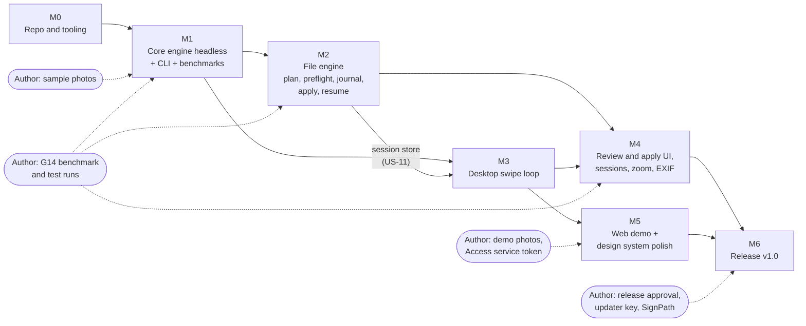

# Roadmap

Status: draft, 24 Nov 2026. No dates: milestones are a sequence, each starts when its dependencies meet their exit criteria. GitHub Milestones mirror M0–M6. Scope is from [SPEC.md](SPEC.md); stories are in [stories.md](stories.md); budgets and invariants in [nfr.md](nfr.md) and [design/file-engine.md](design/file-engine.md).

Order principle: prove the risky parts headless first (performance in M1, data safety in M2), then build the UI on top.

## Sequence and dependencies

M3 can start once M1 is done, building the UI against `DemoBackend`: it needs the scan and preview pipeline, not the apply engine. But M3 cannot exit before M2's session store and decision log (US-10, US-11) are done, because autosave and the shared reducer depend on them. M4 needs both M2 and M3 in full.

Key numbers used in exit criteria below are repeated from [nfr.md](nfr.md) and [benchmarks.md](benchmarks.md), all estimates to be confirmed by M1: first photo ≤ 1.5 s from a UHS-I SD card, next prefetched photo ≤ 50 ms at p95, memory ≤ 1 GB, scan of 3,000 files ≤ 15 s on SD.

## Milestones

### M0 — Repo and tooling

- **Goal:** a repo where an agent can land a tested change safely from the first commit. This is the milestone `CLAUDE.md` refers to: when it exits, the target commands in `CLAUDE.md` are real.
- **Already done before M0:** ADRs 0000–0020 are written ([docs/adr/](adr/README.md)); M0 builds on them and adds new ones only for new decisions.
- **Scope:**
  - pnpm + Cargo workspaces with the layout `crates/core` (`culla-core`, pure, no I/O), `crates/adapters` (`culla-adapters`, Windows fs ops, parsers, decode, SQLite), `src-tauri` (wiring only), `src`; empty but building.
  - CI on PRs: Biome, `tsc`, rustfmt, clippy `-D warnings`, `cargo deny`, `cargo test`, Vitest; a `windows-latest` job; action SHAs pinned or `actions.lock`; `permissions: {}` by default; CodeQL; Scorecard; Dependabot (grouped, 3 ecosystems); pnpm supply-chain settings.
  - `CLAUDE.md` with real commands, `.claude/settings.json` (format hook, fast Stop check, deny rules, protected paths), read-only reviewer agents, skills (`add-command`, `new-adr`, `release`).
  - Workspace members also include `crates/cli` (`culla-cli`, binary `culla`) and `crates/bench` (`culla-bench`), empty ([ADR 0020](adr/0020-headless-cli-and-bench-crates.md)).
  - clippy `disallowed-methods` for `std::fs::remove_*` and raw `std::fs::rename`, enforced on `culla-core`, `culla-adapters`, `culla-cli` and `src-tauri` only (test code and `culla-bench` are outside it and work in temp dirs); `#![forbid(unsafe_code)]` in core; `cargo deny` bans `tauri` in the core and adapters trees and any I/O crate in core.
  - release-please with Conventional Commits; MIT `LICENSE` (GPL-3.0-only since ADR 0026); README stub.
  - A CI check that fails when any tracked file contains merge-conflict markers (`<<<<<<<`, `=======` on its own line, `>>>>>>>`).
  - Fixture generator skeleton (`cargo xtask fixtures`) and the VHDX mount script for Windows CI ([testing.md](testing.md) section 5.1).
  - Spike: detach a mounted VHDX on a hosted runner while a test process holds open handles on it (needed for the card-pull test). Fallbacks if it fails: `mountvol <L>: /p`, or the `setup-dev-drive` action.
- **Exit criteria:**
  - A trivial PR goes green on all jobs, Linux and Windows.
  - A PR that adds `std::fs::remove_file` or `std::fs::rename` outside the audited adapter module fails CI.
  - `CLAUDE.md` commands section no longer says "target"; every listed command runs.
  - The Windows job mounts an exFAT VHDX and runs a placeholder test on it.
  - The VHDX detach spike is done and the working method is recorded in `scripts/ci/README.md`.
  - All commands in [testing.md](testing.md) section 11 run (even if they test nothing yet).

### M1 — Core engine headless + CLI + benchmarks

- **Goal:** scan, group and preview a real card fast enough, proven by numbers on the G14.
- **Scope:**
  - Streamed recursive scan, grouping (JPEG, NEF, sidecars incl. `NKSC_PARAM`), exclusions (`_rejected/`, destination inside source), unknown-extension list.
  - Volume serial + relative path identity; with it, the PC time-zone lookup for the file-time fallback (ADR 0028). Core rules (`culla_core::volume`) and the read-only Win32 lookups (`culla_adapters::winfs`) are in (slice 4); the session store that uses the key comes with M2.
  - EXIF pass (`kamadak-exif`): DateTimeOriginal, orientation, lens fallback; capture-time sort.
  - Own TIFF/IFD walker for NEF previews; fuzz targets running nightly.
  - Preview pipeline: turbojpeg scaled decode, resize, orientation, encode; reader threads separate from decode workers; prefetch; in-memory LRU; disk cache. No mmap on removable media. The decode (slice 5) and the reader thread, decode workers, prefetch window, in-memory cache and memory budgets (slice 7: `culla_core::prefetch`, `culla_adapters::pipeline`) are in; the disk cache is next. Defaults provisional until B-09 and B-10 (SPEC §10).
  - Decode and scan I/O in `culla-adapters`; grouping, ordering and the IFD walker's parsing logic in `culla-core`, fed by positioned reads from `culla-adapters` (ADR 0025).
  - Headless CLI `culla scan`, `culla preview` (`crates/cli`) and `culla-bench` (`crates/bench`), per [ADR 0020](adr/0020-headless-cli-and-bench-crates.md). `culla scan` is in (slice 6): read-only, text or `--json`; its exit codes, off-Windows behaviour, JSON fields (unstable until M2) and std-only parsing are provisional, open in [SPEC §10](SPEC.md#10-open-questions). `culla preview` is in (slice 7): per-step timings, text only, read-only (writes nothing but stdout and stderr); provisional too. `culla-bench` is in (slice 8): `scan`, `preview`, `swipe`, `io-baseline` and `report`, text or JSON, read-only, writing nothing but stdout; how to run the campaign on Windows is in [benchmarks.md](benchmarks.md) §7; its defaults are provisional (SPEC §10).
  - Scan and preview benchmark campaign (B-01 to B-11, B-15, B-16) per [benchmarks.md](benchmarks.md).
- **Exit criteria:**
  - Stories US-01 to US-09 pass, except US-09's criterion that the session and the cache are found again under another letter: the key is in M1 (`culla_core::volume`), and the criterion closes with M2's session store (and the VHDX remount test).
  - Every M1 benchmark in [benchmarks.md](benchmarks.md) has a recorded result on H-2 (UHS-I SD) and passes, or has an ADR that changes the design or the budget. In particular (all est.): first photo ≤ 1.5 s (B-01), scan of 3,000 files with EXIF ≤ 15 s (B-02 + B-03), next prefetched photo ≤ 50 ms at p95 (B-09), peak memory ≤ 1 GB while swiping (B-15).
  - ADRs recorded for preview source (camera JPEG vs NEF embedded), thread counts, prefetch window and LRU size.
  - Fuzz targets ran for at least a week of nightlies without an open crash.
- **Author:** provide 5–10 real sample files from her Nikon Z bodies ([SPEC.md](SPEC.md) section 2); run the benchmarks on the G14 with a real SD card.

### M2 — File engine proven by tests

- **Goal:** an apply that cannot lose or overwrite a photo, shown by tests rather than by argument.
- **Scope:**
  - Session store and decision event log in SQLite (one database per source); reconcile on open (missing, new files). The pure decision log is in (slice A: `culla_core::decisions`, events, fold, undo and redo, reconcile clears, the text form and the golden fixtures); the SQLite store and reconcile on open come later in M2.
  - `plan()`: reject to `_rejected/` mirrored, keep move or copy, RAW follows toggle, sidecars, group-consistent collision suffixes. In (slice B: `culla_core::plan`, pure over a snapshot of the target roots, with property tests on its invariants).
  - Preflight: writable source, free space, destination not inside `_rejected`, path length, locks, symlinks and junctions. The rules are in (slice C: `culla_core::preflight`, pure over a snapshot of facts); the adapter that gathers the facts comes with the apply adapters.
  - Journal and apply (logic in `culla-core`, fs ops in `culla-adapters`): same-volume no-replace rename through the checked handle (ADR 0022; existing target is a hard error); cross-volume copy, fsync, re-read and hash of destination and source, rename, then removal of the source through the single audited function (which may only remove verified cross-volume sources and Culla's own `*.culla-partial` files); copy with `create_new` and mtime kept; sharing-violation retry. The pure part is in (slice D: `culla_core::journal`, states, legal transitions, the recovery table and one executor for apply and resume over `Disk` and `Store` ports, with a seeded crash loop on a fake disk); the `winfs` steps and the SQLite journal come next.
  - Sidecars follow the file they describe (`X.NEF.xmp`, and bare `X.xmp` and `X.pp3`, follow the NEF, ADR 0023), with the collision suffix inside sidecar names.
  - "Nothing touches the disk before Apply" tests ([testing.md](testing.md) section 4).
  - Resume (roll forward) after crash or card pull. Plain-text log file of operations. Resume logic in (slice D, with apply). The log's rendering is in (`culla_core::applylog`, file-engine §9.8: header, one line per operation with its state and H1, alarms first, a summary; untrusted names escaped); the file itself is written with the adapters.
  - CLI: `culla plan`, `culla apply`, `culla resume` (used by the crash tests). `culla plan` is in (slice E): a read-only dry run that scans, folds a decision log from a file, builds the plan and runs preflight on facts gathered read-only (`culla_adapters::facts`), leaving the facts it cannot look up yet unknown so preflight fails closed on them (free space, the sync root, off Windows the volumes), and listing apart what it does not check at all (locks, so P12 never warns; on Windows a second mounted volume with the source's or destination's serial); a destination inside the source is scanned and numbered as `culla scan` does, and its groups are left out of the plan; text or `--json` (`"schema": "unstable"`); flags, group ids and exit codes provisional (SPEC §10). `apply` and `resume` come with the `winfs` steps and the SQLite journal.
  - Apply benchmark campaign (B-12 to B-14, B-15 during apply) per [benchmarks.md](benchmarks.md).
- **Exit criteria:**
  - Stories US-10 (Rust side), US-11 to US-20 and US-41 pass.
  - Property tests on `plan()` and the decision log green at 10,000 cases nightly; golden fixtures in place.
  - Windows integration suite green, including cross-volume on a mounted VHDX, read-only volume, full volume, junctions, long paths.
  - Crash loop (process kill, 50 iterations) and volume-detach scenario green for a week of nightlies, with the end state per op kind and roll-forward from `verified` asserted ([testing.md](testing.md) section 6).
  - Apply benchmarks B-12 to B-14 recorded on H-2 and pass, or have an ADR; peak memory during apply ≤ 1 GB (est.). Hash choice recorded as an ADR.
  - Coverage gate on file engine modules met ([testing.md](testing.md) section 10).
  - Manual checklist items for apply and card pull done once on the G14.
- **Author:** one real apply and card-pull run on the G14 with a copy of a real card.

### M3 — Desktop swipe loop

- **Goal:** cull a real folder end to end by keyboard and trackpad, with decisions saved.
- **Scope:**
  - Tauri 2 shell, one capability, no fs plugin, `AppManifest::commands`, strict CSP.
  - `culla://preview/<id>` async URI scheme from the in-memory LRU.
  - `Backend` interface with `TauriBackend` and `DemoBackend`; generated bindings.
  - Start screen: "Choose a folder" and the recent folders with their session status; choosing one starts sorting at once, with the defaults (US-21, US-44 v1 part; ADR 0029). Move or copy and the destination are chosen on review. Detected drives, the found-photos preview and drag and drop are v2.
  - Swipe screen: Motion card (`drag="x"`, threshold on offset and velocity), at most 3 cards mounted, `img.decode()` before entry, Night theme, progress bar, decision badge, visible Keep and Reject buttons (WCAG 2.5.7).
  - Keyboard map from [SPEC.md](SPEC.md) section 4.1 except zoom (Z, Space) and EXIF overlay (I): decide, navigate, N, F, U, Ctrl+Z, Ctrl+Shift+Z, ?, Esc. Key repeat ignored. Shake and toast on a decided photo. End-of-list card.
  - TS reducer over the event log, checked against the golden fixtures from M2; autosaved to the backend (M2 session store) on each event.
  - `prefers-reduced-motion` support. `tauri-driver` smoke test.
- **Exit criteria:**
  - Stories US-21 to US-33 and US-42 pass (Vitest, Playwright on the demo build, smoke on Windows), and the TS half of the US-10 golden tests is green.
  - Next-photo latency in the webview (key press to `img.decode()` resolved) measured on the G14: ≤ 50 ms at p95 (est.) when prefetched. First photo ≤ 1.5 s (est.) from a UHS-I card. Peak memory of the app ≤ 1 GB (est.).
  - axe reports no serious or critical issue on the swipe screen; keyboard-only flow covered by Playwright.
- **Author:** cull a real card on the G14 and sign off on the feel of the swipe.

### M4 — Review and apply UI, sessions, zoom, EXIF

- **Goal:** the full v1 loop: start or resume, swipe, review, apply, report.
- **Entry criteria:** M4 does not start until US-34 to US-40 in [stories.md](stories.md) have full Given/When/Then acceptance criteria, reviewed like any other doc PR.
- **Scope:**
  - Review screen: counts, kept and rejected grids (click to jump back), full operation plan, preflight results, time and size estimate (calibrated by B-13), unknown files list, confirm dialog with counts.
  - Apply screen: per-file progress, pause, cancel after the current file, report, log file.
  - Resume an interrupted apply on start. Resume a session (or start fresh) on the start screen, including after a drive letter change.
  - Zoom to 100 % (Z toggle, hold Space, pan with arrows) with the full image on demand.
  - EXIF overlay (I).
- **Exit criteria:**
  - Stories US-34 to US-40 pass.
  - Manual checklist in [testing.md](testing.md) section 8 done once in full.
  - Colour check on the G14 OLED done (sRGB and AdobeRGB).
- **Author:** run the manual checklist on the G14.

### M5 — Web demo and design system polish

- **Goal:** a web demo at `culla.margauxfaurie.com` that shows the same UI (behind the site's Cloudflare Access policy until the portfolio opens, public after), and an app that matches the Portfolio Design System.
- **Scope:**
  - Demo build with about 25 author photos (1600 px, AVIF/WebP, EXIF in JSON), simulated apply; optional read-only "your folder" mode (`webkitdirectory`).
  - Hosting on Cloudflare Workers static assets at `culla.margauxfaurie.com`, gated by the site's Cloudflare Access policy until the portfolio opens.
  - While the demo is gated, Playwright against the deployed URL authenticates with a Cloudflare Access service token stored as a CI secret (added in M5, with a security review of that change).
  - Tokens copied into `src/styles/tokens.css` with the source version; `keep` colour contrast checked on Night and cream; additions (`keep`, Night for photo screens) proposed back to the design system.
  - Loading dots, copy pass in the system voice, motion review.
  - Download and install page at `/install` in the demo build, rendering [install.md](install.md) (in since 28 Nov 2026; it says plainly that there is no release yet, and shows the 30 s demo video with its transcript).
  - Demo video (75–85 s, captions in English and French) filmed from the demo build with a Playwright script, per [videos.md](videos.md), published on the install page; a short GIF cut for the README. A 30 s cut is already published there (Margaux, 28 Nov 2026, [videos.md](videos.md#demo-video-published)).
- **Exit criteria:**
  - Demo deployed; Playwright and axe green against the deployed URL in Chromium, Firefox and WebKit, gated or public.
  - No network request from the demo other than its own assets (checked in Playwright).
  - Design review against the Portfolio Design System done.
  - Demo video and its caption files ready. The published demo video uses the author's own photographs, chosen by her (28 Nov 2026), re-encoded so no EXIF survives, with no identifiable people; the demo app itself still uses placeholders until its photos are chosen.
- **Author:** choose and provide the demo photos (GPS and serial stripped); create the Cloudflare Access service token for CI and add it as a repository secret; approve the design system additions; approve the demo video script, record the voice-over or approve a text-to-speech voice (or choose captions only), and publish the video; open the demo to the public when the portfolio goes public.

### M6 — Release v1.0

- **Goal:** a first public release someone else can install and trust.
- **Scope:**
  - NSIS per-user installer via `tauri-action` as a draft GitHub Release; `tauri-plugin-updater` with its signing key (backed up) and `latest.json`.
  - README with GIF, SmartScreen note, Lightroom warning; CONTRIBUTING, a code of conduct if adopted (SPEC §10), SECURITY.md, PRIVACY.md, third-party licences file; `docs/releasing.md`.
  - Third-party notices in the installer, crediting the Independent JPEG Group and carrying libjpeg-turbo's BSD and Zlib notices ([architecture.md](architecture.md) section 5.2, preview pipeline).
  - NASM in CI and release builds, so libjpeg-turbo is built with SIMD, with a check that fails the build when it is missing.
  - Code signing policy section in the README, then the SignPath Foundation application (it requires a released project).
  - Blog enablement guide material gathered from the ADRs ([research/practices.md](research/practices.md) section 4).
  - Uninstaller option "remove my Culla data" ([SPEC.md](SPEC.md) section 5.1), US-43.
  - Final benchmark re-run on H-2.
  - Install guide [install.md](install.md) checked against the release candidate: asset name, `SHA256SUMS`, build attestations, SmartScreen wording, installer pages, uninstall option; "(from the first release)" marks removed.
  - Release assets: installer, `SHA256SUMS` and build provenance attestations (SPEC §10).
  - Install video (about 45 s, captions in English and French) filmed on a clean Windows 11 account with the release candidate, per [videos.md](videos.md), and published on the demo site's install page; the page's release entry (`src/install/status.ts`) filled in.
- **Exit criteria:**
  - Release candidate installed on a clean Windows 11 account without admin rights; updater moves it to a newer test build.
  - Full manual checklist passed on the release candidate.
  - Installer test ([testing.md](testing.md) section 5.3) green: data kept or removed as chosen, photos never touched (US-43).
  - OpenSSF Scorecard checks targeted in [research/practices.md](research/practices.md) section 2 are green or explained.
  - Install guide matches the published release; install video published.
  - v1.0 published.
- **Author:** generate and store the updater signing key; approve and publish the release; submit the SignPath application; write the blog post; add the checksum and attestation steps to the release workflow (protected path); approve the install video, record its voice-over or approve a text-to-speech voice (or choose captions only), and publish it.

After v1.0: winget manifest, then the v2 candidates in [SPEC.md](SPEC.md) section 8.

## Author tasks in one place

| Task | Needed by |
|---|---|
| Decide the minimum WebView2 version ([SPEC.md](SPEC.md) section 10) | M3 start |
| Provide 5–10 real sample files | M1 start |
| Run benchmarks on the G14 with a real UHS-I SD card | M1 exit |
| Real apply and card-pull run on the G14 | M2 exit |
| Cull a real card and sign off on the swipe feel | M3 exit |
| Run the full manual checklist | M4 exit, M6 exit |
| Choose demo photos, create the Cloudflare Access service token and CI secret for `culla.margauxfaurie.com`, approve design system additions | M5 |
| Remove the Access gate on the demo when the portfolio goes public | Portfolio launch |
| Decide the WebView2 installer mode (bootstrapper download or embedded) ([SPEC.md](SPEC.md) section 10) | M6 start |
| Decide the video proposals: lengths, bilingual captions, voice-over or captions only, extra places beyond the demo site's install page ([SPEC.md](SPEC.md) section 10) | M5 start |
| Approve the demo video script, record the voice-over or approve a text-to-speech voice, publish the demo video ([videos.md](videos.md)) | M5 |
| Decide the install folder versus the data folder, and the release assets (`SHA256SUMS`, attestations) ([SPEC.md](SPEC.md) section 10) | M6 start |
| Add checksums and build attestations to the release workflow (protected path) | M6 |
| Approve the install video, record its voice-over or approve a text-to-speech voice, publish it on the demo site's install page ([videos.md](videos.md)) | M6 |
| Updater key custody, release approval, SignPath application | M6 |
