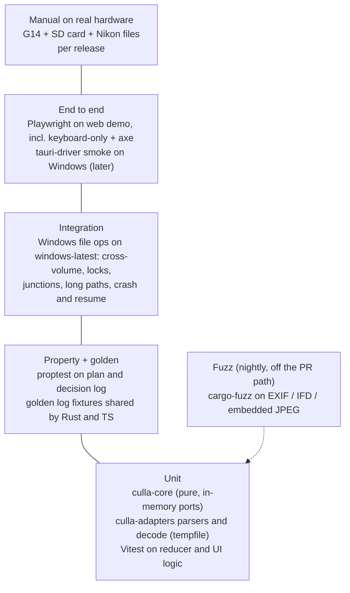

# Test strategy

Status: draft, 24 Nov 2026. Scope: v1 (Windows). Requirements live in [nfr.md](nfr.md) (`NFR-PERF-xx`, `NFR-REL-xx`, `NFR-A11Y-xx`). File engine invariants live in [design/file-engine.md](design/file-engine.md) (`INV-xx`). Behaviour lives in [stories.md](stories.md) (`US-xx`). This document says how each of them is checked.

## 1. Principles

- The file engine is where data can be lost, so it gets most of the tests. A bug in the UI costs a re-swipe. A bug in apply costs a photo.
- Every `INV-xx` has at least one property test or one Windows integration test that names it in the test name or a doc comment.
- Crate split decides where a test runs. `crates/core` (package `culla-core`) is pure, with no I/O, so its tests run anywhere and use in-memory ports. `crates/adapters` (package `culla-adapters`) holds Windows file ops, parsers, decode and SQLite; its file-op tests run on `windows-latest`. `src-tauri` is wiring only and gets a smoke test, not logic tests.
- Tests run on Linux where possible (fast, cheap) and on `windows-latest` where Windows behaviour matters (rename semantics, locks, volumes, long paths, junctions).
- A test that needs real hardware is in the manual checklist (section 8), not skipped silently in CI.
- A bug fix starts with a failing test. A fuzz crash becomes a regression test.
- Scope of the removal and rename rules: clippy `disallowed-methods` (`std::fs::remove_*`, raw `std::fs::rename`) is enforced on `culla-core`, `culla-adapters`, `culla-cli` and `src-tauri` only. Test code, `xtask` and `culla-bench` are outside the rule, because they must create and clean up scratch data. They only ever do so inside temporary directories (`tempfile::TempDir`), never in a user folder ([ADR 0020](adr/0020-headless-cli-and-bench-crates.md)).

## 2. Pyramid

| Layer | Tool | Where it runs | What it covers | Trigger |
|---|---|---|---|---|
| Unit (Rust, core) | `cargo test -p culla-core`, `insta` for plan snapshots, in-memory `FileSystem` port | anywhere | grouping, sidecar matching, plan, preflight rules, journal state machine, resume logic, session reconcile, decision log | every PR |
| Unit (Rust, adapters) | `cargo test -p culla-adapters`, `tempfile` | Linux + Windows | EXIF fields, IFD walker, preview pipeline, SQLite store, scan over a real tree | every PR |
| Property | `proptest` | Linux | plan building, decision log fold (section 3) | every PR (default case count), nightly (high case count) |
| Golden | JSONL fixtures in `testdata/event-log/` | Linux (Rust and Node) | Rust and TS reducers give the same state for the same log | every PR |
| Unit (TS) | Vitest, against `DemoBackend` | Linux | reducer, keyboard map, key-repeat filter, swipe threshold logic, filters, end-of-list | every PR |
| Integration (Windows) | `cargo test -p culla-adapters --features windows-it` on `windows-latest` | Windows | nothing-before-Apply checks (section 4), real file ops (section 5), crash and resume (section 6) | every PR touching `crates/core`, `crates/adapters`, `crates/cli` or `src-tauri`, and nightly |
| End to end | Playwright + `@axe-core/playwright` on the demo build | Linux (Chromium, plus Firefox and WebKit for the demo) | swipe loop, keyboard-only flows, click-only flow with the Keep and Reject buttons, review screen, a11y | every PR touching `src/` |
| Installer | NSIS silent install and uninstall on `windows-latest` | Windows | per-user install, "remove my Culla data" option (section 5.3) | from M6, on release PRs |
| Desktop smoke | `tauri-driver` on Windows | Windows | app starts, opens a fixture folder, shows a photo through `culla://` | from M3, nightly |
| Fuzz | `cargo-fuzz` (nightly toolchain, libFuzzer) | Linux | parsers (section 7) | nightly |
| Manual | checklist in section 8 | G14 | real media, colour, feel | before each release |

## 3. Property tests

### 3.1 Plan building (`plan()`)

Generators: a random folder tree (depth 0–4, Unicode and mixed-case names), random groups (JPEG only, NEF only, pair, pair with each sidecar kind, `NKSC_PARAM/*.nksc`), random decisions (undecided, kept, rejected), random session options (keep = move or copy, RAW follows on or off, destination inside or outside the source), and pre-existing files at the destination to force collisions.

Properties, each linked to its invariant in [design/file-engine.md](design/file-engine.md):

| Property | INV family |
|---|---|
| No two operations share a destination path. | no overwrite |
| No destination equals an existing file. | no overwrite |
| Every destination is under the chosen destination root or under `<source>/_rejected/`. | path containment |
| All members of a group get the same target stem (same suffix `_1`, `_2`…). | group consistency |
| Undecided groups produce no operation. | undecided untouched |
| With RAW follows off, no operation touches a NEF that has a JPEG primary. | RAW pairing |
| Each sidecar follows the file it describes ([SPEC.md](SPEC.md) section 3.1): `X.NEF.xmp` and `NKSC_PARAM/X.NEF.nksc` follow the NEF, `X.JPG.xmp` and `NKSC_PARAM/X.JPG.nksc` follow the JPEG, `X.xmp` and `X.pp3` follow the group's primary. With RAW follows off, the NEF's sidecars stay with the NEF. | group consistency |
| A collision suffix is applied inside sidecar names too (`X_1.NEF.xmp`, `NKSC_PARAM/X_1.NEF.nksc`). | group consistency |
| Every removal in a plan targets either a verified cross-volume source or a Culla `*.culla-partial` file. | never delete |
| Subfolder structure is mirrored (relative path preserved). | path containment |
| `plan()` is deterministic: same input, same plan. | determinism |

Shrunk failures are saved by proptest in `proptest-regressions/` and committed.

### 3.2 Decision log

Generators: random sequences of decide, undo-current (`U`), global undo (Ctrl+Z) and redo (Ctrl+Shift+Z) over a small set of groups.

Properties:
- The state after `fold(log)` equals the state from a naive model (a map updated step by step).
- Undo followed by redo returns the same state.
- A new decision after undo clears the redo stack.
- Folding any prefix of the log gives a valid state (this is what makes resume after a crash safe).
- Decide on a group that already has a decision is rejected (the SPEC rule "undo first"), and the log is unchanged.

### 3.3 Golden fixtures shared by Rust and TS

- Files: `testdata/event-log/<case>.jsonl` (input events) and `<case>.expected.json` (derived state and undo/redo cursor).
- The event schema is the one defined in [design/file-engine.md](design/file-engine.md), exported from Rust to TS. This doc does not define it.
- `cargo test` and Vitest both load every case. A case that passes in one language and fails in the other fails CI.
- Timing: the Rust side and the fixtures land in M2 (US-10). The TS reducer, and so the Vitest half of the golden tests, lands in M3 (US-27).
- A proptest run in Rust can write new cases (`cargo xtask golden --from-proptest`), so the TS reducer is checked against generated logs too, not only hand-written ones.

## 4. Nothing touches the disk before Apply

This is the first invariant in `CLAUDE.md` and [ADR 0003](adr/0003-stage-decisions-in-a-queue-until-explicit-apply.md). It is tested at three levels.

| Test | Where | Assertion |
|---|---|---|
| Recording `FileSystem` port | `culla-core`, anywhere | A `RecordingFs` wraps the in-memory port and logs every call. Drive a whole session through it: scan, EXIF pass, decisions with undo and redo, filters, review (plan building), preflight. The log contains zero mutating calls (create, write, rename, remove, set-times, set-attributes) on any path under the source or the destination. Mutating calls happen only after the explicit `apply` call. |
| Source tree hash | `culla-adapters`, Windows integration | Hash every file and record every mtime and attribute under the source (on the exFAT VHDX) and the destination before a session. Run scan, preview generation, decisions, review and preflight through the real adapters, then close the app without applying. Hashes, mtimes, attributes and the file list are unchanged. Also after a session that ends with "start fresh". |
| Write locations | `culla-adapters`, Windows integration | The data root is injected through config, not read from the environment (`SHGetKnownFolderPath` ignores a changed `%LOCALAPPDATA%`), see [architecture.md](architecture.md) section 8.7. First assert that the composition root passes the injected root to every adapter that writes (session store, cache, log), and that no adapter resolves a known folder itself. Then inject a temp dir as the root. After a full session without Apply, every file created or modified on the test volumes (`C:` workspace, `T:`, `U:`) is under the injected root (`sessions`, `cache`, `logs`). Nothing is written on the card, in the source or in the destination (no session database, no thumbnails, no temp files). Checked by diffing a full listing of the test volumes before and after. |

## 5. Windows integration tests

Run on `windows-latest`. They use the real `culla-adapters` file ops, not the in-memory `FileSystem` port.

### 5.1 Getting a second volume on a GitHub-hosted runner

The cross-volume path (copy, hash, fsync, rename, delete source) only runs when source and destination are on different volumes. Options checked:

| Option | Separate volume? | Verdict |
|---|---|---|
| `subst X: <dir>` | No. Same device and same volume serial, so `rename` succeeds and the copy path is never hit. | Use only to test that identity ignores drive letters. |
| `D:` temp disk | Present on some standard images, absent on others (larger runners, some newer images). | Do not rely on it. |
| VHDX created and mounted in the job | Yes. Real volume, own serial, any file system. | **Use this.** |

How: a script `scripts/ci/mount-test-volume.ps1` creates a small VHDX with `diskpart` (`create vdisk`, `attach vdisk`, `create partition primary`, `format quick fs=<fs>`, `assign letter=<L>`). The runner has admin rights. `diskpart` avoids a dependency on the Hyper-V `New-VHD` cmdlet. The `samypr100/setup-dev-drive` action does the same job and supports `NTFS`, `exFAT`, `FAT32` and `ReFS` on `windows-2022` and later; it is an option if the script proves flaky (pin by SHA).

Volumes per job:
- `T:` exFAT, 256 MB, stands in for an SD card (FAT-family timestamps, no ACLs).
- `U:` NTFS, 64 MB, small on purpose so the free-space preflight can be hit.
- The runner's `C:` workspace (NTFS) as the "internal disk".

The card-pull case uses `Dismount-DiskImage` or `diskpart detach vdisk` in the middle of an apply. The write-protect case uses `diskpart attributes volume set readonly`.

**M0 spike:** detaching a VHDX while the test process still holds open handles on it may be refused or may block. Prove in M0 that the detach works mid-apply on a hosted runner, with handles open. Fallbacks if it does not: `mountvol <L>: /p` (removes the mount point and takes the volume offline), or the `setup-dev-drive` action's volume handling. Record the method that works in `scripts/ci/README.md`.

### 5.2 Cases

| Case | Expectation | Links |
|---|---|---|
| Same-volume move | single rename, no copy, source gone, target present | INV, NFR-REL |
| Cross-volume move C: → T: and T: → C: | partial file, hash of the source during the copy, fsync, destination read back with `FILE_FLAG_NO_BUFFERING`, source re-read with `FILE_FLAG_NO_BUFFERING` for a second hash, all three hashes equal, rename, then source removal; mtime kept | INV, NFR-REL |
| Verify reads bypass the OS cache | the adapter opens both the destination (hash 2) and the source (hash 3) for verify with `FILE_FLAG_NO_BUFFERING`, asserted through a flag-recording wrapper around the open call. Without it on the source, the standby cache would answer and hash 3 would only repeat hash 1. | INV never delete, NFR-REL-04 |
| Unbuffered reads with odd sizes | verify on files of 1 byte, sector size − 1, sector size + 1 and a typical photo size, on exFAT and NTFS VHDX volumes: the aligned read loop and the final partial sector produce the right hash, no `ERROR_INVALID_PARAMETER` | NFR-REL-04 |
| Read-back mismatch (test adapter flips a byte in the destination after fsync, or the source changes during the copy) | verify fails, source is kept, the op is marked failed, the bad partial is cleaned up | INV never delete |
| `remove_verified`, direct calls | refuses a path that is not a journalled, verified cross-volume source and not a Culla `*.culla-partial`: an unverified source, a kept original, a file in `_rejected/`, a user file named `*.culla-partial` outside the journal, a junction target | INV never delete |
| Copy across volumes | source kept, mtime kept (±2 s on exFAT) | INV |
| Target appears between plan and execute (same volume) | `MoveFileExW` is called with only `MOVEFILE_WRITE_THROUGH` (no replace-existing, no copy-allowed); the existing target is a hard error, the op is marked failed, the existing file is byte-identical afterwards | INV no overwrite |
| Target appears between plan and execute (cross volume or copy, at the final rename of the partial) | same hard error; the partial is removed through `remove_verified`, the op ends `failed`, the source is kept, and the file that appeared is byte-identical afterwards | INV no overwrite, never delete |
| Rename across volumes with the checked rename | fails with `ERROR_NOT_SAME_DEVICE` (no silent copy, since copy-allowed is not set); the engine takes the verified copy path instead | INV no overwrite |
| Raw `std::fs::rename` not used | enforced by clippy `disallowed-methods`; the checked rename is the only path | INV no overwrite |
| `create_new` on copy target | fails if target exists | INV no overwrite |
| File held open with no sharing by another process | retries with backoff, then marked failed, apply continues | NFR-REL |
| Transient sharing violation (handle released after 300 ms) | retry succeeds | NFR-REL |
| Read-only file attribute, read-only volume | caught by preflight, nothing executes | NFR-REL |
| Not enough free space on `U:` | caught by preflight for copy and for cross-volume move | NFR-REL |
| Junction and symlink inside the source (`mklink /J`, `mklink`) | not followed by scan, refused by preflight | INV path containment |
| Path longer than 260 characters after mirroring | works with `\\?\` | NFR-REL |
| Unicode and mixed-case names, `DSC_0001.JPG` + `dsc_0001.nef` | paired | INV |
| Same basename in two DCIM folders | not paired across folders | INV |
| Destination inside the source, `_rejected/` present | both excluded from the rescan | INV |
| Volume remounted under another letter | session and cache found by volume serial | NFR-REL |
| No `remove_*` outside `remove_verified` | enforced by clippy `disallowed-methods` on `culla-core`, `culla-adapters`, `culla-cli` and `src-tauri`, plus a CI grep that `remove_verified` is the only caller of the underlying call | INV never delete |
| `X.NEF.xmp` with RAW follows off | NEF and its `.NEF.xmp` and `.nksc` stay; JPEG, `X.JPG.xmp` and `NKSC_PARAM/X.JPG.nksc` move; `X.xmp` and `X.pp3` follow the primary (the JPEG) | INV group consistency |

### 5.3 Installer and uninstaller (from M6)

`scripts/ci/installer-test.ps1` installs the NSIS build silently for the current user, seeds `%LOCALAPPDATA%\Culla` with a fixture session database, cache entries and a log, next to a fixture source with `_rejected/` and a destination, then:
- uninstalls with "remove my Culla data" off: `%LOCALAPPDATA%\Culla` is kept, the app files are gone;
- reinstalls and uninstalls with the option on: `%LOCALAPPDATA%\Culla` is gone;
- in both cases the fixture source, its `_rejected/` and the destination are byte-identical to before (the uninstaller never touches photos).

The NSIS option name used for the silent run is to confirm when the installer hook is written.

## 6. Interrupted apply and crash simulation

Four levels, from cheap to realistic.

1. **Fault injection in core (anywhere).** `FaultyFs` (core `FileSystem` port) and an in-memory `Journal` port, both in `culla-core`. The fault fires at a chosen step of a chosen op: after the partial copy, before fsync, after the hash check, after rename, before the source removal, during the journal write (the write is lost or half-applied). The test keeps only what the in-memory journal had durably committed, drops everything else, and runs resume. A proptest variant picks the op and step at random. No SQLite and no disk here.
2. **Journal persistence (`culla-adapters`).** The SQLite journal is closed abruptly (connection dropped without commit, process killed between statements) and reopened. Every committed row reads back with its state; an uncommitted transition is not visible. The SQLite settings are pending: WAL with `synchronous=FULL` is proposed in [ADR 0009](adr/0009-sqlite-per-source-for-sessions-and-journal.md) and NFR-REL-10, to confirm in [design/file-engine.md](design/file-engine.md). Once confirmed, the chosen settings are asserted on open.
3. **Process kill (Windows).** The test spawns `culla apply` ([ADR 0020](adr/0020-headless-cli-and-bench-crates.md), from M2) on a fixture plan and kills it with `TerminateProcess` after a random delay. Repeat 50 times per nightly run (5 per PR). Then run `culla resume`.
4. **Volume loss (Windows).** Detach the `T:` VHDX during a cross-volume apply (method proven in the M0 spike, section 5.1). Reattach under a different letter. Resume.

### 6.1 Expected end state per op kind

After resume has finished, each op is `done` or `failed` ([SPEC.md](SPEC.md) section 5.2 states). The checker asserts, per op kind:

| Op kind | `done` | `failed` |
|---|---|---|
| Keep, move, same volume | at destination only, original hash | at source only, original hash |
| Keep, move, cross volume | at destination only, original hash; source removed by `remove_verified` | at source only, original hash; no partial left (removed through `remove_verified`), including when the target appeared at the final rename |
| Keep, copy (same or cross volume) | at **both** source and destination, identical hashes; source mtime and attributes unchanged | at source only; no partial left (removed through `remove_verified`), including when the target appeared at the final rename |
| Reject, move to `<source>/_rejected/` (always same volume as the source) | in `_rejected/` only, original hash | at source only, original hash |

For every op, in every case:
- the file is never missing from both places, and never present at both places for a move;
- no `*.culla-partial` file is left;
- no file outside the plan was touched (hash and listing of both trees before and after);
- running resume a second time changes nothing (idempotent).

### 6.2 Roll forward past `verified`

- An op whose journal row was `verified` at the time of the crash ends `done` after resume: the rename into place and, for a cross-volume move, the source removal are completed. It is never rolled back and never re-copied (asserted with the recording port: no copy call for that op during resume).
- An op that was `pending` or `copying` is started again from its beginning; its leftover partial is removed through `remove_verified`.
- If the destination is not what the journal expects (missing, or a different hash), the op ends `failed` and the source is kept.
- If the final target name was taken by another file in the meantime, the partial is removed through `remove_verified` and the op ends `failed` (the same rule as during a normal apply).

The exact transitions and resume rules are owned by [design/file-engine.md](design/file-engine.md); the checker reads them from there.

## 7. Fuzzing

- Targets in `fuzz/` (cargo-fuzz, `arbitrary` for structure-aware input):
  1. `tiff_ifd_walk`: IFD0, SubIFDs, MakerNote PreviewIFD, offsets and counts out of range, loops between IFDs.
  2. `nef_preview_extract`: picks the largest embedded JPEG; must never read past the buffer or allocate more than the configured limit.
  3. `exif_fields`: the fields Culla reads through `kamadak-exif` (DateTimeOriginal, Orientation, LensModel, LensSpecification).
  4. `jpeg_header`: the decode-size guard in front of turbojpeg (decompression bombs).
- Seed corpus: the synthetic fixtures (section 9) plus the stripped real samples.
- Schedule: nightly GitHub Actions job, 10 minutes per target, corpus cached between runs. `practices.md` suggested weekly; nightly is cheap at this size.
- A crash opens an issue, and the minimized input is added to `testdata/fuzz-regressions/` with a unit test that runs on every PR.
- Pass bar: no panic, no timeout above 1 s per input, no allocation above the limit.

## 8. Manual checklist (real hardware)

Run on the ROG Zephyrus G14 2024 before each release, and once at the end of M1, M2 and M3. The author does this.

- [ ] Real SD card (UHS-I) in a USB reader, and a microSD in the built-in reader, with real Nikon JPEG + NEF files (body or bodies: see open question in [SPEC.md](SPEC.md) section 10).
- [ ] First photo appears in 1.5 s or less (est., `NFR-PERF`) on a cold UHS-I card (card freshly inserted), 3,000-file folder.
- [ ] Next photo appears in 50 ms or less at p95 (est.) when prefetched. Memory stays at 1 GB or less (est.) during a 200-photo cull.
- [ ] Swipe 200 photos at full speed by keyboard. No dropped or doubled decisions. Holding → decides one photo only.
- [ ] Drag with the trackpad: commit on flick, spring back on a short drag.
- [ ] Portrait photos are upright (EXIF orientation).
- [ ] Lone NEF shows its embedded preview. An HE/HE\* NEF shows its preview (no RAW decode expected).
- [ ] Colour: an sRGB JPEG and an AdobeRGB JPEG look right on the OLED in WebView2 compared with a colour-managed viewer.
- [ ] Night theme on the swipe and zoom screens, cream elsewhere. Keep colour readable on both.
- [ ] Windows "Reduce animations" (maps to `prefers-reduced-motion`) turns off the swipe physics.
- [ ] Narrator reads the decision state and counts on the swipe and review screens.
- [ ] Apply a real session: move pairs to the NVMe, rejects to `_rejected/`. Compare file counts and hashes with a script.
- [ ] Pull the card during a cross-volume apply, reinsert (drive letter may change), restart the app, resume completes.
- [ ] Flip the SD write-protect switch: preflight blocks apply with a clear message.
- [ ] Open the same card in Lightroom or Explorer during apply: sharing violations are retried, and failures are reported.
- [ ] Installer: per-user install without admin, SmartScreen warning matches the README text, updater finds a test release.
- [ ] Uninstall without ticking "remove my Culla data": `%LOCALAPPDATA%\Culla` is kept. Reinstall, uninstall with the box ticked: it is removed. Photos, `_rejected/` and destinations are untouched in both cases.

## 9. Test data

| Set | Content | Where | Licence |
|---|---|---|---|
| Synthetic | Small JPEGs (64–512 px) with chosen EXIF (each Orientation value, DateTimeOriginal, LensModel present or absent), and minimal NEF-shaped TIFFs: IFD0 + SubIFDs + MakerNote PreviewIFD with embedded JPEGs of different sizes, plus broken variants (bad offsets, IFD loops, truncated files). Sidecars of each kind. Folder trees for pairing and collision cases. | Generated by `cargo xtask fixtures` into `testdata/synthetic/`, committed (small, a few MB in total). CI regenerates and runs `git diff --exit-code` to catch drift. | MIT, same as the code. |
| Real samples | 5–10 of the author's own files: JPEG + NEF pairs from her body or bodies, one lone NEF, one HE/HE\* NEF if the body supports it, one portrait, one NX Studio edit with `NKSC_PARAM`. | `testdata/real/` in Git LFS, or a release asset fetched by `cargo xtask fetch-samples`. To decide: which of the two. | **To decide:** an image licence (for example CC BY 4.0 or CC0). MIT does not fit photos well. State it in `testdata/real/LICENSE`. |
| Benchmark sets | Full cards of real photos (thousands). | Never committed. Local only. See [benchmarks.md](benchmarks.md). | n/a |

The generator writes TIFF and EXIF structures with its own minimal writer, not with the parser under test, so a parser bug cannot hide in the fixtures.

Privacy for real samples: before committing, strip GPS, owner name and body serial number from the files (a local `exiftool` run is fine; it is a dev tool, not shipped). Check that each stripped NEF still parses and still yields its preview. The same rule applies to the web demo photos.

## 10. Coverage

- Measured with `cargo llvm-cov` on `culla-core` (Linux) and `culla-adapters` (Windows job), reported on PRs.
- Gate: line coverage of the file engine modules in `culla-core` (plan, preflight, journal, apply, resume) at 90 % or more, the rest of `culla-core` at 80 % or more. The fs-op module of `culla-adapters` (checked rename, copy, verify, audited removal) at 90 % or more on the Windows job.
- No gate on the UI or on `src-tauri`. Vitest coverage is reported for the reducer and keyboard logic only.
- Coverage is a floor, not the goal. A PR that lowers it on the file engine needs a reason in the description.

## 11. Commands

These are the planned commands. M0 makes them real and keeps `CLAUDE.md` in sync. Packages: `culla-core` (`crates/core`), `culla-adapters` (`crates/adapters`), `culla-cli` (`crates/cli`, binary `culla`) and `culla-bench` (`crates/bench`), see [ADR 0020](adr/0020-headless-cli-and-bench-crates.md).

| Purpose | Command |
|---|---|
| Fast check (Stop hook) | `pnpm check` (Biome + `tsc --noEmit`) and `cargo check -p culla-core -p culla-adapters` |
| All Rust tests | `cargo test --workspace` |
| One Rust test | `cargo test -p culla-core <name>` or `cargo test -p culla-adapters <name>` |
| Property tests, long run | `PROPTEST_CASES=10000 cargo test -p culla-core prop_` |
| Windows integration | `pwsh scripts/ci/mount-test-volume.ps1` then `cargo test -p culla-adapters --features windows-it` (Windows only) |
| Crash loop | `cargo xtask crash-loop --iterations 50` (Windows only, from M2; drives `culla apply` and `culla resume`) |
| Installer test | `pwsh scripts/ci/installer-test.ps1` (Windows only, from M6) |
| Lint Rust | `cargo fmt --check` and `cargo clippy --all-targets -- -D warnings` and `cargo deny check` |
| All TS tests | `pnpm test` |
| One TS test file | `pnpm test <file>` |
| End to end | `pnpm build:demo` then `pnpm e2e` (Playwright, includes axe) |
| Golden fixtures | `cargo xtask golden --check` |
| Regenerate fixtures | `cargo xtask fixtures` |
| Coverage | `cargo llvm-cov -p culla-core -p culla-adapters --html` |
| Fuzz one target | `cargo +nightly fuzz run tiff_ifd_walk -- -max_total_time=60` |

Agents run the fast check after each change, the relevant test file before saying a task is done, and paste the command and its output as evidence. Windows-only tests are left to CI when the agent runs on Linux; the agent says so in the PR.

## 12. Definition of Done (per PR)

Copy of the PR template checklist.

- [ ] Linked to a story (`US-xx`) or an issue. Acceptance criteria met.
- [ ] Tests added or changed first, and failing before the fix (for bug fixes).
- [ ] Any change to plan, preflight, journal, apply or resume has property or integration tests naming the `INV-xx` it protects.
- [ ] Any change to scan, preview, session or review code keeps the "nothing touches the disk before Apply" tests (section 4) green.
- [ ] `pnpm check`, `pnpm test`, `cargo test --workspace`, clippy `-D warnings`, `cargo fmt --check` and `cargo deny check` are green.
- [ ] Windows integration job green when `crates/core`, `crates/adapters`, `crates/cli` or `src-tauri` changed.
- [ ] Playwright and axe green when `src/` changed. New UI is reachable by keyboard.
- [ ] Coverage gates on `culla-core` and the `culla-adapters` fs-op module hold.
- [ ] Generated bindings are up to date (`git diff --exit-code` after `pnpm gen:bindings`).
- [ ] No new `std::fs::remove_*` or raw `std::fs::rename` in `culla-core`, `culla-adapters`, `culla-cli` or `src-tauri`; no I/O and no `unsafe` in `crates/core`; test and bench code remove only their own temp dirs; no new Tauri command without a capability entry.
- [ ] No network call added (privacy rule in [nfr.md](nfr.md)).
- [ ] If a decision changed: ADR added or updated in `docs/adr/`. If a budget moved: [nfr.md](nfr.md) updated.
- [ ] `CLAUDE.md` updated if a command, the layout, an invariant or a convention changed.
- [ ] Read-only reviewer agent pass (correctness, safety invariants, spec consistency) with findings fixed in the same PR.
- [ ] Conventional Commit title.
