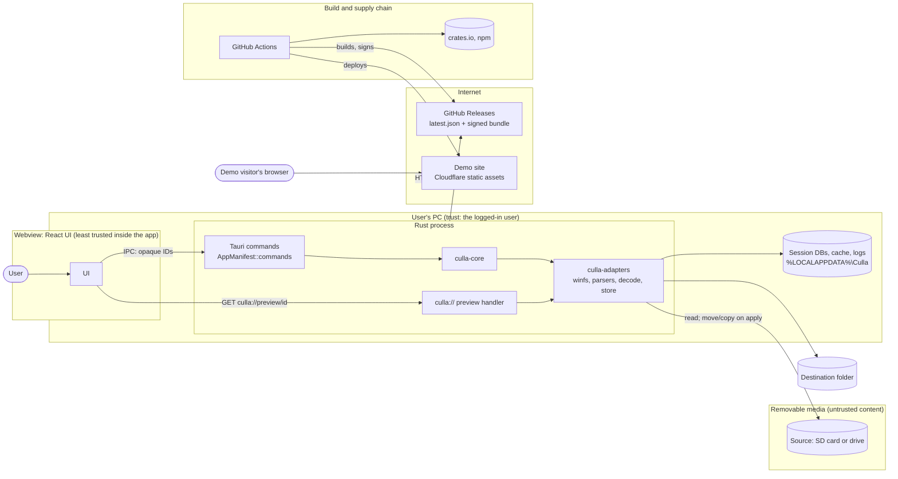

# Threat model

Status: draft, 24 Nov 2026. Method: the four OWASP questions, with STRIDE as prompts ([pre-project-docs.md](research/pre-project-docs.md)). Updated at each milestone. File engine details are in [design/file-engine.md](design/file-engine.md); containers in [architecture.md](architecture.md).

## 1. What are we working on

A Windows desktop app that reads photos from a folder (often an SD card), shows previews in a webview and, after an explicit confirm, moves or copies them. It makes one network call, the update check. A static web demo runs the same UI with bundled photos.

Trust boundaries: (B1) webview ↔ Rust process; (B2) file contents and names on the media ↔ parsers and the file engine; (B3) update endpoint ↔ updater; (B4) third-party packages and CI ↔ release artifacts; (B5) demo site ↔ visitor.

### Assets

| Asset | Property that matters | Why |
|---|---|---|
| User photos (JPEG, NEF) | Integrity, availability | Often irreplaceable; the card may be formatted after an apply |
| Sidecars (`.xmp`, `.pp3`, `.nksc`) | Integrity, staying with their photo | Hold the user's edits |
| Session DB (decisions, plans, journal) | Integrity | Drives resume; a wrong journal could misdirect recovery |
| Preview cache | Confidentiality (low) | Copies of the user's photos on the internal disk |
| Updater channel and signing key | Integrity, key custody | Whoever controls both can run code on every install |
| Release pipeline and dependencies | Integrity | Same reach as the updater |
| Demo site and its photos | Integrity; author privacy | Public; EXIF can reveal location |

## 2. What can go wrong, and 3. what we will do

Status: *planned* (designed, not built), *decided* (in an ADR or SPEC), *open* (to decide).

| # | STRIDE | Threat | Component | Mitigation | Status |
|---|---|---|---|---|---|
| T1 | T | Path traversal via crafted file names on a card (`..`, `\`, `:`, device names, trailing dots), made worse because `\\?\` paths skip normalization | Scan, `plan()`, `winfs` | Validate every name component; build paths only from validated components; P7 checks every target is under its root and is no source path; invalid names are listed and never touched | planned ([file-engine §3.4, §8](design/file-engine.md)) |
| T2 | T, E | Symlink, junction or mount point redirects a move, or swaps a file between check and act (cf. CVE-2022-21658) | Scan, `winfs` | Walk with `follow_links(false)`; refuse every reparse point at scan, preflight and each step; open with `FILE_FLAG_OPEN_REPARSE_POINT`; `make_dirs` refuses reparse components; renames and removals act through the same file handle that was checked, held with no write or delete sharing; the target folder is opened with `FILE_FLAG_OPEN_REPARSE_POINT`, checked to be a real directory, held without delete sharing, and the rename uses it as `RootDirectory` with a relative leaf name. The M1 scan (`culla_adapters::scan`) never follows a link and re-checks each folder with `symlink_metadata` just before listing it, but it still lists by path: its output is not trusted against swaps, and protection rests on preflight and apply re-checking every component through handles (handle-relative listing comes with `winfs`, M2) | planned (scan: partial); scan side (PR #25): `winfs::resolve_folder` refuses a chosen folder that is a reparse point or placeholder and follows links above it once (canonicalize), as a session lookup key only |
| T2b | T, D | Cloud placeholders (OneDrive and other sync clients): reading one triggers a download, and the sync client can change or remove the file during an apply | Scan, preflight | Detect cloud reparse tags and the `RECALL_ON_DATA_ACCESS`, `RECALL_ON_OPEN` and `OFFLINE` attributes; placeholder files are never grouped; a source that is a placeholder is refused. The attribute check is in the M1 scan; the reparse-tag check comes with `winfs` (M2), and until then a cloud file without those attributes is still excluded, as a reparse point. The NEF preview reader (`nef_preview`, PR #18) and the EXIF reader (`metadata::exif`, PR #23) use a plain read-only open, so until these checks land they must only get paths from the current scan; reparse-point and placeholder refusal on open is added when it is wired to the CLI or `culla://`. A destination inside a synced folder is allowed, with a warning in the review screen (decided by Margaux, 27 Nov 2026; file-engine P17) | planned, decided (destination); `winfs::resolve_folder` refuses a chosen source folder with placeholder attributes (PR #25) |
| T3 | T | Overwrite of an existing file through a race | `winfs` | No-replace rename through a handle (`FileRenameInfoEx` without `REPLACE_IF_EXISTS`, same semantics as `MoveFileExW` without `MOVEFILE_REPLACE_EXISTING`); `create_new`; no check-then-act; Culla never opens a user file for writing | decided ([ADR 0004](adr/0004-never-delete-or-overwrite.md)), mechanism in [file-engine §9.3](design/file-engine.md) |
| T3b | S, T | Two volumes with the same serial, or a drive letter that changes mid-run, redirect operations to the wrong volume | `winfs`, apply | Each run binds the serial to one `\\?\Volume{GUID}\` path and uses it for every operation; two matching volumes pause the run and the user picks; "same volume" is decided by GUID | partial: the pure rules are in `culla_core::volume` (`bind`: one match binds, none is missing, several are ambiguous; `relation`: same volume by GUID, equal serials with different GUIDs are a clash) and `winfs::resolve_folder` reads the GUID path; volume enumeration and its use in apply come with M2 |
| T4 | T, D | A bug or a crafted state removes a photo | `winfs` | One audited `remove_verified` with unforgeable proofs; clippy `disallowed-methods` on every other removal or rename; grep check on `allow`; Margaux is a required code owner for every protected path (`.github/CODEOWNERS`, in effect once the ruleset requires code-owner review) | decided, planned; the `windows-sys` removal, replace, rename, copy and link APIs reachable since PR #25 are in `clippy.toml` and `crates/core/clippy.toml` (PR #25, approved by Margaux) |
| T5 | D, E | Malicious EXIF or NEF: out-of-bounds offsets, IFD loops, huge counts, decompression bombs | EXIF reader, IFD walker, turbojpeg | Bounds-checked parser with no `unsafe`; visited-offset set and depth and entry caps; max preview size and pixel count before decode; per-decode error isolation (a panic fails one preview, never the apply); cargo-fuzz targets for the IFD walker, embedded-JPEG extraction and EXIF, run nightly, crashes kept as regression tests | partial: the IFD walker's bounds checks, visited set, depth, entry and count caps, preview size and pixel caps and the `tiff_ifd_walk` target are in place (PR #18); the EXIF read is capped at 128 KiB in memory and only TIFF data reaches `kamadak-exif` (TIFF and JPEG recognised by their magic bytes, the JPEG's APP1 extracted by Culla, other containers never parsed), its text values are cleaned and capped, a parser panic fails only that file, and the `exif_fields` target exists (EXIF slice); the preview decoder (M1 slice 5) gets only bytes that Culla's own frame check accepted (at most 64 MiB, SOI and EOI, 8-bit baseline, extended or progressive, at most 100 MP declared), turbojpeg's header must agree with it, buffers are sized from that plan and reserved fallibly, each preview has its own turbojpeg handles and a panic fails only that preview, and the `jpeg_header` target covers the check; a memory-safety bug inside libjpeg-turbo (C) is not contained in-process (no process isolation in v1), and libjpeg-turbo's own `TJPARAM_MAXPIXELS` and `TJPARAM_SCANLIMIT` are not set because the `turbojpeg` crate does not expose them (to recheck); `nef_preview_extract` and the first libFuzzer run (with `fuzz/Cargo.lock`) are to come |
| T6 | I, T | Text from EXIF (lens, comments) or file names injects markup into the UI (XSS) | UI | React text rendering only, no `dangerouslySetInnerHTML`; CSP `script-src 'self'`, no `eval`, no remote origins | planned |
| T7 | E | Compromised webview abuses IPC to read or move arbitrary files | Commands | `AppManifest::commands` allowlist in `build.rs`; one capability for `main` with minimal `core:*`; no fs, shell or opener-to-path plugin permissions; commands take opaque IDs, never paths; folders picked through a native dialog run from Rust; the asset protocol is off | partial: allowlist, single capability with only `allow-version`, no plugins and asset protocol off are in the M0 shell (PR #12); opaque IDs and the native folder dialog come with the first file commands |
| T8 | E | Compromised webview fabricates decisions and confirms an apply | Commands, apply | Impact bounded: only keep/reject moves inside the chosen roots, nothing removed except verified move sources. Further option: a native (Rust-side) confirm dialog stating the counts | open |
| T9 | I | `culla://` handler used to read other files | Preview scheme | Serves only IDs from the current scan, from memory or the cache; strict ID parsing, no path in the URL; `X-Content-Type-Options: nosniff`; CSP `img-src` allows only this origin | planned |
| T10 | S | Navigation to a remote page inside the webview | Shell | Block navigation off the app origin; external links open in the system browser; isolation pattern judged optional (ADR to record) | planned, open (ADR) |
| T11 | S, T | Tampered or spoofed update | Updater | `tauri-plugin-updater` signature check with the inline public key (cannot be turned off); HTTPS; private key only in a protected GitHub environment secret, with an offline backup | decided (SPEC §6) |
| T11b | T | Rollback to an older, vulnerable version through a validly signed old release | Updater | Keep the plugin's default version check (install only a version newer than the running one); no custom comparator that allows downgrades | planned |
| T11c | D | An update restarts the app in the middle of an apply, or a new version changes the journal format under an open plan | Updater, apply | No update check, download or install while any plan is open (`confirmed`, `applying`, `paused`, `interrupted`); if a new version still finds an open plan (for example after a manual install), it first recovers and finishes that plan with the old schema's journal rules, and only then migrates the database | planned |
| T12 | T | Supply-chain compromise of a crate, npm package or action | CI, build | `cargo-deny` (advisories, bans, licences, sources); pnpm `allowBuilds`, `strictDepBuilds`, `blockExoticSubdeps`, `minimumReleaseAge`, `trustPolicy: no-downgrade`; committed lockfiles; actions pinned by SHA or `actions.lock`; `permissions: {}` per workflow; Dependabot with cooldown; CodeQL (JS/TS, Rust, Actions); Scorecard | decided (SPEC §7) |
| T12b | T, E | A manually dispatched `Refresh lockfiles` workflow has `contents: write` | CI | Only repo writers can dispatch; never main; credentials not persisted while branch code runs; pnpmfile ignored; cargo config flags refused; pushes only Cargo.lock and pnpm-lock.yaml | in place (PR #17) |
| T13 | S | Another card with the same 32-bit serial and folder matches an old session | Session, reconcile | Per-file checks before every operation; recovery re-hashes before any removal; reconcile flags a mostly-different folder | planned, threshold open. The identity itself is in (`culla_core::volume::SourceKey`, M1 slice 4): it is the serial and the folded path only, so such a card does find the old session, by design (ADR 0008); `VolumeRecord::observe` reports a changed label or file system name, which the reconcile can use as a hint once the threshold is decided. Serial 0, network and GUID-only volumes are refused (decided 27 Nov 2026). The M1 lookup is by path and is a session key only; M2 re-reads the serial from the opened folder's handle before any operation (file-engine §3.1) |
| T14 | T | Local process edits the session DB to misdirect recovery | Store, recovery | Recovery trusts the disk over the journal (re-inspects, re-hashes); removal needs a fresh in-process proof. A same-user attacker is out of scope | planned |
| T15 | R | "The app lost my photo": no record of what happened | Apply | Append-only journal (triggers) and a plain-text log per apply | planned |
| T16 | I | Preview cache exposes photos to other users of the PC | Cache | Lives in the user's `%LOCALAPPDATA%` (per-user ACL); no telemetry; the only network call is the updater | planned |
| T17 | I | Demo reveals the author's location through EXIF GPS | Demo build | Strip GPS and serial numbers when pre-extracting EXIF and encoding AVIF/WebP | planned |
| T18 | I, T | Demo "your folder" mode leaks a visitor's files, or the site serves altered code | Demo | Static assets only, no backend, no uploads; files read in the browser only; CSP `connect-src 'self'`; no third-party scripts; Cloudflare account with 2FA and a scoped deploy token | planned |
| T19 | D | Huge or deep folder trees exhaust memory or time | Scan | Streamed scan, folder by folder; caps on depth (32) and entries per folder (100,000) in `ScanPolicy`, a folder over a cap is reported and never listed partially; entries share their folder's path components (ADR 0027) | partial (caps in place; time budget unmeasured until B-01) |
| T20 | S | Unsigned installer trains users to click through SmartScreen | Distribution | README explains; checksums on releases; SignPath Foundation after v1 | decided (SPEC §6) |

## 4. Did we do enough

At each milestone, check:

- Every invariant in [file-engine §11](design/file-engine.md) has a passing test, including the crash-after-every-step suite.
- The capability file, `AppManifest::commands` list and CSP match this document (reviewed by the read-only security reviewer agent).
- Fuzz targets ran in the last week with no open crash.
- `cargo deny check`, CodeQL and Scorecard are green; no new `allow(clippy::disallowed_methods)` outside `winfs`.
- Open items (T8, T10, T13) are decided or carried forward explicitly.

## Out of scope

- An attacker running code as the same Windows user: they can already read and change every file Culla can.
- Physical attacks and theft of the PC or card.
- Storage hardware or drivers that acknowledge a flush they did not perform, and file system corruption caused by removing media during a metadata write (Culla reports it; it cannot prevent it).
- Vulnerabilities in Windows, WebView2 (evergreen, updated by the OS) or the Tauri runtime itself, beyond keeping dependencies current.
- Multi-user setups. Network shares are not a scope question any more: v1 refuses them, and mapped network drives, as sources and destinations (decided by Margaux, 27 Nov 2026; file-engine §6.2).
- Lightroom catalog consistency after files move (README warning).
- margauxfaurie.com beyond the demo subdomain.
